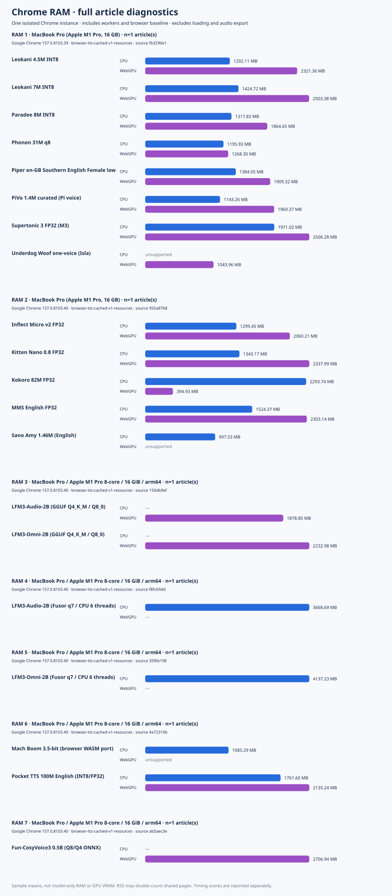
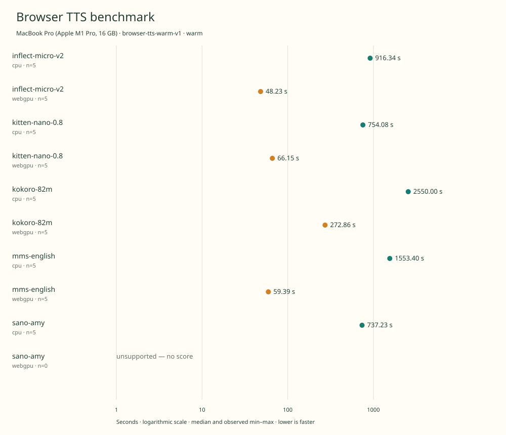
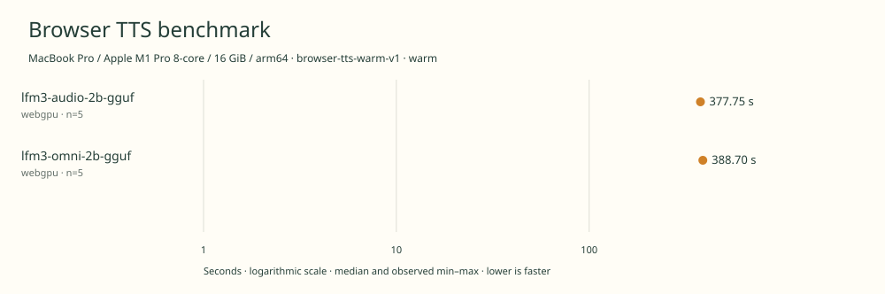
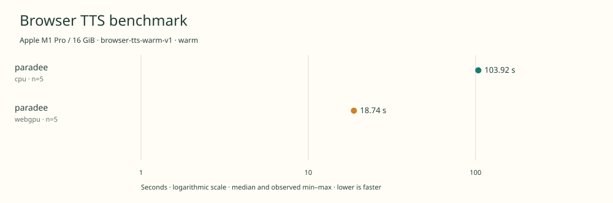
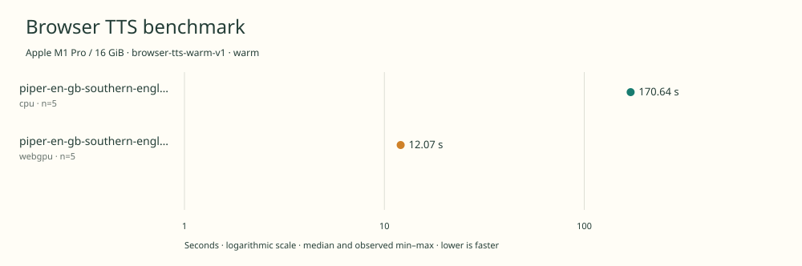
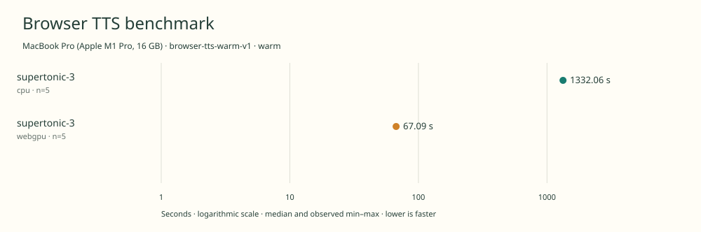
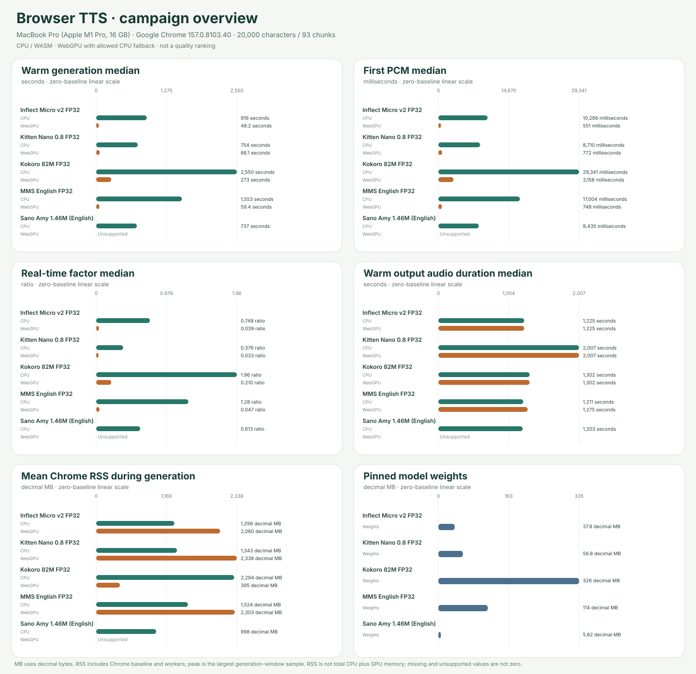
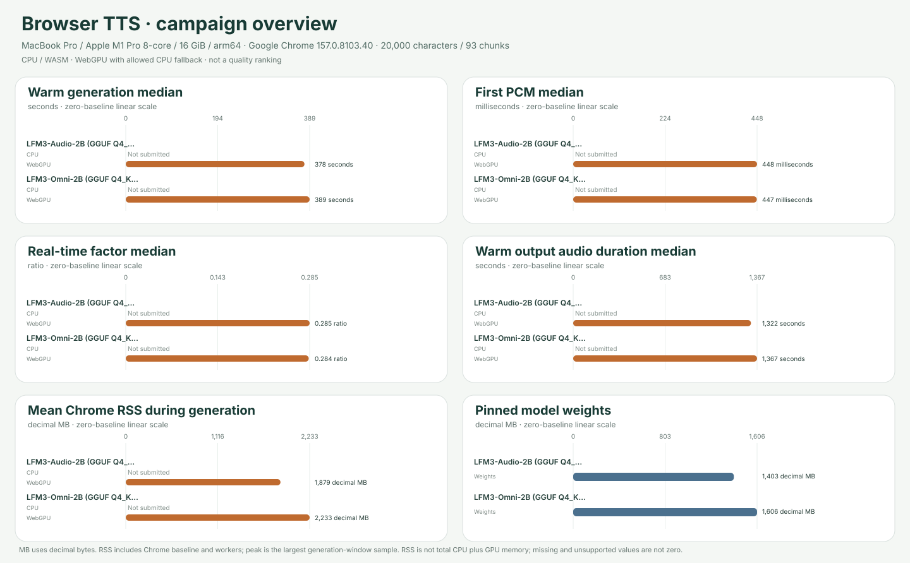
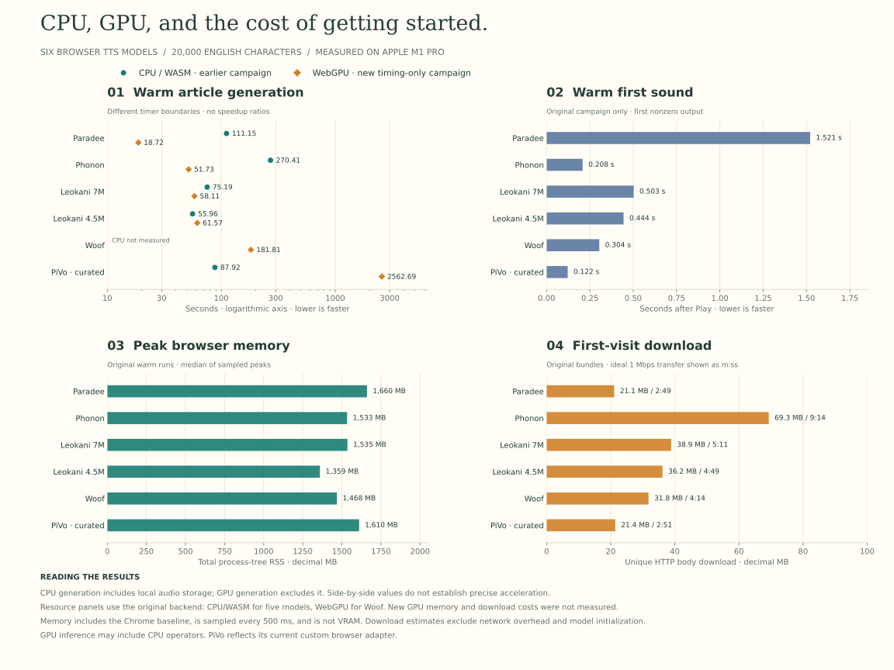

# Browser TTS Benchmark

[](https://github.com/ngelik/browser-tts-benchmark/actions/workflows/validate.yml)

Repeatable, local text-to-speech benchmarks in **Google Chrome**: CPU/WASM,
and WebGPU. Select a model, run a fixed
20,000-character English article, then contribute baseline results or request a
new model evaluation through a pull request.

All inference happens in the browser. A local Node process serves static assets
and controls Chrome; it never performs speech synthesis. Results are not uploaded
automatically. Model assets are pinned, verified and kept outside Git.

[**Explore the interactive dashboard →**](https://ngelik.github.io/browser-tts-benchmark/) · [▶ Listen to the benchmark samples](https://ngelik.github.io/browser-tts-benchmark/audio/) · [Run a benchmark](#run-a-benchmark) · [Request a model evaluation](#request-a-model-evaluation)

## Interactive dashboard

[**Open the benchmark dashboard**](https://ngelik.github.io/browser-tts-benchmark/)
for searchable, sortable results, CPU/GPU charts, average Chrome RAM, model
weights and licenses, and inline audio playback. Open any model for memory peaks,
voice/language support, exact source receipts and recording attribution.
Historical protocols and native source cohorts remain distinct; this is an
explorer of published evidence, not a cross-cohort quality ranking.

The site is static and hosted on GitHub Pages. Its data is built from validated
result receipts, the pinned model catalog and the verified audio manifest.
No inference, analytics or external font services run on the dashboard. Audio
loads when you press play. Existing `/audio/` sample links continue to work.

```sh
npm run dashboard:build
npm run dashboard:preview
# Open the loopback URL printed by the preview server.
```

See [dashboard development and publication](docs/DASHBOARD.md) for the data
selection rules, local checks and deployment workflow.

## Reference results

<!-- benchmark-results:start -->

Generated from every submitted result. Latest warm attempt per model/backend and exact environment is shown; errors are retained. No cross-machine or cross-protocol speedup is implied.

- **E1**: Apple M1 Pro reference machine · Google Chrome 157.0.8103.39 · macOS 26.6.2.
- **E2**: Apple M1 Pro / 16 GiB · Google Chrome 157.0.8103.39 · Darwin 25.6.0.
- **E3**: MacBook Pro (Apple M1 Pro, 16 GB) · Google Chrome 157.0.8103.39 · Darwin 25.6.0.
- **E4**: MacBook Pro (Apple M1 Pro, 16 GB) · Google Chrome 157.0.8103.40 · Darwin 25.6.0.
- **E5**: MacBook Pro / Apple M1 Pro 8-core / 16 GiB / arm64 · Google Chrome 157.0.8103.40 · Darwin 25.6.0.

| Model | Environment | Model weights (MB) | CPU warm median | WebGPU warm median | Evidence scope |
|---|---|---:|---:|---:|---|
| Leokani 4.5M INT8 | E1 | 5.14 | [55.96 s](results/historical-2026-11-08-m1pro-primary-warm/summary.md) | [61.57 s](results/historical-2026-11-08-m1pro-gpu-warm/summary.md) | Historical; distinct timing protocols |
| Leokani 7M INT8 | E1 | 7.84 | [75.19 s](results/historical-2026-11-08-m1pro-primary-warm/summary.md) | [58.11 s](results/historical-2026-11-08-m1pro-gpu-warm/summary.md) | Historical; distinct timing protocols |
| Paradee 8M INT8 | E1 | 8.46 | [111.15 s](results/historical-2026-11-08-m1pro-primary-warm/summary.md) | [18.72 s](results/historical-2026-11-08-m1pro-gpu-warm/summary.md) | Historical; distinct timing protocols |
| Phonon 31M q8 | E1 | 64.51 | [270.41 s](results/historical-2026-11-08-m1pro-primary-warm/summary.md) | [51.73 s](results/historical-2026-11-08-m1pro-gpu-warm/summary.md) | Historical; distinct timing protocols |
| PiVo 1.4M curated (Pi voice) | E1 | 5.84 | [87.92 s](results/historical-2026-11-08-m1pro-primary-warm/summary.md) | [2562.69 s](results/historical-2026-11-08-m1pro-gpu-warm/summary.md) | Historical; distinct timing protocols |
| Underdog Woof one-voice (Isla) | E1 | 31.71 | — | [181.81 s](results/historical-2026-11-08-m1pro-gpu-warm/summary.md) | Historical; distinct timing protocols |
| Paradee 8M INT8 | E2 | 8.46 | [103.92 s](results/2026-11-09t04-55-36-509z-paradee-cpu-warm-244b2a2f/summary.md) | [18.74 s](results/2026-11-09t05-06-08-477z-paradee-webgpu-warm-c3836dc0/summary.md) | Native; matched source |
| Piper en-GB Southern English Female low | E2 | 63.10 | [170.64 s](results/2026-11-09t20-33-26-966z-piper-en-gb-southern-english-female-low-cpu-warm-9a0ba981/summary.md) | [12.07 s](results/2026-11-09t20-52-18-629z-piper-en-gb-southern-english-female-low-webgpu-warm-d8fb8392/summary.md) | Native; matched source |
| Supertonic 3 FP32 (M3) | E3 | 398.08 | [1332.06 s](results/2026-11-10t07-43-34-755z-supertonic-3-cpu-warm-a07fded0/summary.md) | [67.09 s](results/2026-11-10t09-58-29-882z-supertonic-3-webgpu-warm-97865808/summary.md) | Native; matched source |
| Inflect Micro v2 FP32 | E4 | 37.75 | [916.34 s](results/2026-11-10t17-52-21-838z-inflect-micro-v2-cpu-warm-c57a83a6/summary.md) | [48.23 s](results/2026-11-11t02-50-06-191z-inflect-micro-v2-webgpu-warm-e21ef201/summary.md) | Native; matched source |
| Kitten Nano 0.8 FP32 | E4 | 56.77 | [754.08 s](results/2026-11-10t15-16-09-599z-kitten-nano-0.8-cpu-warm-624ea636/summary.md) | [66.15 s](results/2026-11-10t19-24-19-116z-kitten-nano-0.8-webgpu-warm-cef85ae4/summary.md) | Native; matched source |
| Kokoro 82M FP32 | E4 | 325.53 | [2550.00 s](results/2026-11-10t22-06-51-166z-kokoro-82m-cpu-warm-a9cc8d21/summary.md) | [272.86 s](results/2026-11-11t02-22-33-290z-kokoro-82m-webgpu-warm-58b6b9b7/summary.md) | Native; matched source |
| MMS English FP32 | E4 | 114.26 | [1553.40 s](results/2026-11-10t19-31-08-081z-mms-english-cpu-warm-b81daec2/summary.md) | [59.39 s](results/2026-11-10t17-46-17-830z-mms-english-webgpu-warm-3eb8b06a/summary.md) | Native; matched source |
| Sano Amy 1.46M (English) | E4 | 5.82 | [737.23 s](results/2026-11-10t16-32-03-827z-sano-amy-cpu-warm-0a4ec2a0/summary.md) | [unsupported](results/2026-11-10t16-32-02-384z-sano-amy-webgpu-warm-24afcdc7/summary.md) | Native; matched source |
| LFM3-Audio-2B (GGUF Q4_K_M / Q8_0) | E5 | 1403.44 | — | [377.75 s](results/2026-11-11t07-33-16-967z-lfm3-audio-2b-gguf-webgpu-warm-b42e4073/summary.md) | Native; separate configuration |
| LFM3-Omni-2B (GGUF Q4_K_M / Q8_0) | E5 | 1606.47 | — | [388.70 s](results/2026-11-11t08-11-31-864z-lfm3-omni-2b-gguf-webgpu-warm-0e07e4f7/summary.md) | Native; separate configuration |

Each measured warm cell uses five scored full 20,000-character articles. Missing values are not zero. Open receipts for voice, precision, timing boundaries, power conditions and observed min–max.

### Output-length observations

These notes report the shortest measured PCM output per source chunk. A sub-second output alone does not establish truncation or transcript fidelity. Warm-up audio is not archived. Any published clip belongs to the scored trial listed by `trialIndex` in the audio manifest and may not match the trial with the shortest source chunk. Excluded warm-up observations are listed separately from scored trials.

| Model | Backend | Evidence | Observation | Receipt |
|---|---|---|---|---|
| LFM3-Audio-2B (GGUF Q4_K_M / Q8_0) | WebGPU | Scored output | The shortest source-chunk output in scored trial 5 was 0.88 s (21,120 samples at 24,000 Hz). Check audio; this is an output-length observation only, not a diagnosis of truncation or transcript fidelity. | [2026-11-11t07-33-16-967z-lfm3-audio-2b-gguf-webgpu-warm-b42e4073](results/2026-11-11t07-33-16-967z-lfm3-audio-2b-gguf-webgpu-warm-b42e4073/summary.md) |
| LFM3-Audio-2B (GGUF Q4_K_M / Q8_0) | WebGPU | Excluded warm-up | The excluded warm-up's shortest source-chunk output was 0.64 s (warm-up 1; 15,360 samples at 24,000 Hz). It is not part of the scored trials and is an output-length observation only, not a diagnosis of truncation or transcript fidelity. | [2026-11-11t07-33-16-967z-lfm3-audio-2b-gguf-webgpu-warm-b42e4073](results/2026-11-11t07-33-16-967z-lfm3-audio-2b-gguf-webgpu-warm-b42e4073/summary.md) |

MB = 1,000,000 bytes. Model size counts pinned core model-weight files (including the vocoder), verified against the displayed run receipts; it excludes runtime, G2P, voice/config files and transfer overhead.

### Chrome RAM during generation

Dedicated full-article memory runs measure an isolated Chrome instance with one benchmark tab, including inference workers and browser baseline. These are separate resource diagnostics; their timings do not replace the warm speed measurements above. RSS may double-count shared pages and is not model-only RAM or GPU VRAM. Values are the mean of generation-window samples, averaged equally across recorded articles. [Method and reproduction](docs/MEMORY.md).

**RAM 1** · MacBook Pro (Apple M1 Pro, 16 GB) · Google Chrome 157.0.8103.39 · Darwin 25.6.0 · browser-tts-cached-v1-resources · 1 full article(s) per measured cell · source [`fb3290e1`](https://github.com/ngelik/browser-tts-benchmark/commit/fb3290e1fca0c3a416e1352a1cb7fc8232ea826c).

| Model | Model weights (MB) | CPU avg Chrome RAM (MB) | WebGPU avg Chrome RAM (MB) |
|---|---:|---:|---:|
| Leokani 4.5M INT8 | 5.14 | [1292.11](results/2026-11-10t12-19-17-960z-leokani-4.5m-cpu-cached-31b8534b/summary.md) | [2321.36](results/2026-11-10t12-20-20-070z-leokani-4.5m-webgpu-cached-2527e2cc/summary.md) |
| Leokani 7M INT8 | 7.84 | [1424.72](results/2026-11-10t12-21-33-736z-leokani-7m-cpu-cached-05654530/summary.md) | [2503.38](results/2026-11-10t12-22-54-319z-leokani-7m-webgpu-cached-fd1cde50/summary.md) |
| Paradee 8M INT8 | 8.46 | [1317.83](results/2026-11-10t12-13-43-130z-paradee-cpu-cached-becd1b05/summary.md) | [1864.65](results/2026-11-10t12-18-50-239z-paradee-webgpu-cached-66f2f822/summary.md) |
| Phonon 31M q8 | 64.51 | [1195.93](results/2026-11-10t12-24-03-928z-phonon-cpu-cached-26724b34/summary.md) | [1268.30](results/2026-11-10t12-28-29-585z-phonon-webgpu-cached-4f21d78e/summary.md) |
| Piper en-GB Southern English Female low | 63.10 | [1384.05](results/2026-11-10t12-32-39-591z-piper-en-gb-southern-english-female-low-cpu-cached-fff0c4ea/summary.md) | [1909.32](results/2026-11-10t12-35-36-473z-piper-en-gb-southern-english-female-low-webgpu-cached-b3f670b8/summary.md) |
| PiVo 1.4M curated (Pi voice) | 5.84 | [1143.26](results/2026-11-10t12-59-54-018z-pivo-curated-cpu-cached-60e6cfd6/summary.md) | [1969.37](results/2026-11-10t13-01-23-404z-pivo-curated-webgpu-cached-d9ffb3e4/summary.md) |
| Supertonic 3 FP32 (M3) | 398.08 | [1971.02](results/2026-11-10t12-37-17-447z-supertonic-3-cpu-cached-9f32062c/summary.md) | [2506.28](results/2026-11-10t12-35-56-902z-supertonic-3-webgpu-cached-3af494cf/summary.md) |
| Underdog Woof one-voice (Isla) | 31.71 | [unsupported](results/2026-11-10t12-29-27-973z-woof-cpu-cached-0c9a58d8/summary.md) | [1043.96](results/2026-11-10t12-29-29-399z-woof-webgpu-cached-14969663/summary.md) |

**RAM 2** · MacBook Pro (Apple M1 Pro, 16 GB) · Google Chrome 157.0.8103.40 · Darwin 25.6.0 · browser-tts-cached-v1-resources · 1 full article(s) per measured cell · source [`955a8768`](https://github.com/ngelik/browser-tts-benchmark/commit/955a87683c0c899cc299161a7b8b127fb75617be).

| Model | Model weights (MB) | CPU avg Chrome RAM (MB) | WebGPU avg Chrome RAM (MB) |
|---|---:|---:|---:|
| Inflect Micro v2 FP32 | 37.75 | [1299.45](results/2026-11-11t04-11-48-039z-inflect-micro-v2-cpu-cached-d7106d59/summary.md) | [2060.21](results/2026-11-11t02-55-05-893z-inflect-micro-v2-webgpu-cached-51e2acf0/summary.md) |
| Kitten Nano 0.8 FP32 | 56.77 | [1343.17](results/2026-11-11t04-41-26-026z-kitten-nano-0.8-cpu-cached-5dc541fc/summary.md) | [2337.99](results/2026-11-11t04-10-31-407z-kitten-nano-0.8-webgpu-cached-25f950b4/summary.md) |
| Kokoro 82M FP32 | 325.53 | [2293.74](results/2026-11-11t03-00-52-961z-kokoro-82m-cpu-cached-9b2283f1/summary.md) | [394.93](results/2026-11-11t02-56-02-596z-kokoro-82m-webgpu-cached-b4638a41/summary.md) |
| MMS English FP32 | 114.26 | [1524.37](results/2026-11-11t03-44-05-639z-mms-english-cpu-cached-446def8a/summary.md) | [2303.14](results/2026-11-11t04-27-23-653z-mms-english-webgpu-cached-6aa1e983/summary.md) |
| Sano Amy 1.46M (English) | 5.82 | [997.53](results/2026-11-11t04-28-31-035z-sano-amy-cpu-cached-c0371d1a/summary.md) | [unsupported](results/2026-11-11t04-41-18-742z-sano-amy-webgpu-cached-78dfb9fa/summary.md) |

**RAM 3** · MacBook Pro / Apple M1 Pro 8-core / 16 GiB / arm64 · Google Chrome 157.0.8103.40 · Darwin 25.6.0 · browser-tts-cached-v1-resources · 1 full article(s) per measured cell · source [`150db9ef`](https://github.com/ngelik/browser-tts-benchmark/commit/150db9efe48086e488bf2a206279b2384826b245).

| Model | Model weights (MB) | CPU avg Chrome RAM (MB) | WebGPU avg Chrome RAM (MB) |
|---|---:|---:|---:|
| LFM3-Audio-2B (GGUF Q4_K_M / Q8_0) | 1403.44 | — | [1878.80](results/2026-11-11t08-50-49-901z-lfm3-audio-2b-gguf-webgpu-cached-ffbdd243/summary.md) |
| LFM3-Omni-2B (GGUF Q4_K_M / Q8_0) | 1606.47 | — | [2232.98](results/2026-11-11t08-57-29-900z-lfm3-omni-2b-gguf-webgpu-cached-f692b3e2/summary.md) |



### Voice and language support

Counts describe the pinned model/catalog, not the number of voices or languages benchmarked. All current measurements use English and one selected voice per model. Other checkpoints in a family are excluded.

| Model | Supported voices | Bundled voices | Supported languages | Scope / source |
|---|---:|---:|---|---|
| Paradee 8M INT8 | 4 | 4 | 1 (en) | [Details](docs/MODEL_SUPPORT.md#paradee) |
| Phonon 31M q8 | 102 | 1 | 1 (en) | [Details](docs/MODEL_SUPPORT.md#phonon) |
| Leokani 7M INT8 | 1 | 1 | 1 (en) | [Details](docs/MODEL_SUPPORT.md#leokani-7m) |
| Leokani 4.5M INT8 | 1 | 1 | 1 (en) | [Details](docs/MODEL_SUPPORT.md#leokani-4.5m) |
| PiVo 1.4M curated (Pi voice) | 2 | 2 | 1 (en) | [Details](docs/MODEL_SUPPORT.md#pivo-curated) |
| Underdog Woof one-voice (Isla) | 1 | 1 | 1 (en) | [Details](docs/MODEL_SUPPORT.md#woof) |
| Piper en-GB Southern English Female low | 1 | 1 | 1 (en) | [Details](docs/MODEL_SUPPORT.md#piper-en-gb-southern-english-female-low) |
| Supertonic 3 FP32 (M3) | 10 | 1 | 31 | [Details](docs/MODEL_SUPPORT.md#supertonic-3) |
| Kokoro 82M FP32 | 54 | 1 | 8 | [Details](docs/MODEL_SUPPORT.md#kokoro-82m) |
| MMS English FP32 | 1 | 1 | 1 (en) | [Details](docs/MODEL_SUPPORT.md#mms-english) |
| Kitten Nano 0.8 FP32 | 8 | 8 | 1 (en) | [Details](docs/MODEL_SUPPORT.md#kitten-nano-0.8) |
| Sano Amy 1.46M (English) | 1 | 1 | 1 (en) | [Details](docs/MODEL_SUPPORT.md#sano-amy) |
| Inflect Micro v2 FP32 | 1 | 1 | 1 (en) | [Details](docs/MODEL_SUPPORT.md#inflect-micro-v2) |
| LFM3-Audio-2B (GGUF Q4_K_M / Q8_0) | Unknown | Unknown | 18 | [Details](docs/MODEL_SUPPORT.md#lfm3-audio-2b-gguf) |
| LFM3-Omni-2B (GGUF Q4_K_M / Q8_0) | Unknown | Unknown | 18 | [Details](docs/MODEL_SUPPORT.md#lfm3-omni-2b-gguf) |
| LFM3-Audio-2B (Fusor q7 / CPU 6 threads) | Unknown | Unknown | 18 | [Details](docs/MODEL_SUPPORT.md#lfm3-audio-2b-fusor-q7-cpu) |
| LFM3-Omni-2B (Fusor q7 / CPU 6 threads) | Unknown | Unknown | 18 | [Details](docs/MODEL_SUPPORT.md#lfm3-omni-2b-fusor-q7-cpu) |

### Controlled native comparisons

Only compatible receipts enter these comparisons; source, settings, fixture and environment checks must pass.

[five-tiny-models — table and input receipts](comparisons/five-tiny-models/summary.md)



[m1-pro-lfm3-webgpu — table and input receipts](comparisons/m1-pro-lfm3-webgpu/summary.md)



[m1-pro-paradee-native — table and input receipts](comparisons/m1-pro-paradee-native/summary.md)



[m1-pro-piper-native — table and input receipts](comparisons/m1-pro-piper-native/summary.md)



[m1-pro-supertonic3-native — table and input receipts](comparisons/m1-pro-supertonic3-native/summary.md)



### Campaign overviews

Each report states its selected scenarios and keeps their measurement boundaries separate.

[five-tiny-models — all-metrics table and source receipts](reports/five-tiny-models/overview.md)



[lfm3-webgpu — all-metrics table and source receipts](reports/lfm3-webgpu/overview.md)



### Historical resource measurements

Startup, memory and download figures below belong to the original campaign. They were not remeasured in subsequent warm-only runs. CPU and later GPU timer boundaries differ; do not calculate a speedup ratio across them.



### Listening samples

[▶ Open the listening room](https://ngelik.github.io/browser-tts-benchmark/audio/) — play and compare recordings in your browser, without cloning. GitHub README previews do not embed audio controls; each Listen link opens the matching player.

Synthetic speech from the actual recorded runs. [Listening instructions and attribution](audio/README.md). Compact clips stay in Git; full recordings are repository release assets.

| Model | Backend | Source run | 30-second clip | Full article WAV |
|---|---|---|---|---|
| Inflect Micro v2 FP32 | cpu | [Receipt](results/2026-11-10t17-52-21-838z-inflect-micro-v2-cpu-warm-c57a83a6/summary.md) | [▶ Listen](https://ngelik.github.io/browser-tts-benchmark/audio/?sample=2026-11-10t17-52-21-838z-inflect-micro-v2-cpu-warm-c57a83a6--inflect-micro-v2--cpu.wav) | [Download / listen](https://github.com/ngelik/browser-tts-benchmark/releases/download/benchmark-audio-v1/2026-11-10t17-52-21-838z-inflect-micro-v2-cpu-warm-c57a83a6--inflect-micro-v2--cpu-full.wav) |
| Inflect Micro v2 FP32 | webgpu | [Receipt](results/2026-11-11t02-50-06-191z-inflect-micro-v2-webgpu-warm-e21ef201/summary.md) | [▶ Listen](https://ngelik.github.io/browser-tts-benchmark/audio/?sample=2026-11-11t02-50-06-191z-inflect-micro-v2-webgpu-warm-e21ef201--inflect-micro-v2--webgpu.wav) | [Download / listen](https://github.com/ngelik/browser-tts-benchmark/releases/download/benchmark-audio-v1/2026-11-11t02-50-06-191z-inflect-micro-v2-webgpu-warm-e21ef201--inflect-micro-v2--webgpu-full.wav) |
| Kitten Nano 0.8 FP32 | cpu | [Receipt](results/2026-11-10t15-16-09-599z-kitten-nano-0.8-cpu-warm-624ea636/summary.md) | [▶ Listen](https://ngelik.github.io/browser-tts-benchmark/audio/?sample=2026-11-10t15-16-09-599z-kitten-nano-0.8-cpu-warm-624ea636--kitten-nano-0.8--cpu.wav) | [Download / listen](https://github.com/ngelik/browser-tts-benchmark/releases/download/benchmark-audio-v1/2026-11-10t15-16-09-599z-kitten-nano-0.8-cpu-warm-624ea636--kitten-nano-0.8--cpu-full.wav) |
| Kitten Nano 0.8 FP32 | webgpu | [Receipt](results/2026-11-10t19-24-19-116z-kitten-nano-0.8-webgpu-warm-cef85ae4/summary.md) | [▶ Listen](https://ngelik.github.io/browser-tts-benchmark/audio/?sample=2026-11-10t19-24-19-116z-kitten-nano-0.8-webgpu-warm-cef85ae4--kitten-nano-0.8--webgpu.wav) | [Download / listen](https://github.com/ngelik/browser-tts-benchmark/releases/download/benchmark-audio-v1/2026-11-10t19-24-19-116z-kitten-nano-0.8-webgpu-warm-cef85ae4--kitten-nano-0.8--webgpu-full.wav) |
| Kokoro 82M FP32 | cpu | [Receipt](results/2026-11-10t22-06-51-166z-kokoro-82m-cpu-warm-a9cc8d21/summary.md) | [▶ Listen](https://ngelik.github.io/browser-tts-benchmark/audio/?sample=2026-11-10t22-06-51-166z-kokoro-82m-cpu-warm-a9cc8d21--kokoro-82m--cpu.wav) | [Download / listen](https://github.com/ngelik/browser-tts-benchmark/releases/download/benchmark-audio-v1/2026-11-10t22-06-51-166z-kokoro-82m-cpu-warm-a9cc8d21--kokoro-82m--cpu-full.wav) |
| Kokoro 82M FP32 | webgpu | [Receipt](results/2026-11-11t02-22-33-290z-kokoro-82m-webgpu-warm-58b6b9b7/summary.md) | [▶ Listen](https://ngelik.github.io/browser-tts-benchmark/audio/?sample=2026-11-11t02-22-33-290z-kokoro-82m-webgpu-warm-58b6b9b7--kokoro-82m--webgpu.wav) | [Download / listen](https://github.com/ngelik/browser-tts-benchmark/releases/download/benchmark-audio-v1/2026-11-11t02-22-33-290z-kokoro-82m-webgpu-warm-58b6b9b7--kokoro-82m--webgpu-full.wav) |
| Leokani 4.5M INT8 | cpu | [Receipt](results/2026-11-10t12-19-17-960z-leokani-4.5m-cpu-cached-31b8534b/summary.md) | [▶ Listen](https://ngelik.github.io/browser-tts-benchmark/audio/?sample=2026-11-10t12-19-17-960z-leokani-4.5m-cpu-cached-31b8534b--leokani-4.5m--cpu.wav) | [Download / listen](https://github.com/ngelik/browser-tts-benchmark/releases/download/benchmark-audio-v1/2026-11-10t12-19-17-960z-leokani-4.5m-cpu-cached-31b8534b--leokani-4.5m--cpu-full.wav) |
| Leokani 4.5M INT8 | cpu | [Receipt](results/historical-2026-11-08-m1pro-primary-warm/summary.md) | [▶ Listen](https://ngelik.github.io/browser-tts-benchmark/audio/?sample=historical-2026-11-08-m1pro-primary-warm--leokani-4.5m--cpu.wav) | [Download / listen](https://github.com/ngelik/browser-tts-benchmark/releases/download/benchmark-audio-v1/historical-2026-11-08-m1pro-primary-warm--leokani-4.5m--cpu-full.wav) |
| Leokani 4.5M INT8 | webgpu | [Receipt](results/2026-11-10t12-20-20-070z-leokani-4.5m-webgpu-cached-2527e2cc/summary.md) | [▶ Listen](https://ngelik.github.io/browser-tts-benchmark/audio/?sample=2026-11-10t12-20-20-070z-leokani-4.5m-webgpu-cached-2527e2cc--leokani-4.5m--webgpu.wav) | [Download / listen](https://github.com/ngelik/browser-tts-benchmark/releases/download/benchmark-audio-v1/2026-11-10t12-20-20-070z-leokani-4.5m-webgpu-cached-2527e2cc--leokani-4.5m--webgpu-full.wav) |
| Leokani 4.5M INT8 | webgpu | [Receipt](results/historical-2026-11-08-m1pro-gpu-warm/summary.md) | [▶ Listen](https://ngelik.github.io/browser-tts-benchmark/audio/?sample=historical-2026-11-08-m1pro-gpu-warm--leokani-4.5m--webgpu.wav) | [Download / listen](https://github.com/ngelik/browser-tts-benchmark/releases/download/benchmark-audio-v1/historical-2026-11-08-m1pro-gpu-warm--leokani-4.5m--webgpu-full.wav) |
| Leokani 7M INT8 | cpu | [Receipt](results/2026-11-10t12-21-33-736z-leokani-7m-cpu-cached-05654530/summary.md) | [▶ Listen](https://ngelik.github.io/browser-tts-benchmark/audio/?sample=2026-11-10t12-21-33-736z-leokani-7m-cpu-cached-05654530--leokani-7m--cpu.wav) | [Download / listen](https://github.com/ngelik/browser-tts-benchmark/releases/download/benchmark-audio-v1/2026-11-10t12-21-33-736z-leokani-7m-cpu-cached-05654530--leokani-7m--cpu-full.wav) |
| Leokani 7M INT8 | cpu | [Receipt](results/historical-2026-11-08-m1pro-primary-warm/summary.md) | [▶ Listen](https://ngelik.github.io/browser-tts-benchmark/audio/?sample=historical-2026-11-08-m1pro-primary-warm--leokani-7m--cpu.wav) | [Download / listen](https://github.com/ngelik/browser-tts-benchmark/releases/download/benchmark-audio-v1/historical-2026-11-08-m1pro-primary-warm--leokani-7m--cpu-full.wav) |
| Leokani 7M INT8 | webgpu | [Receipt](results/2026-11-10t12-22-54-319z-leokani-7m-webgpu-cached-fd1cde50/summary.md) | [▶ Listen](https://ngelik.github.io/browser-tts-benchmark/audio/?sample=2026-11-10t12-22-54-319z-leokani-7m-webgpu-cached-fd1cde50--leokani-7m--webgpu.wav) | [Download / listen](https://github.com/ngelik/browser-tts-benchmark/releases/download/benchmark-audio-v1/2026-11-10t12-22-54-319z-leokani-7m-webgpu-cached-fd1cde50--leokani-7m--webgpu-full.wav) |
| Leokani 7M INT8 | webgpu | [Receipt](results/historical-2026-11-08-m1pro-gpu-warm/summary.md) | [▶ Listen](https://ngelik.github.io/browser-tts-benchmark/audio/?sample=historical-2026-11-08-m1pro-gpu-warm--leokani-7m--webgpu.wav) | [Download / listen](https://github.com/ngelik/browser-tts-benchmark/releases/download/benchmark-audio-v1/historical-2026-11-08-m1pro-gpu-warm--leokani-7m--webgpu-full.wav) |
| LFM3-Audio-2B (GGUF Q4_K_M / Q8_0) | webgpu | [Receipt](results/2026-11-11t07-33-16-967z-lfm3-audio-2b-gguf-webgpu-warm-b42e4073/summary.md) | [▶ Listen](https://ngelik.github.io/browser-tts-benchmark/audio/?sample=2026-11-11t07-33-16-967z-lfm3-audio-2b-gguf-webgpu-warm-b42e4073--lfm3-audio-2b-gguf--webgpu.wav) | [Download / listen](https://github.com/ngelik/browser-tts-benchmark/releases/download/benchmark-audio-v1/2026-11-11t07-33-16-967z-lfm3-audio-2b-gguf-webgpu-warm-b42e4073--lfm3-audio-2b-gguf--webgpu-full.wav) |
| LFM3-Omni-2B (GGUF Q4_K_M / Q8_0) | webgpu | [Receipt](results/2026-11-11t08-11-31-864z-lfm3-omni-2b-gguf-webgpu-warm-0e07e4f7/summary.md) | [▶ Listen](https://ngelik.github.io/browser-tts-benchmark/audio/?sample=2026-11-11t08-11-31-864z-lfm3-omni-2b-gguf-webgpu-warm-0e07e4f7--lfm3-omni-2b-gguf--webgpu.wav) | [Download / listen](https://github.com/ngelik/browser-tts-benchmark/releases/download/benchmark-audio-v1/2026-11-11t08-11-31-864z-lfm3-omni-2b-gguf-webgpu-warm-0e07e4f7--lfm3-omni-2b-gguf--webgpu-full.wav) |
| MMS English FP32 | cpu | [Receipt](results/2026-11-10t19-31-08-081z-mms-english-cpu-warm-b81daec2/summary.md) | [▶ Listen](https://ngelik.github.io/browser-tts-benchmark/audio/?sample=2026-11-10t19-31-08-081z-mms-english-cpu-warm-b81daec2--mms-english--cpu.wav) | [Download / listen](https://github.com/ngelik/browser-tts-benchmark/releases/download/benchmark-audio-v1/2026-11-10t19-31-08-081z-mms-english-cpu-warm-b81daec2--mms-english--cpu-full.wav) |
| MMS English FP32 | webgpu | [Receipt](results/2026-11-10t17-46-17-830z-mms-english-webgpu-warm-3eb8b06a/summary.md) | [▶ Listen](https://ngelik.github.io/browser-tts-benchmark/audio/?sample=2026-11-10t17-46-17-830z-mms-english-webgpu-warm-3eb8b06a--mms-english--webgpu.wav) | [Download / listen](https://github.com/ngelik/browser-tts-benchmark/releases/download/benchmark-audio-v1/2026-11-10t17-46-17-830z-mms-english-webgpu-warm-3eb8b06a--mms-english--webgpu-full.wav) |
| Paradee 8M INT8 | cpu | [Receipt](results/2026-11-09t04-55-36-509z-paradee-cpu-warm-244b2a2f/summary.md) | [▶ Listen](https://ngelik.github.io/browser-tts-benchmark/audio/?sample=2026-11-09t04-55-36-509z-paradee-cpu-warm-244b2a2f--paradee--cpu.wav) | [Download / listen](https://github.com/ngelik/browser-tts-benchmark/releases/download/benchmark-audio-v1/2026-11-09t04-55-36-509z-paradee-cpu-warm-244b2a2f--paradee--cpu-full.wav) |
| Paradee 8M INT8 | cpu | [Receipt](results/2026-11-10t12-13-43-130z-paradee-cpu-cached-becd1b05/summary.md) | [▶ Listen](https://ngelik.github.io/browser-tts-benchmark/audio/?sample=2026-11-10t12-13-43-130z-paradee-cpu-cached-becd1b05--paradee--cpu.wav) | [Download / listen](https://github.com/ngelik/browser-tts-benchmark/releases/download/benchmark-audio-v1/2026-11-10t12-13-43-130z-paradee-cpu-cached-becd1b05--paradee--cpu-full.wav) |
| Paradee 8M INT8 | webgpu | [Receipt](results/2026-11-09t05-06-08-477z-paradee-webgpu-warm-c3836dc0/summary.md) | [▶ Listen](https://ngelik.github.io/browser-tts-benchmark/audio/?sample=2026-11-09t05-06-08-477z-paradee-webgpu-warm-c3836dc0--paradee--webgpu.wav) | [Download / listen](https://github.com/ngelik/browser-tts-benchmark/releases/download/benchmark-audio-v1/2026-11-09t05-06-08-477z-paradee-webgpu-warm-c3836dc0--paradee--webgpu-full.wav) |
| Paradee 8M INT8 | webgpu | [Receipt](results/2026-11-10t12-18-50-239z-paradee-webgpu-cached-66f2f822/summary.md) | [▶ Listen](https://ngelik.github.io/browser-tts-benchmark/audio/?sample=2026-11-10t12-18-50-239z-paradee-webgpu-cached-66f2f822--paradee--webgpu.wav) | [Download / listen](https://github.com/ngelik/browser-tts-benchmark/releases/download/benchmark-audio-v1/2026-11-10t12-18-50-239z-paradee-webgpu-cached-66f2f822--paradee--webgpu-full.wav) |
| Phonon 31M q8 | cpu | [Receipt](results/2026-11-10t12-24-03-928z-phonon-cpu-cached-26724b34/summary.md) | [▶ Listen](https://ngelik.github.io/browser-tts-benchmark/audio/?sample=2026-11-10t12-24-03-928z-phonon-cpu-cached-26724b34--phonon--cpu.wav) | [Download / listen](https://github.com/ngelik/browser-tts-benchmark/releases/download/benchmark-audio-v1/2026-11-10t12-24-03-928z-phonon-cpu-cached-26724b34--phonon--cpu-full.wav) |
| Phonon 31M q8 | cpu | [Receipt](results/historical-2026-11-08-m1pro-primary-warm/summary.md) | [▶ Listen](https://ngelik.github.io/browser-tts-benchmark/audio/?sample=historical-2026-11-08-m1pro-primary-warm--phonon--cpu.wav) | [Download / listen](https://github.com/ngelik/browser-tts-benchmark/releases/download/benchmark-audio-v1/historical-2026-11-08-m1pro-primary-warm--phonon--cpu-full.wav) |
| Phonon 31M q8 | webgpu | [Receipt](results/2026-11-10t12-28-29-585z-phonon-webgpu-cached-4f21d78e/summary.md) | [▶ Listen](https://ngelik.github.io/browser-tts-benchmark/audio/?sample=2026-11-10t12-28-29-585z-phonon-webgpu-cached-4f21d78e--phonon--webgpu.wav) | [Download / listen](https://github.com/ngelik/browser-tts-benchmark/releases/download/benchmark-audio-v1/2026-11-10t12-28-29-585z-phonon-webgpu-cached-4f21d78e--phonon--webgpu-full.wav) |
| Phonon 31M q8 | webgpu | [Receipt](results/historical-2026-11-08-m1pro-gpu-warm/summary.md) | [▶ Listen](https://ngelik.github.io/browser-tts-benchmark/audio/?sample=historical-2026-11-08-m1pro-gpu-warm--phonon--webgpu.wav) | [Download / listen](https://github.com/ngelik/browser-tts-benchmark/releases/download/benchmark-audio-v1/historical-2026-11-08-m1pro-gpu-warm--phonon--webgpu-full.wav) |
| Piper en-GB Southern English Female low | cpu | [Receipt](results/2026-11-09t20-33-26-966z-piper-en-gb-southern-english-female-low-cpu-warm-9a0ba981/summary.md) | [▶ Listen](https://ngelik.github.io/browser-tts-benchmark/audio/?sample=2026-11-09t20-33-26-966z-piper-en-gb-southern-english-female-low-cpu-warm-9a0ba981--piper-en-gb-southern-english-female-low--cpu.wav) | [Download / listen](https://github.com/ngelik/browser-tts-benchmark/releases/download/benchmark-audio-v1/2026-11-09t20-33-26-966z-piper-en-gb-southern-english-female-low-cpu-warm-9a0ba981--piper-en-gb-southern-english-female-low--cpu-full.wav) |
| Piper en-GB Southern English Female low | cpu | [Receipt](results/2026-11-10t12-32-39-591z-piper-en-gb-southern-english-female-low-cpu-cached-fff0c4ea/summary.md) | [▶ Listen](https://ngelik.github.io/browser-tts-benchmark/audio/?sample=2026-11-10t12-32-39-591z-piper-en-gb-southern-english-female-low-cpu-cached-fff0c4ea--piper-en-gb-southern-english-female-low--cpu.wav) | [Download / listen](https://github.com/ngelik/browser-tts-benchmark/releases/download/benchmark-audio-v1/2026-11-10t12-32-39-591z-piper-en-gb-southern-english-female-low-cpu-cached-fff0c4ea--piper-en-gb-southern-english-female-low--cpu-full.wav) |
| Piper en-GB Southern English Female low | webgpu | [Receipt](results/2026-11-09t20-52-18-629z-piper-en-gb-southern-english-female-low-webgpu-warm-d8fb8392/summary.md) | [▶ Listen](https://ngelik.github.io/browser-tts-benchmark/audio/?sample=2026-11-09t20-52-18-629z-piper-en-gb-southern-english-female-low-webgpu-warm-d8fb8392--piper-en-gb-southern-english-female-low--webgpu.wav) | [Download / listen](https://github.com/ngelik/browser-tts-benchmark/releases/download/benchmark-audio-v1/2026-11-09t20-52-18-629z-piper-en-gb-southern-english-female-low-webgpu-warm-d8fb8392--piper-en-gb-southern-english-female-low--webgpu-full.wav) |
| Piper en-GB Southern English Female low | webgpu | [Receipt](results/2026-11-10t12-35-36-473z-piper-en-gb-southern-english-female-low-webgpu-cached-b3f670b8/summary.md) | [▶ Listen](https://ngelik.github.io/browser-tts-benchmark/audio/?sample=2026-11-10t12-35-36-473z-piper-en-gb-southern-english-female-low-webgpu-cached-b3f670b8--piper-en-gb-southern-english-female-low--webgpu.wav) | [Download / listen](https://github.com/ngelik/browser-tts-benchmark/releases/download/benchmark-audio-v1/2026-11-10t12-35-36-473z-piper-en-gb-southern-english-female-low-webgpu-cached-b3f670b8--piper-en-gb-southern-english-female-low--webgpu-full.wav) |
| PiVo 1.4M curated (Pi voice) | cpu | [Receipt](results/2026-11-10t12-59-54-018z-pivo-curated-cpu-cached-60e6cfd6/summary.md) | [▶ Listen](https://ngelik.github.io/browser-tts-benchmark/audio/?sample=2026-11-10t12-59-54-018z-pivo-curated-cpu-cached-60e6cfd6--pivo-curated--cpu.wav) | [Download / listen](https://github.com/ngelik/browser-tts-benchmark/releases/download/benchmark-audio-v1/2026-11-10t12-59-54-018z-pivo-curated-cpu-cached-60e6cfd6--pivo-curated--cpu-full.wav) |
| PiVo 1.4M curated (Pi voice) | cpu | [Receipt](results/historical-2026-11-08-m1pro-primary-warm/summary.md) | [▶ Listen](https://ngelik.github.io/browser-tts-benchmark/audio/?sample=historical-2026-11-08-m1pro-primary-warm--pivo-curated--cpu.wav) | [Download / listen](https://github.com/ngelik/browser-tts-benchmark/releases/download/benchmark-audio-v1/historical-2026-11-08-m1pro-primary-warm--pivo-curated--cpu-full.wav) |
| PiVo 1.4M curated (Pi voice) | webgpu | [Receipt](results/2026-11-10t13-01-23-404z-pivo-curated-webgpu-cached-d9ffb3e4/summary.md) | [▶ Listen](https://ngelik.github.io/browser-tts-benchmark/audio/?sample=2026-11-10t13-01-23-404z-pivo-curated-webgpu-cached-d9ffb3e4--pivo-curated--webgpu.wav) | [Download / listen](https://github.com/ngelik/browser-tts-benchmark/releases/download/benchmark-audio-v1/2026-11-10t13-01-23-404z-pivo-curated-webgpu-cached-d9ffb3e4--pivo-curated--webgpu-full.wav) |
| PiVo 1.4M curated (Pi voice) | webgpu | [Receipt](results/historical-2026-11-08-m1pro-gpu-warm/summary.md) | [▶ Listen](https://ngelik.github.io/browser-tts-benchmark/audio/?sample=historical-2026-11-08-m1pro-gpu-warm--pivo-curated--webgpu.wav) | [Download / listen](https://github.com/ngelik/browser-tts-benchmark/releases/download/benchmark-audio-v1/historical-2026-11-08-m1pro-gpu-warm--pivo-curated--webgpu-full.wav) |
| Sano Amy 1.46M (English) | cpu | [Receipt](results/2026-11-10t16-32-03-827z-sano-amy-cpu-warm-0a4ec2a0/summary.md) | [▶ Listen](https://ngelik.github.io/browser-tts-benchmark/audio/?sample=2026-11-10t16-32-03-827z-sano-amy-cpu-warm-0a4ec2a0--sano-amy--cpu.wav) | [Download / listen](https://github.com/ngelik/browser-tts-benchmark/releases/download/benchmark-audio-v1/2026-11-10t16-32-03-827z-sano-amy-cpu-warm-0a4ec2a0--sano-amy--cpu-full.wav) |
| Supertonic 3 FP32 (M3) | cpu | [Receipt](results/2026-11-10t07-43-34-755z-supertonic-3-cpu-warm-a07fded0/summary.md) | [▶ Listen](https://ngelik.github.io/browser-tts-benchmark/audio/?sample=2026-11-10t07-43-34-755z-supertonic-3-cpu-warm-a07fded0--supertonic-3--cpu.wav) | [Download / listen](https://github.com/ngelik/browser-tts-benchmark/releases/download/benchmark-audio-v1/2026-11-10t07-43-34-755z-supertonic-3-cpu-warm-a07fded0--supertonic-3--cpu-full.wav) |
| Supertonic 3 FP32 (M3) | cpu | [Receipt](results/2026-11-10t12-37-17-447z-supertonic-3-cpu-cached-9f32062c/summary.md) | [▶ Listen](https://ngelik.github.io/browser-tts-benchmark/audio/?sample=2026-11-10t12-37-17-447z-supertonic-3-cpu-cached-9f32062c--supertonic-3--cpu.wav) | [Download / listen](https://github.com/ngelik/browser-tts-benchmark/releases/download/benchmark-audio-v1/2026-11-10t12-37-17-447z-supertonic-3-cpu-cached-9f32062c--supertonic-3--cpu-full.wav) |
| Supertonic 3 FP32 (M3) | webgpu | [Receipt](results/2026-11-10t09-58-29-882z-supertonic-3-webgpu-warm-97865808/summary.md) | [▶ Listen](https://ngelik.github.io/browser-tts-benchmark/audio/?sample=2026-11-10t09-58-29-882z-supertonic-3-webgpu-warm-97865808--supertonic-3--webgpu.wav) | [Download / listen](https://github.com/ngelik/browser-tts-benchmark/releases/download/benchmark-audio-v1/2026-11-10t09-58-29-882z-supertonic-3-webgpu-warm-97865808--supertonic-3--webgpu-full.wav) |
| Supertonic 3 FP32 (M3) | webgpu | [Receipt](results/2026-11-10t12-35-56-902z-supertonic-3-webgpu-cached-3af494cf/summary.md) | [▶ Listen](https://ngelik.github.io/browser-tts-benchmark/audio/?sample=2026-11-10t12-35-56-902z-supertonic-3-webgpu-cached-3af494cf--supertonic-3--webgpu.wav) | [Download / listen](https://github.com/ngelik/browser-tts-benchmark/releases/download/benchmark-audio-v1/2026-11-10t12-35-56-902z-supertonic-3-webgpu-cached-3af494cf--supertonic-3--webgpu-full.wav) |
| Underdog Woof one-voice (Isla) | webgpu | [Receipt](results/2026-11-10t12-29-29-399z-woof-webgpu-cached-14969663/summary.md) | [▶ Listen](https://ngelik.github.io/browser-tts-benchmark/audio/?sample=2026-11-10t12-29-29-399z-woof-webgpu-cached-14969663--woof--webgpu.wav) | [Download / listen](https://github.com/ngelik/browser-tts-benchmark/releases/download/benchmark-audio-v1/2026-11-10t12-29-29-399z-woof-webgpu-cached-14969663--woof--webgpu-full.wav) |
| Underdog Woof one-voice (Isla) | webgpu | [Receipt](results/historical-2026-11-08-m1pro-gpu-warm/summary.md) | [▶ Listen](https://ngelik.github.io/browser-tts-benchmark/audio/?sample=historical-2026-11-08-m1pro-gpu-warm--woof--webgpu.wav) | [Download / listen](https://github.com/ngelik/browser-tts-benchmark/releases/download/benchmark-audio-v1/historical-2026-11-08-m1pro-gpu-warm--woof--webgpu-full.wav) |

<details>
<summary>All submitted results — every scenario and earlier run</summary>

| Run | Models / backends | Scenario / protocol | Status | Table | Chart |
|---|---|---|---|---|---|
| 1 · 2026-11-08 | phonon/cpu, paradee/cpu, leokani-7m/cpu, leokani-4.5m/cpu, pivo-curated/cpu, woof/webgpu | cached / legacy-storage-v0-network-cached-return | measured | [Report](results/historical-2026-11-08-m1pro-network-cached-return/summary.md) | [SVG](results/historical-2026-11-08-m1pro-network-cached-return/chart.svg) |
| 2 · 2026-11-08 | phonon/cpu, paradee/cpu, leokani-7m/cpu, leokani-4.5m/cpu, pivo-curated/cpu, woof/webgpu | network / legacy-storage-v0-network-cold | measured | [Report](results/historical-2026-11-08-m1pro-network-cold/summary.md) | [SVG](results/historical-2026-11-08-m1pro-network-cold/chart.svg) |
| 3 · 2026-11-08 | phonon/cpu, paradee/cpu, leokani-7m/cpu, leokani-4.5m/cpu, pivo-curated/cpu, woof/webgpu | switch / legacy-storage-v0-network-switch | measured | [Report](results/historical-2026-11-08-m1pro-network-switch/summary.md) | [SVG](results/historical-2026-11-08-m1pro-network-switch/chart.svg) |
| 4 · 2026-11-08 | phonon/cpu, paradee/cpu, leokani-7m/cpu, leokani-4.5m/cpu, pivo-curated/cpu, woof/webgpu | offline / legacy-storage-v0-offline-cache-verification | measured | [Report](results/historical-2026-11-08-m1pro-offline-cache-verification/summary.md) | [SVG](results/historical-2026-11-08-m1pro-offline-cache-verification/chart.svg) |
| 5 · 2026-11-08 | phonon/cpu, paradee/cpu, leokani-7m/cpu, leokani-4.5m/cpu, pivo-curated/cpu, woof/webgpu | cached / legacy-storage-v0-primary-cached | measured | [Report](results/historical-2026-11-08-m1pro-primary-cached/summary.md) | [SVG](results/historical-2026-11-08-m1pro-primary-cached/chart.svg) |
| 6 · 2026-11-08 | phonon/cpu, paradee/cpu, leokani-7m/cpu, leokani-4.5m/cpu, pivo-curated/cpu, woof/webgpu | cold / legacy-storage-v0-primary-cold | measured | [Report](results/historical-2026-11-08-m1pro-primary-cold/summary.md) | [SVG](results/historical-2026-11-08-m1pro-primary-cold/chart.svg) |
| 7 · 2026-11-08 | phonon/cpu, paradee/cpu, leokani-7m/cpu, leokani-4.5m/cpu, pivo-curated/cpu, woof/webgpu | warm / legacy-storage-v0-primary-warm | measured | [Report](results/historical-2026-11-08-m1pro-primary-warm/summary.md) | [SVG](results/historical-2026-11-08-m1pro-primary-warm/chart.svg) |
| 8 · 2026-11-08 | woof/webgpu, phonon/webgpu, paradee/webgpu, leokani-7m/webgpu, pivo-curated/webgpu, leokani-4.5m/webgpu | warm / legacy-gpu-pcm-v0 | measured | [Report](results/historical-2026-11-08-m1pro-gpu-warm/summary.md) | [SVG](results/historical-2026-11-08-m1pro-gpu-warm/chart.svg) |
| 9 · 2026-11-09 | paradee/cpu | warm / browser-tts-warm-v1 | measured | [Report](results/2026-11-09t04-55-36-509z-paradee-cpu-warm-244b2a2f/summary.md) | [SVG](results/2026-11-09t04-55-36-509z-paradee-cpu-warm-244b2a2f/chart.svg) |
| 10 · 2026-11-09 | paradee/webgpu | warm / browser-tts-warm-v1 | measured | [Report](results/2026-11-09t05-06-08-477z-paradee-webgpu-warm-c3836dc0/summary.md) | [SVG](results/2026-11-09t05-06-08-477z-paradee-webgpu-warm-c3836dc0/chart.svg) |
| 11 · 2026-11-09 | piper-en-gb-southern-english-female-low/cpu | warm / browser-tts-warm-v1 | measured | [Report](results/2026-11-09t07-33-26-519z-piper-en-gb-southern-english-female-low-cpu-warm-810f85a3/summary.md) | [SVG](results/2026-11-09t07-33-26-519z-piper-en-gb-southern-english-female-low-cpu-warm-810f85a3/chart.svg) |
| 12 · 2026-11-09 | piper-en-gb-southern-english-female-low/cpu | warm / browser-tts-warm-v1 | measured | [Report](results/2026-11-09t20-33-26-966z-piper-en-gb-southern-english-female-low-cpu-warm-9a0ba981/summary.md) | [SVG](results/2026-11-09t20-33-26-966z-piper-en-gb-southern-english-female-low-cpu-warm-9a0ba981/chart.svg) |
| 13 · 2026-11-09 | piper-en-gb-southern-english-female-low/webgpu | warm / browser-tts-warm-v1 | measured | [Report](results/2026-11-09t20-52-18-629z-piper-en-gb-southern-english-female-low-webgpu-warm-d8fb8392/summary.md) | [SVG](results/2026-11-09t20-52-18-629z-piper-en-gb-southern-english-female-low-webgpu-warm-d8fb8392/chart.svg) |
| 14 · 2026-11-10 | supertonic-3/cpu | warm / browser-tts-warm-v1 | measured | [Report](results/2026-11-10t07-43-34-755z-supertonic-3-cpu-warm-a07fded0/summary.md) | [SVG](results/2026-11-10t07-43-34-755z-supertonic-3-cpu-warm-a07fded0/chart.svg) |
| 15 · 2026-11-10 | supertonic-3/webgpu | warm / browser-tts-warm-v1 | measured | [Report](results/2026-11-10t09-58-29-882z-supertonic-3-webgpu-warm-97865808/summary.md) | [SVG](results/2026-11-10t09-58-29-882z-supertonic-3-webgpu-warm-97865808/chart.svg) |
| 16 · 2026-11-10 | paradee/cpu | cached / browser-tts-cached-v1-resources | error | [Report](results/2026-11-10t12-11-42-908z-paradee-cpu-cached-f3fc560d/summary.md) | [SVG](results/2026-11-10t12-11-42-908z-paradee-cpu-cached-f3fc560d/chart.svg) |
| 17 · 2026-11-10 | paradee/cpu | cached / browser-tts-cached-v1-resources | measured | [Report](results/2026-11-10t12-13-43-130z-paradee-cpu-cached-becd1b05/summary.md) | [SVG](results/2026-11-10t12-13-43-130z-paradee-cpu-cached-becd1b05/chart.svg) |
| 18 · 2026-11-10 | paradee/webgpu | cached / browser-tts-cached-v1-resources | measured | [Report](results/2026-11-10t12-18-50-239z-paradee-webgpu-cached-66f2f822/summary.md) | [SVG](results/2026-11-10t12-18-50-239z-paradee-webgpu-cached-66f2f822/chart.svg) |
| 19 · 2026-11-10 | leokani-4.5m/cpu | cached / browser-tts-cached-v1-resources | measured | [Report](results/2026-11-10t12-19-17-960z-leokani-4.5m-cpu-cached-31b8534b/summary.md) | [SVG](results/2026-11-10t12-19-17-960z-leokani-4.5m-cpu-cached-31b8534b/chart.svg) |
| 20 · 2026-11-10 | leokani-4.5m/webgpu | cached / browser-tts-cached-v1-resources | measured | [Report](results/2026-11-10t12-20-20-070z-leokani-4.5m-webgpu-cached-2527e2cc/summary.md) | [SVG](results/2026-11-10t12-20-20-070z-leokani-4.5m-webgpu-cached-2527e2cc/chart.svg) |
| 21 · 2026-11-10 | leokani-7m/cpu | cached / browser-tts-cached-v1-resources | measured | [Report](results/2026-11-10t12-21-33-736z-leokani-7m-cpu-cached-05654530/summary.md) | [SVG](results/2026-11-10t12-21-33-736z-leokani-7m-cpu-cached-05654530/chart.svg) |
| 22 · 2026-11-10 | leokani-7m/webgpu | cached / browser-tts-cached-v1-resources | measured | [Report](results/2026-11-10t12-22-54-319z-leokani-7m-webgpu-cached-fd1cde50/summary.md) | [SVG](results/2026-11-10t12-22-54-319z-leokani-7m-webgpu-cached-fd1cde50/chart.svg) |
| 23 · 2026-11-10 | phonon/cpu | cached / browser-tts-cached-v1-resources | measured | [Report](results/2026-11-10t12-24-03-928z-phonon-cpu-cached-26724b34/summary.md) | [SVG](results/2026-11-10t12-24-03-928z-phonon-cpu-cached-26724b34/chart.svg) |
| 24 · 2026-11-10 | phonon/webgpu | cached / browser-tts-cached-v1-resources | measured | [Report](results/2026-11-10t12-28-29-585z-phonon-webgpu-cached-4f21d78e/summary.md) | [SVG](results/2026-11-10t12-28-29-585z-phonon-webgpu-cached-4f21d78e/chart.svg) |
| 25 · 2026-11-10 | woof/cpu | cached / browser-tts-cached-v1-resources | unsupported | [Report](results/2026-11-10t12-29-27-973z-woof-cpu-cached-0c9a58d8/summary.md) | [SVG](results/2026-11-10t12-29-27-973z-woof-cpu-cached-0c9a58d8/chart.svg) |
| 26 · 2026-11-10 | woof/webgpu | cached / browser-tts-cached-v1-resources | measured | [Report](results/2026-11-10t12-29-29-399z-woof-webgpu-cached-14969663/summary.md) | [SVG](results/2026-11-10t12-29-29-399z-woof-webgpu-cached-14969663/chart.svg) |
| 27 · 2026-11-10 | piper-en-gb-southern-english-female-low/cpu | cached / browser-tts-cached-v1-resources | measured | [Report](results/2026-11-10t12-32-39-591z-piper-en-gb-southern-english-female-low-cpu-cached-fff0c4ea/summary.md) | [SVG](results/2026-11-10t12-32-39-591z-piper-en-gb-southern-english-female-low-cpu-cached-fff0c4ea/chart.svg) |
| 28 · 2026-11-10 | piper-en-gb-southern-english-female-low/webgpu | cached / browser-tts-cached-v1-resources | measured | [Report](results/2026-11-10t12-35-36-473z-piper-en-gb-southern-english-female-low-webgpu-cached-b3f670b8/summary.md) | [SVG](results/2026-11-10t12-35-36-473z-piper-en-gb-southern-english-female-low-webgpu-cached-b3f670b8/chart.svg) |
| 29 · 2026-11-10 | supertonic-3/webgpu | cached / browser-tts-cached-v1-resources | measured | [Report](results/2026-11-10t12-35-56-902z-supertonic-3-webgpu-cached-3af494cf/summary.md) | [SVG](results/2026-11-10t12-35-56-902z-supertonic-3-webgpu-cached-3af494cf/chart.svg) |
| 30 · 2026-11-10 | supertonic-3/cpu | cached / browser-tts-cached-v1-resources | measured | [Report](results/2026-11-10t12-37-17-447z-supertonic-3-cpu-cached-9f32062c/summary.md) | [SVG](results/2026-11-10t12-37-17-447z-supertonic-3-cpu-cached-9f32062c/chart.svg) |
| 31 · 2026-11-10 | pivo-curated/cpu | cached / browser-tts-cached-v1-resources | measured | [Report](results/2026-11-10t12-59-54-018z-pivo-curated-cpu-cached-60e6cfd6/summary.md) | [SVG](results/2026-11-10t12-59-54-018z-pivo-curated-cpu-cached-60e6cfd6/chart.svg) |
| 32 · 2026-11-10 | pivo-curated/webgpu | cached / browser-tts-cached-v1-resources | measured | [Report](results/2026-11-10t13-01-23-404z-pivo-curated-webgpu-cached-d9ffb3e4/summary.md) | [SVG](results/2026-11-10t13-01-23-404z-pivo-curated-webgpu-cached-d9ffb3e4/chart.svg) |
| 33 · 2026-11-10 | kitten-nano-0.8/cpu | warm / browser-tts-warm-v1 | measured | [Report](results/2026-11-10t15-16-09-599z-kitten-nano-0.8-cpu-warm-624ea636/summary.md) | [SVG](results/2026-11-10t15-16-09-599z-kitten-nano-0.8-cpu-warm-624ea636/chart.svg) |
| 34 · 2026-11-10 | sano-amy/webgpu | warm / browser-tts-warm-v1 | unsupported | [Report](results/2026-11-10t16-32-02-384z-sano-amy-webgpu-warm-24afcdc7/summary.md) | [SVG](results/2026-11-10t16-32-02-384z-sano-amy-webgpu-warm-24afcdc7/chart.svg) |
| 35 · 2026-11-10 | sano-amy/cpu | warm / browser-tts-warm-v1 | measured | [Report](results/2026-11-10t16-32-03-827z-sano-amy-cpu-warm-0a4ec2a0/summary.md) | [SVG](results/2026-11-10t16-32-03-827z-sano-amy-cpu-warm-0a4ec2a0/chart.svg) |
| 36 · 2026-11-10 | mms-english/webgpu | warm / browser-tts-warm-v1 | measured | [Report](results/2026-11-10t17-46-17-830z-mms-english-webgpu-warm-3eb8b06a/summary.md) | [SVG](results/2026-11-10t17-46-17-830z-mms-english-webgpu-warm-3eb8b06a/chart.svg) |
| 37 · 2026-11-10 | inflect-micro-v2/cpu | warm / browser-tts-warm-v1 | measured | [Report](results/2026-11-10t17-52-21-838z-inflect-micro-v2-cpu-warm-c57a83a6/summary.md) | [SVG](results/2026-11-10t17-52-21-838z-inflect-micro-v2-cpu-warm-c57a83a6/chart.svg) |
| 38 · 2026-11-10 | kitten-nano-0.8/webgpu | warm / browser-tts-warm-v1 | measured | [Report](results/2026-11-10t19-24-19-116z-kitten-nano-0.8-webgpu-warm-cef85ae4/summary.md) | [SVG](results/2026-11-10t19-24-19-116z-kitten-nano-0.8-webgpu-warm-cef85ae4/chart.svg) |
| 39 · 2026-11-10 | mms-english/cpu | warm / browser-tts-warm-v1 | measured | [Report](results/2026-11-10t19-31-08-081z-mms-english-cpu-warm-b81daec2/summary.md) | [SVG](results/2026-11-10t19-31-08-081z-mms-english-cpu-warm-b81daec2/chart.svg) |
| 40 · 2026-11-11 | kokoro-82m/cpu | warm / browser-tts-warm-v1 | measured | [Report](results/2026-11-10t22-06-51-166z-kokoro-82m-cpu-warm-a9cc8d21/summary.md) | [SVG](results/2026-11-10t22-06-51-166z-kokoro-82m-cpu-warm-a9cc8d21/chart.svg) |
| 41 · 2026-11-11 | kokoro-82m/webgpu | warm / browser-tts-warm-v1 | measured | [Report](results/2026-11-11t02-22-33-290z-kokoro-82m-webgpu-warm-58b6b9b7/summary.md) | [SVG](results/2026-11-11t02-22-33-290z-kokoro-82m-webgpu-warm-58b6b9b7/chart.svg) |
| 42 · 2026-11-11 | inflect-micro-v2/webgpu | warm / browser-tts-warm-v1 | measured | [Report](results/2026-11-11t02-50-06-191z-inflect-micro-v2-webgpu-warm-e21ef201/summary.md) | [SVG](results/2026-11-11t02-50-06-191z-inflect-micro-v2-webgpu-warm-e21ef201/chart.svg) |
| 43 · 2026-11-11 | inflect-micro-v2/webgpu | cached / browser-tts-cached-v1-resources | measured | [Report](results/2026-11-11t02-55-05-893z-inflect-micro-v2-webgpu-cached-51e2acf0/summary.md) | [SVG](results/2026-11-11t02-55-05-893z-inflect-micro-v2-webgpu-cached-51e2acf0/chart.svg) |
| 44 · 2026-11-11 | kokoro-82m/webgpu | cached / browser-tts-cached-v1-resources | measured | [Report](results/2026-11-11t02-56-02-596z-kokoro-82m-webgpu-cached-b4638a41/summary.md) | [SVG](results/2026-11-11t02-56-02-596z-kokoro-82m-webgpu-cached-b4638a41/chart.svg) |
| 45 · 2026-11-11 | kokoro-82m/cpu | cached / browser-tts-cached-v1-resources | measured | [Report](results/2026-11-11t03-00-52-961z-kokoro-82m-cpu-cached-9b2283f1/summary.md) | [SVG](results/2026-11-11t03-00-52-961z-kokoro-82m-cpu-cached-9b2283f1/chart.svg) |
| 46 · 2026-11-11 | mms-english/cpu | cached / browser-tts-cached-v1-resources | measured | [Report](results/2026-11-11t03-44-05-639z-mms-english-cpu-cached-446def8a/summary.md) | [SVG](results/2026-11-11t03-44-05-639z-mms-english-cpu-cached-446def8a/chart.svg) |
| 47 · 2026-11-11 | kitten-nano-0.8/webgpu | cached / browser-tts-cached-v1-resources | measured | [Report](results/2026-11-11t04-10-31-407z-kitten-nano-0.8-webgpu-cached-25f950b4/summary.md) | [SVG](results/2026-11-11t04-10-31-407z-kitten-nano-0.8-webgpu-cached-25f950b4/chart.svg) |
| 48 · 2026-11-11 | inflect-micro-v2/cpu | cached / browser-tts-cached-v1-resources | measured | [Report](results/2026-11-11t04-11-48-039z-inflect-micro-v2-cpu-cached-d7106d59/summary.md) | [SVG](results/2026-11-11t04-11-48-039z-inflect-micro-v2-cpu-cached-d7106d59/chart.svg) |
| 49 · 2026-11-11 | mms-english/webgpu | cached / browser-tts-cached-v1-resources | measured | [Report](results/2026-11-11t04-27-23-653z-mms-english-webgpu-cached-6aa1e983/summary.md) | [SVG](results/2026-11-11t04-27-23-653z-mms-english-webgpu-cached-6aa1e983/chart.svg) |
| 50 · 2026-11-11 | sano-amy/cpu | cached / browser-tts-cached-v1-resources | measured | [Report](results/2026-11-11t04-28-31-035z-sano-amy-cpu-cached-c0371d1a/summary.md) | [SVG](results/2026-11-11t04-28-31-035z-sano-amy-cpu-cached-c0371d1a/chart.svg) |
| 51 · 2026-11-11 | sano-amy/webgpu | cached / browser-tts-cached-v1-resources | unsupported | [Report](results/2026-11-11t04-41-18-742z-sano-amy-webgpu-cached-78dfb9fa/summary.md) | [SVG](results/2026-11-11t04-41-18-742z-sano-amy-webgpu-cached-78dfb9fa/chart.svg) |
| 52 · 2026-11-11 | kitten-nano-0.8/cpu | cached / browser-tts-cached-v1-resources | measured | [Report](results/2026-11-11t04-41-26-026z-kitten-nano-0.8-cpu-cached-5dc541fc/summary.md) | [SVG](results/2026-11-11t04-41-26-026z-kitten-nano-0.8-cpu-cached-5dc541fc/chart.svg) |
| 53 · 2026-11-11 | lfm3-audio-2b-gguf/webgpu | warm / browser-tts-warm-v1 | measured | [Report](results/2026-11-11t07-33-16-967z-lfm3-audio-2b-gguf-webgpu-warm-b42e4073/summary.md) | [SVG](results/2026-11-11t07-33-16-967z-lfm3-audio-2b-gguf-webgpu-warm-b42e4073/chart.svg) |
| 54 · 2026-11-11 | lfm3-omni-2b-gguf/webgpu | warm / browser-tts-warm-v1 | measured | [Report](results/2026-11-11t08-11-31-864z-lfm3-omni-2b-gguf-webgpu-warm-0e07e4f7/summary.md) | [SVG](results/2026-11-11t08-11-31-864z-lfm3-omni-2b-gguf-webgpu-warm-0e07e4f7/chart.svg) |
| 55 · 2026-11-11 | lfm3-audio-2b-gguf/webgpu | cached / browser-tts-cached-v1-resources | measured | [Report](results/2026-11-11t08-50-49-901z-lfm3-audio-2b-gguf-webgpu-cached-ffbdd243/summary.md) | [SVG](results/2026-11-11t08-50-49-901z-lfm3-audio-2b-gguf-webgpu-cached-ffbdd243/chart.svg) |
| 56 · 2026-11-11 | lfm3-omni-2b-gguf/webgpu | cached / browser-tts-cached-v1-resources | measured | [Report](results/2026-11-11t08-57-29-900z-lfm3-omni-2b-gguf-webgpu-cached-f692b3e2/summary.md) | [SVG](results/2026-11-11t08-57-29-900z-lfm3-omni-2b-gguf-webgpu-cached-f692b3e2/chart.svg) |

</details>

<!-- benchmark-results:end -->

## Use with an AI agent

Give your agent this instruction:

> Use the [browser-tts-benchmark skill](skills/browser-tts-benchmark/SKILL.md).
> Evaluate MODEL for this benchmark. If this machine is an Apple M1 Pro MacBook
> running natively as arm64, follow the baseline result workflow. Otherwise,
> prepare an evaluation-request PR containing the model link, without running it.
> I authorize publishing the reviewed source, results or request to my fork.

Replace MODEL with a catalog ID or Hugging Face model URL. Follow the
[contribution routes](#contribute-a-new-model-for-evaluation) below. For measured
submissions, a new model goes through runtime/asset/license verification and a
code PR before scored results. For a
random model, the skill records the eligible pool, seed and selection before any
timing. It never treats smoke tests, native Python inference or CPU fallback as
successful browser GPU measurements.

The skill is agent-neutral Markdown with a small Node.js selection helper. Agents
can read it directly from the clone. For Codex discovery, copy the entire
`skills/browser-tts-benchmark/` folder to `~/.codex/skills/browser-tts-benchmark/`
when that destination does not already exist, then invoke `$browser-tts-benchmark`.
Review an existing installed copy before replacing it. Other agents can load the
same `SKILL.md`; no Codex-only tool is required by the workflow.

Publication follows the user's authorization. Without it, the skill prepares
local result files and does not push. Model binaries stay local; explicitly
authorized audio uses verified clips and repository release assets.

The [fresh-clone skill trial](docs/SKILL_TRIAL.md) exercised this workflow.
All submitted runs, including Piper, appear in [Reference results](#reference-results).

## Run a benchmark

Requirements: Node.js 22 or newer, npm, installed Google Chrome, enough free disk
space for selected assets, and a desktop session for headed Chrome. A hardware
WebGPU adapter is required for GPU measurements. Local runs can use other hardware;
reference-result PRs require the M1 Pro baseline described below. Start with one model.

```sh
git clone https://github.com/ngelik/browser-tts-benchmark.git
cd browser-tts-benchmark
npm ci
npm run assets -- fetch --model phonon
npm run bench -- run --model phonon --backend cpu --smoke
npm run bench -- run --model phonon --backend cpu --scenario warm
```

See the [command reference](docs/CLI.md) for model selection, GPU runs, cached,
cold, offline, bandwidth-limited and model-switch scenarios. Assets are fetched/imported separately and hash-verified before running.
Use a smoke check to validate installation; use the full article and five
repetitions for a publishable warm result. Do not run models concurrently.

Pinned model IDs (use these with `--model`):

| Model ID | CPU/WASM | WebGPU | Local terms acknowledgment |
|---|---|---|---|
| `phonon` | Yes | Yes | No |
| `paradee` | Yes | Yes, mixed operators | No |
| `leokani-7m` | Yes | Yes, CPU G2P/iSTFT | `--accept-license` |
| `leokani-4.5m` | Yes | Yes, CPU G2P/iSTFT | `--accept-license` |
| `pivo-curated` | Yes | Yes, current adapter is slow | No |
| `woof` | Unavailable in pinned runtime | Yes | `--accept-license` |
| `piper-en-gb-southern-english-female-low` | Yes | Yes, mixed operators | `--accept-license` |
| `supertonic-3` | Yes | Yes, mixed operators | `--accept-license` |

Phonon, Woof and Piper use official browser runtimes. Supertonic 3 reuses its official MIT browser helper with documented module/lifecycle integration. Model-specific adapters
record their preprocessing, voice and allowed CPU operator fallback.

New native warm runs use one common CPU/GPU timing boundary: first chunk request
through final CPU-readable PCM, excluding warm-up, validation, hashing and export.
Model loading is excluded. One full article warm-up is followed by five scored
articles with the model resident. The historical PiVo GPU configuration can take
over four hours for this sequence.

## Contribute a new model for evaluation

Choose the pull-request route that matches your hardware:

| Your machine | What to submit |
|---|---|
| MacBook Pro with **Apple M1 Pro**, running natively as **arm64** | A measured baseline result PR, using the protocol and evidence requirements below. |
| Any other machine, or baseline hardware cannot be verified | An **evaluation-request PR** with the TTS model link. Maintainers can evaluate it on baseline hardware. |

The current baseline is an Apple M1 Pro MacBook Pro with **8 CPU cores and 16 GiB
RAM**, using headed Google Chrome. M1 Pro result submissions are eligible for
acceptance after evidence and protocol review; hardware alone does not guarantee
acceptance. Record the actual CPU configuration, RAM, architecture, OS and Chrome
version. Different configurations, versions or protocols remain separate cohorts.
A different Apple Silicon chip, generic ARM machine, or Rosetta/x64 run does not
qualify as an M1 Pro baseline result. Existing published evidence is retained.

### Request a model evaluation

You only need the model name and a public TTS model URL, such as a Hugging Face
model card. No benchmark run, adapter implementation, model download or audio is
required for this request.

1. Fork this repository and create a branch such as `request/org-model`.
2. Copy [the request template](evaluation-requests/TEMPLATE.md) to
   `evaluation-requests/org-model.md`, replacing `org-model` with a unique model slug.
3. Add the model name and URL. Upstream code/browser runtime, license and preferred
   voice are optional details if known.
4. Commit that request file and open a PR titled **`[Evaluation request] org/model`**.
   Select the evaluation-request type in the PR template. Leave result-specific
   checks as not applicable.

For example, the new file can contain:

```markdown
# Evaluate org/model

Model URL: https://huggingface.co/org/model

Requested evaluation: English, CPU/WASM and WebGPU where supported,
using the repository's fixed article and M1 Pro baseline.
```

Maintainers review browser feasibility, upstream terms and the requested model.
An accepted request records a proposal for evaluation; it does not automatically
run code or guarantee a completion date. When evaluated, the implementation and
measured results follow the normal PR workflow, with results added to this same
[Reference results](#reference-results) section. Keep requests out of `results/`
and do not add placeholder scores to the generated tables.

## Publish your result through a pull request

Use this route for a verified **Apple M1 Pro / native arm64** run. If you do not
have that baseline hardware, use an [evaluation request](#request-a-model-evaluation).
For a new model, first follow [model onboarding](docs/ADDING_MODELS.md) and publish
the reviewed implementation before scoring from its clean source commit.

Fork this repository on GitHub first. Replace `YOUR_USERNAME` below with your
account; keep the original `origin` remote pointing to upstream.

```sh
npm run report -- runs/<run-id>/result.json
npm run submit -- runs/<run-id>/result.json
npm run validate
npm test
git switch -c results/my-machine
git add results/<run-id> README.md
# Also stage generated comparison/RAM charts and authorized audio, when included.
git commit -m "Add M1 Pro benchmark results"
git remote add fork https://github.com/YOUR_USERNAME/browser-tts-benchmark.git
git push -u fork results/my-machine
```

Open a pull request from your fork. The submitted bundle contains a JSON receipt,
generated Markdown table, SVG chart and checksums. CI validates these artifacts;
it does not pretend a shared GitHub runner reproduces your laptop's GPU timings.
Use `npm run compare -- --out comparisons/my-machine results/<cpu-id>/result.json results/<gpu-id>/result.json` for a combined table and chart of compatible runs.
See [CONTRIBUTING.md](CONTRIBUTING.md) for review requirements and adding models.

## Generate speech with TTSBuddy

[TTSBuddy](https://www.ttsbuddy.com) converts text, documents and webpages to speech.
Use the [TTSBuddy CLI](https://github.com/ngelik/ttsbuddy-cli) from your terminal or
AI agent to choose voices from supported models, including Kokoro and Supertonic,
and save generated audio locally.

[CLI guide](https://www.ttsbuddy.com/docs/developers/cli) · [AI agent skill](https://github.com/ngelik/ttsbuddy-cli/blob/main/skills/tts-buddy/SKILL.md) · [Raw SKILL.md](https://raw.githubusercontent.com/ngelik/ttsbuddy-cli/main/skills/tts-buddy/SKILL.md)

TTSBuddy generation uses its hosted service and your account's plan allowance.
The benchmark results in this repository measure local browser inference.

## Scope and licensing

The original harness, agent skill and fixture are MIT licensed; [retained notices](NOTICE.md) identify exceptions. Model/runtime licenses are
separate: Leokani weights and Woof have noncommercial restrictions; Paradee's
tested frontend includes a GPL component. Restricted weights, upstream engine
bundles and browser profiles are not redistributed here. Authorized recording clips and full WAV release assets retain their [attribution and terms](audio/README.md).
Read [component licensing](docs/LICENSING.md) before downloading or deploying.

See the [implementation validation record](docs/VALIDATION.md) for checks and limits.
Supported commands and validation status are documented, including limitations;
an unsupported path is not replaced by a fabricated score. The result schema,
privacy rules and evidence limits are in [docs/RESULTS.md](docs/RESULTS.md).

## Model discovery

The [2026-11-10 five-model selection](docs/discovery/2026-11-10.md) records Hugging Face downloads/likes, exact revisions, eligibility and exclusions before timing. It is a curated small English TTS shortlist, not an objective global quality ranking. Full results belong in [Reference results](#reference-results).
