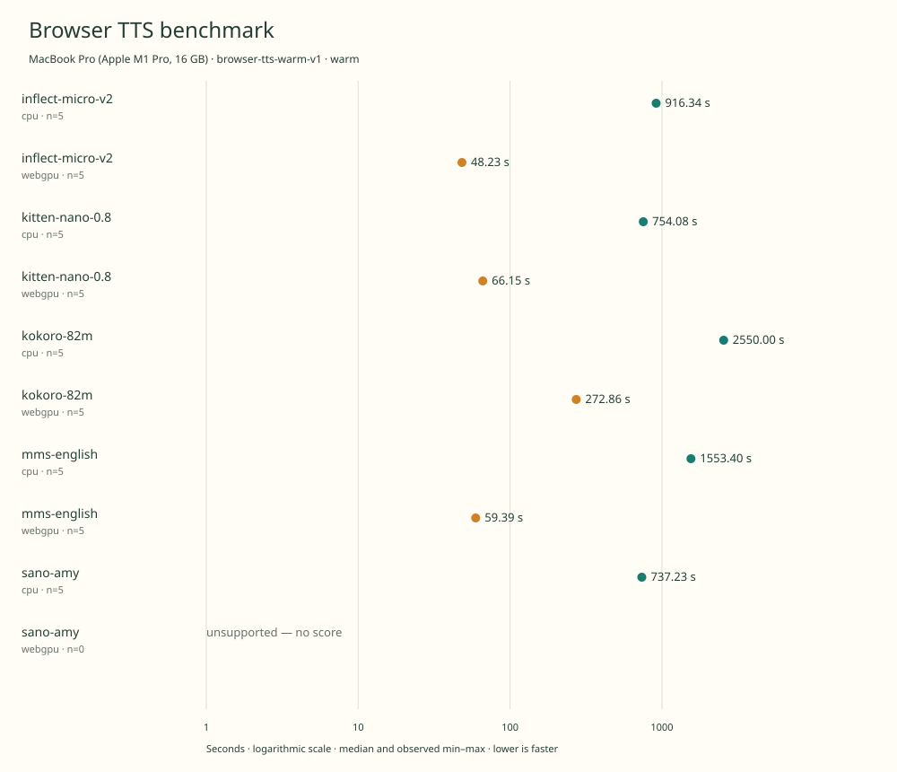

# native-benchmark-comparison

MacBook Pro (Apple M1 Pro, 16 GB) · Apple M1 Pro · Google Chrome 157.0.8103.40

Protocol: **browser-tts-warm-v1**, scenario **warm**. Comparison of separate native harness runs.

First source-chunk request through final CPU-readable PCM; excludes initialization, validation, hashing, WAV encoding and save. Optional articleCallPeakRssBytes spans the entire browser call including post-timer validation/export.

| Model | Requested backend | Status | Median | Min–max | Runs |
|---|---|---|---:|---:|---:|
| inflect-micro-v2 | cpu | measured | 916.34 s | 916.23–916.41 s | 5 |
| inflect-micro-v2 | webgpu | measured | 48.23 s | 48.18–48.29 s | 5 |
| kitten-nano-0.8 | cpu | measured | 754.08 s | 753.71–755.39 s | 5 |
| kitten-nano-0.8 | webgpu | measured | 66.15 s | 66.01–66.31 s | 5 |
| kokoro-82m | cpu | measured | 2550.00 s | 2549.88–2550.72 s | 5 |
| kokoro-82m | webgpu | measured | 272.86 s | 271.87–273.12 s | 5 |
| mms-english | cpu | measured | 1553.40 s | 1545.72–1560.89 s | 5 |
| mms-english | webgpu | measured | 59.39 s | 58.73–59.80 s | 5 |
| sano-amy | cpu | measured | 737.23 s | 737.12–737.31 s | 5 |
| sano-amy | webgpu | unsupported | — | — | 0 |

Additional metrics (median of available observations; scopes are distinct):

| Model | Backend | Metric | Median | Unit | n |
|---|---|---|---:|---|---:|
| inflect-micro-v2 | cpu | First completed source chunk | 10266.410 | ms | 5 |
| inflect-micro-v2 | cpu | First PCM block | 10266.400 | ms | 5 |
| inflect-micro-v2 | cpu | Generated audio | 1224.771 | s | 5 |
| inflect-micro-v2 | cpu | Generation / audio duration | 0.748 | ratio | 5 |
| inflect-micro-v2 | webgpu | First completed source chunk | 551.275 | ms | 5 |
| inflect-micro-v2 | webgpu | First PCM block | 551.270 | ms | 5 |
| inflect-micro-v2 | webgpu | Generated audio | 1224.771 | s | 5 |
| inflect-micro-v2 | webgpu | Generation / audio duration | 0.039 | ratio | 5 |
| kitten-nano-0.8 | cpu | First completed source chunk | 8710.175 | ms | 5 |
| kitten-nano-0.8 | cpu | First PCM block | 8710.170 | ms | 5 |
| kitten-nano-0.8 | cpu | Generated audio | 2007.075 | s | 5 |
| kitten-nano-0.8 | cpu | Generation / audio duration | 0.376 | ratio | 5 |
| kitten-nano-0.8 | webgpu | First completed source chunk | 772.120 | ms | 5 |
| kitten-nano-0.8 | webgpu | First PCM block | 772.110 | ms | 5 |
| kitten-nano-0.8 | webgpu | Generated audio | 2007.075 | s | 5 |
| kitten-nano-0.8 | webgpu | Generation / audio duration | 0.033 | ratio | 5 |
| kokoro-82m | cpu | First completed source chunk | 29340.785 | ms | 5 |
| kokoro-82m | cpu | First PCM block | 29340.780 | ms | 5 |
| kokoro-82m | cpu | Generated audio | 1302.450 | s | 5 |
| kokoro-82m | cpu | Generation / audio duration | 1.958 | ratio | 5 |
| kokoro-82m | webgpu | First completed source chunk | 3158.405 | ms | 5 |
| kokoro-82m | webgpu | First PCM block | 3157.900 | ms | 5 |
| kokoro-82m | webgpu | Generated audio | 1302.450 | s | 5 |
| kokoro-82m | webgpu | Generation / audio duration | 0.210 | ratio | 5 |
| mms-english | cpu | First completed source chunk | 17004.225 | ms | 5 |
| mms-english | cpu | First PCM block | 17004.215 | ms | 5 |
| mms-english | cpu | Generated audio | 1210.560 | s | 5 |
| mms-english | cpu | Generation / audio duration | 1.283 | ratio | 5 |
| mms-english | webgpu | First completed source chunk | 748.345 | ms | 5 |
| mms-english | webgpu | First PCM block | 748.345 | ms | 5 |
| mms-english | webgpu | Generated audio | 1274.960 | s | 5 |
| mms-english | webgpu | Generation / audio duration | 0.047 | ratio | 5 |
| sano-amy | cpu | First completed source chunk | 8435.335 | ms | 5 |
| sano-amy | cpu | First PCM block | 8435.325 | ms | 5 |
| sano-amy | cpu | Generated audio | 1202.945 | s | 5 |
| sano-amy | cpu | Generation / audio duration | 0.613 | ratio | 5 |

Model support (catalog capability, not coverage of this run):

| Model | Supported voices | Bundled voices | Languages | Tested voice |
|---|---:|---:|---|---|
| inflect-micro-v2 | 1 | 1 | 1 (en) | English (single speaker; eSpeak en-us) |
| inflect-micro-v2 | 1 | 1 | 1 (en) | English (single speaker; eSpeak en-us) |
| kitten-nano-0.8 | 8 | 8 | 1 (en) | Bella (expr-voice-2-f) |
| kitten-nano-0.8 | 8 | 8 | 1 (en) | Bella (expr-voice-2-f) |
| kokoro-82m | 54 | 1 | 8 | af_heart |
| kokoro-82m | 54 | 1 | 8 | af_heart |
| mms-english | 1 | 1 | 1 (en) | English fixed voice |
| mms-english | 1 | 1 | 1 (en) | English fixed voice |
| sano-amy | 1 | 1 | 1 (en) | Amy (English, eSpeak en-us) |
| sano-amy | 1 | 1 | 1 (en) | Amy (English) |

Pinned Inflect Micro v2 complete English checkpoint and official FP32 ONNX export. One fixed synthetic English voice; no reference recording or voice-cloning model required. 9,356,513 deployable parameters including waveform decoder. Browser port uses a disclosed seeded JavaScript normal-noise generator rather than NumPy bitwise parity. Sources: [1](https://huggingface.co/owensong/Inflect-Micro-v2-ONNX/blob/91b1ab6432323064ec0e8e9704d92fcecd24855f/README.md), [2](https://huggingface.co/owensong/Inflect-Micro-v2-ONNX/blob/91b1ab6432323064ec0e8e9704d92fcecd24855f/onnx/SOURCE.json), [3](https://huggingface.co/owensong/Inflect-Micro-v2/blob/9d862840734dcc53afb5d27ef468459daad020fa/README.md).

Pinned Inflect Micro v2 complete English checkpoint and official FP32 ONNX export. One fixed synthetic English voice; no reference recording or voice-cloning model required. 9,356,513 deployable parameters including waveform decoder. Browser port uses a disclosed seeded JavaScript normal-noise generator rather than NumPy bitwise parity. Sources: [1](https://huggingface.co/owensong/Inflect-Micro-v2-ONNX/blob/91b1ab6432323064ec0e8e9704d92fcecd24855f/README.md), [2](https://huggingface.co/owensong/Inflect-Micro-v2-ONNX/blob/91b1ab6432323064ec0e8e9704d92fcecd24855f/onnx/SOURCE.json), [3](https://huggingface.co/owensong/Inflect-Micro-v2/blob/9d862840734dcc53afb5d27ef468459daad020fa/README.md).

Pinned Kitten Nano 0.8 checkpoint and supplied voice archive. Eight preset voices; all styles bundled in voices.npz. Only Bella is tested. Official clean\_text=false path with browser eSpeak and strict token mapping; no silent unknown-symbol skips. Sources: [1](https://huggingface.co/KittenML/kitten-tts-nano-0.8-fp32/blob/e73cfb095bd949c786ccdcf3b8ab04eb36c47442/config.json).

Pinned Kitten Nano 0.8 checkpoint and supplied voice archive. Eight preset voices; all styles bundled in voices.npz. Only Bella is tested. Official clean\_text=false path with browser eSpeak and strict token mapping; no silent unknown-symbol skips. Sources: [1](https://huggingface.co/KittenML/kitten-tts-nano-0.8-fp32/blob/e73cfb095bd949c786ccdcf3b8ab04eb36c47442/config.json).

Kokoro v1.0 model catalog; English browser runtime exercised. 54 named preset voices across 8 languages \(English has US/GB accents\). The export also contains a legacy af.bin alias, not a distinct named catalog voice. Official JS 1.2.1 exposes 28 English voices; only af\_heart is staged and tested. Sources: [1](https://huggingface.co/hexgrad/Kokoro-82M/blob/f3ff3571791e39611d31c381e3a41a3af07b4987/VOICES.md).

Kokoro v1.0 model catalog; English browser runtime exercised. 54 named preset voices across 8 languages \(English has US/GB accents\). The export also contains a legacy af.bin alias, not a distinct named catalog voice. Official JS 1.2.1 exposes 28 English voices; only af\_heart is staged and tested. Sources: [1](https://huggingface.co/hexgrad/Kokoro-82M/blob/f3ff3571791e39611d31c381e3a41a3af07b4987/VOICES.md).

Pinned English checkpoint, not the wider multilingual MMS family. Single English speaker. Official Xenova ONNX export removes training-only weights. Benchmark spells out numeric tokens before the official grapheme tokenizer to avoid dropping digits absent from its vocabulary. Sources: [1](https://huggingface.co/facebook/mms-tts-eng/blob/c71de0fe7204c83f1c10820a7d696d0b450048ba/README.md).

Pinned English checkpoint, not the wider multilingual MMS family. Single English speaker. Official Xenova ONNX export removes training-only weights. Benchmark spells out numeric tokens before the official grapheme tokenizer to avoid dropping digits absent from its vocabulary. Sources: [1](https://huggingface.co/facebook/mms-tts-eng/blob/c71de0fe7204c83f1c10820a7d696d0b450048ba/README.md).

Pinned Sano Amy 1.46M checkpoint and FP32 browser bundle only. Amy browser bundle uses the official en-us eSpeak frontend and synthesizes at 22,050 Hz. The broader Sano family supports additional voices and languages; they are outside this pinned checkpoint. Sources: [1](https://huggingface.co/ampixa/sanoTTS/blob/4a8194aa1dd958033ee449b3ad30c37e536b216e/amy-en-1p46m/README.md), [2](https://huggingface.co/ampixa/sanoTTS/blob/4a8194aa1dd958033ee449b3ad30c37e536b216e/web/voices/amy/meta.json).

Pinned Sano Amy 1.46M checkpoint and FP32 browser bundle only. Amy browser bundle uses the official en-us eSpeak frontend and synthesizes at 22,050 Hz. The broader Sano family supports additional voices and languages; they are outside this pinned checkpoint. Sources: [1](https://huggingface.co/ampixa/sanoTTS/blob/4a8194aa1dd958033ee449b3ad30c37e536b216e/amy-en-1p46m/README.md), [2](https://huggingface.co/ampixa/sanoTTS/blob/4a8194aa1dd958033ee449b3ad30c37e536b216e/web/voices/amy/meta.json).

- **inflect-micro-v2 / cpu**: Explicit one-thread WASM; an untimed CPU utterance passed.
- **inflect-micro-v2 / webgpu**: Observed 2250 WebGPU dispatches in untimed duration and decoder inference; final waveform was read back to CPU. WASM fallback may execute unsupported operators. Hooks removed before timing.
- **kitten-nano-0.8 / cpu**: Explicit single-thread WASM provider.
- **kitten-nano-0.8 / webgpu**: Observed 1543 dispatches during separate untimed synthesis. WebGPU with WASM operator fallback; CPU eSpeak preprocessing and PCM readback. Hooks removed before timing.
- **kokoro-82m / cpu**: Explicit single-thread WASM provider.
- **kokoro-82m / webgpu**: Observed 2088 dispatches in separate untimed synthesis. CPU preprocessing and possible WASM operators; CPU-readable output. Hooks removed before timing.
- **mms-english / cpu**: Explicit single-thread WASM provider.
- **mms-english / webgpu**: Observed 1766 dispatches in separate untimed synthesis. CPU tokenization and possible WASM operators; CPU-readable output. Hooks removed before timing.
- **sano-amy / cpu**: Official Sano Emscripten WebAssembly inference in a headed Chrome classic worker; an untimed CPU utterance passed; no GPU execution.
- **sano-amy / webgpu**: No official Sano WebGPU backend is available to probe. The official Sano browser runtime uses WebAssembly on CPU and does not provide a WebGPU path.

Comparison of separate native run receipts; no repetitions were pooled.

Input: 2026-11-10t15-16-09-599z-kitten-nano-0.8-cpu-warm-624ea636

Input: 2026-11-10t16-32-02-384z-sano-amy-webgpu-warm-24afcdc7

Input: 2026-11-10t16-32-03-827z-sano-amy-cpu-warm-0a4ec2a0

Input: 2026-11-10t17-46-17-830z-mms-english-webgpu-warm-3eb8b06a

Input: 2026-11-10t17-52-21-838z-inflect-micro-v2-cpu-warm-c57a83a6

Input: 2026-11-10t19-24-19-116z-kitten-nano-0.8-webgpu-warm-cef85ae4

Input: 2026-11-10t19-31-08-081z-mms-english-cpu-warm-b81daec2

Input: 2026-11-10t22-06-51-166z-kokoro-82m-cpu-warm-a9cc8d21

Input: 2026-11-11t02-22-33-290z-kokoro-82m-webgpu-warm-58b6b9b7

Input: 2026-11-11t02-50-06-191z-inflect-micro-v2-webgpu-warm-e21ef201

Read each source result for power, thermal, execution-order and other run-specific notes.

Different protocols, fixtures, settings or machines must not be pooled into a speedup ranking. This report does not rate speech quality.
