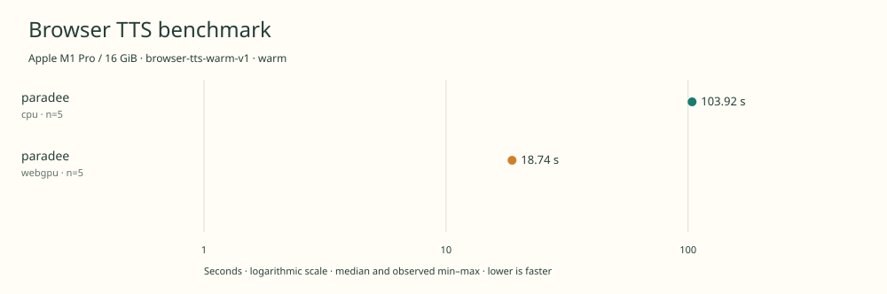

# native-benchmark-comparison

Apple M1 Pro / 16 GiB · Apple M1 Pro · Google Chrome 157.0.8103.39

Protocol: **browser-tts-warm-v1**, scenario **warm**. Comparison of separate native harness runs.

First source-chunk request through final CPU-readable PCM; excludes initialization, validation, hashing, WAV encoding and save. Optional articleCallPeakRssBytes spans the entire browser call including post-timer validation/export.

| Model | Requested backend | Status | Median | Min–max | Runs |
|---|---|---|---:|---:|---:|
| paradee | cpu | measured | 103.92 s | 103.69–103.99 s | 5 |
| paradee | webgpu | measured | 18.74 s | 18.61–18.80 s | 5 |

Additional metrics (median of available observations; scopes are distinct):

| Model | Backend | Metric | Median | Unit | n |
|---|---|---|---:|---|---:|
| paradee | cpu | First completed source chunk | 1199.090 | ms | 5 |
| paradee | cpu | First PCM block | 1199.085 | ms | 5 |
| paradee | cpu | Generated audio | 1287.350 | s | 5 |
| paradee | cpu | Generation / audio duration | 0.081 | ratio | 5 |
| paradee | webgpu | First completed source chunk | 227.455 | ms | 5 |
| paradee | webgpu | First PCM block | 227.445 | ms | 5 |
| paradee | webgpu | Generated audio | 1287.350 | s | 5 |
| paradee | webgpu | Generation / audio duration | 0.015 | ratio | 5 |

- **paradee / cpu**: Explicit single-thread ONNX WASM provider.
- **paradee / webgpu**: Observed 1046 compute dispatches in a separate untimed utterance. WebGPU + WASM operator fallback; CPU text preprocessing. Hooks removed before timing.

Comparison of separate native run receipts; no repetitions were pooled.

Input: 2026-11-09t04-55-36-509z-paradee-cpu-warm-244b2a2f

Input: 2026-11-09t05-06-08-477z-paradee-webgpu-warm-c3836dc0

Read each source result for power, thermal, execution-order and other run-specific notes.

Different protocols, fixtures, settings or machines must not be pooled into a speedup ranking. This report does not rate speech quality.
