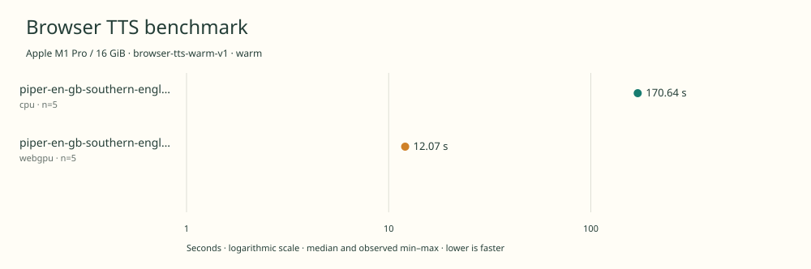

# native-benchmark-comparison

Apple M1 Pro / 16 GiB · Apple M1 Pro · Google Chrome 157.0.8103.39

Protocol: **browser-tts-warm-v1**, scenario **warm**. Comparison of separate native harness runs.

First source-chunk request through final CPU-readable PCM; excludes initialization, validation, hashing, WAV encoding and save. Optional articleCallPeakRssBytes spans the entire browser call including post-timer validation/export.

| Model | Requested backend | Status | Median | Min–max | Runs |
|---|---|---|---:|---:|---:|
| piper-en-gb-southern-english-female-low | cpu | measured | 170.64 s | 170.20–170.69 s | 5 |
| piper-en-gb-southern-english-female-low | webgpu | measured | 12.07 s | 12.00–12.18 s | 5 |

Additional metrics (median of available observations; scopes are distinct):

| Model | Backend | Metric | Median | Unit | n |
|---|---|---|---:|---|---:|
| piper-en-gb-southern-english-female-low | cpu | First completed source chunk | 1872.035 | ms | 5 |
| piper-en-gb-southern-english-female-low | cpu | First PCM block | 1872.030 | ms | 5 |
| piper-en-gb-southern-english-female-low | cpu | Generated audio | 1054.432 | s | 5 |
| piper-en-gb-southern-english-female-low | cpu | Generation / audio duration | 0.162 | ratio | 5 |
| piper-en-gb-southern-english-female-low | webgpu | First completed source chunk | 138.250 | ms | 5 |
| piper-en-gb-southern-english-female-low | webgpu | First PCM block | 138.245 | ms | 5 |
| piper-en-gb-southern-english-female-low | webgpu | Generated audio | 1052.880 | s | 5 |
| piper-en-gb-southern-english-female-low | webgpu | Generation / audio duration | 0.011 | ratio | 5 |

Model support (catalog capability, not coverage of this run):

| Model | Supported voices | Bundled voices | Languages | Tested voice |
|---|---:|---:|---|---|
| piper-en-gb-southern-english-female-low | 1 | 1 | 1 (en) | en_GB-southern_english_female-low (single speaker) |
| piper-en-gb-southern-english-female-low | 1 | 1 | 1 (en) | en_GB-southern_english_female-low (single speaker) |

Pinned benchmark checkpoint. One British English speaker in this checkpoint. The broader Piper voice repository contains other independent models and languages; they are not included in this count. Sources: [1](https://huggingface.co/rhasspy/piper-voices/resolve/e7229f7d33a10e145e109b886d661984201ac3c4/en/en_GB/southern_english_female/low/en_GB-southern_english_female-low.onnx.json), [2](https://huggingface.co/rhasspy/piper-voices/raw/e7229f7d33a10e145e109b886d661984201ac3c4/en/en_GB/southern_english_female/low/MODEL_CARD).

Pinned benchmark checkpoint. One British English speaker in this checkpoint. The broader Piper voice repository contains other independent models and languages; they are not included in this count. Sources: [1](https://huggingface.co/rhasspy/piper-voices/resolve/e7229f7d33a10e145e109b886d661984201ac3c4/en/en_GB/southern_english_female/low/en_GB-southern_english_female-low.onnx.json), [2](https://huggingface.co/rhasspy/piper-voices/raw/e7229f7d33a10e145e109b886d661984201ac3c4/en/en_GB/southern_english_female/low/MODEL_CARD).

- **piper-en-gb-southern-english-female-low / cpu**: Explicit ONNX Runtime Web WASM provider with one thread; eSpeak preprocessing and synthesis run locally in the Chrome worker.
- **piper-en-gb-southern-english-female-low / webgpu**: Observed 1585 WebGPU compute dispatches during a separate untimed synthesis. WebGPU + WASM operator fallback; eSpeak preprocessing runs on CPU. Hooks were removed before timed generation.

Comparison of separate native run receipts; no repetitions were pooled.

Input: 2026-11-09t20-33-26-966z-piper-en-gb-southern-english-female-low-cpu-warm-9a0ba981

Input: 2026-11-09t20-52-18-629z-piper-en-gb-southern-english-female-low-webgpu-warm-d8fb8392

Read each source result for power, thermal, execution-order and other run-specific notes.

Different protocols, fixtures, settings or machines must not be pooled into a speedup ranking. This report does not rate speech quality.
