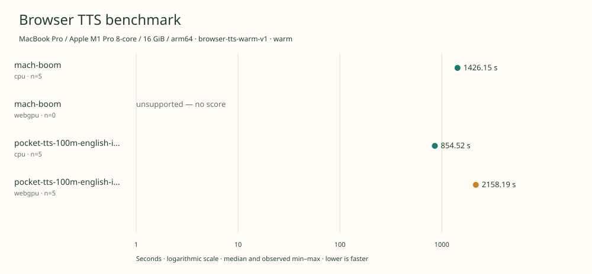

# native-benchmark-comparison

MacBook Pro / Apple M1 Pro 8-core / 16 GiB / arm64 · Apple M1 Pro · Google Chrome 157.0.8103.40

Protocol: **browser-tts-warm-v1**, scenario **warm**. Comparison of separate native harness runs.

First source-chunk request through final CPU-readable PCM; excludes initialization, validation, hashing, WAV encoding and save. Optional articleCallPeakRssBytes spans the entire browser call including post-timer validation/export.

| Model | Requested backend | Status | Median | Min–max | Runs |
|---|---|---|---:|---:|---:|
| mach-boom | cpu | measured | 1426.15 s | 1420.75–1432.03 s | 5 |
| mach-boom | webgpu | unsupported | — | — | 0 |
| pocket-tts-100m-english-int8 | cpu | measured | 854.52 s | 847.79–856.45 s | 5 |
| pocket-tts-100m-english-int8 | webgpu | measured | 2158.19 s | 2099.83–2225.88 s | 5 |

Additional metrics (median of available observations; scopes are distinct):

| Model | Backend | Metric | Median | Unit | n |
|---|---|---|---:|---|---:|
| mach-boom | cpu | First completed source chunk | 17073.265 | ms | 5 |
| mach-boom | cpu | First PCM block | 463.215 | ms | 5 |
| mach-boom | cpu | Generated audio | 1173.920 | s | 5 |
| mach-boom | cpu | Generation / audio duration | 1.215 | ratio | 5 |
| pocket-tts-100m-english-int8 | cpu | First completed source chunk | 9822.055 | ms | 5 |
| pocket-tts-100m-english-int8 | cpu | First PCM block | 312.375 | ms | 5 |
| pocket-tts-100m-english-int8 | cpu | Generated audio | 1101.730 | s | 5 |
| pocket-tts-100m-english-int8 | cpu | Generation / audio duration | 0.775 | ratio | 5 |
| pocket-tts-100m-english-int8 | webgpu | First completed source chunk | 26286.420 | ms | 5 |
| pocket-tts-100m-english-int8 | webgpu | First PCM block | 898.015 | ms | 5 |
| pocket-tts-100m-english-int8 | webgpu | Generated audio | 1097.890 | s | 5 |
| pocket-tts-100m-english-int8 | webgpu | Generation / audio duration | 1.966 | ratio | 5 |

Model support (catalog capability, not coverage of this run):

| Model | Supported voices | Bundled voices | Languages | Tested voice |
|---|---:|---:|---|---|
| mach-boom | 4 | 1 | 1 (en) | Zoey |
| mach-boom | 4 | 1 | 1 (en) | Zoey |
| pocket-tts-100m-english-int8 | 8 | 8 | 1 (en) | alba |
| pocket-tts-100m-english-int8 | 8 | 8 | 1 (en) | alba |

Four named voices bundled upstream with this English checkpoint; Zoey staged for the benchmark. Zoey, Juniper, Everly and Harper are supplied upstream. Additional compatible Phonon voices are not counted here. Only Zoey in English is measured. Browser port uses CPU WebAssembly, not native x86 AMX/AVX. Sources: [1](https://huggingface.co/SyzygyResearch/Mach-Boom/blob/01860b06bdf8498761255ad1c64b99980b96486d/README.md), [2](https://huggingface.co/SyzygyResearch/Mach-Boom/blob/01860b06bdf8498761255ad1c64b99980b96486d/voices/voices.jsonl).

Four named voices bundled upstream with this English checkpoint; Zoey staged for the benchmark. Zoey, Juniper, Everly and Harper are supplied upstream. Additional compatible Phonon voices are not counted here. Only Zoey in English is measured. Browser port uses CPU WebAssembly, not native x86 AMX/AVX. Sources: [1](https://huggingface.co/SyzygyResearch/Mach-Boom/blob/01860b06bdf8498761255ad1c64b99980b96486d/README.md), [2](https://huggingface.co/SyzygyResearch/Mach-Boom/blob/01860b06bdf8498761255ad1c64b99980b96486d/voices/voices.jsonl).

Selected english\_2026-04 checkpoint with eight bundled preset voices; not the broader multilingual family. Alba, Azelma, Cosette, Eponine, Fantine, Javert, Jean and Marius are bundled; only alba in English is measured. This is the original approximately 100M Pocket family, not the newer 18.2M model. A pinned community ONNX/browser implementation is used. Sources: [1](https://huggingface.co/KevinAHM/pocket-tts-onnx/tree/58a6d00cf13d239b6748cb0769f35c580a8f606c), [2](https://huggingface.co/spaces/KevinAHM/pocket-tts-web/tree/d0c0c79b7712256a32d691c67f20b8ae2e020d00), [3](https://huggingface.co/KevinAHM/pocket-tts-onnx/blob/58a6d00cf13d239b6748cb0769f35c580a8f606c/onnx/english_2026-04/bundle.json).

Selected english\_2026-04 checkpoint with eight bundled preset voices; not the broader multilingual family. Alba, Azelma, Cosette, Eponine, Fantine, Javert, Jean and Marius are bundled; only alba in English is measured. This is the original approximately 100M Pocket family, not the newer 18.2M model. A pinned community ONNX/browser implementation is used. Sources: [1](https://huggingface.co/KevinAHM/pocket-tts-onnx/tree/58a6d00cf13d239b6748cb0769f35c580a8f606c), [2](https://huggingface.co/spaces/KevinAHM/pocket-tts-web/tree/d0c0c79b7712256a32d691c67f20b8ae2e020d00), [3](https://huggingface.co/KevinAHM/pocket-tts-onnx/blob/58a6d00cf13d239b6748cb0769f35c580a8f606c/onnx/english_2026-04/bundle.json).

- **mach-boom / cpu**: Upstream Python/NumPy and portable C kernels execute inside one Chrome worker through WebAssembly. No host Python synthesis, AMX, or GPU.
- **mach-boom / webgpu**: No GPU path is substituted or silently routed to CPU. Mach Boom ships CPU C/Python kernels; this browser port runs CPU WebAssembly and has no WebGPU inference implementation.
- **pocket-tts-100m-english-int8 / cpu**: Explicit 1-thread ONNX Runtime Web WASM; text processing runs in the worker.
- **pocket-tts-100m-english-int8 / webgpu**: Observed 117258 WebGPU compute dispatches in separate untimed Pocket TTS synthesis; WebGPU with WASM fallback. Hooks removed before scored generation.

Comparison of separate native run receipts; no repetitions were pooled.

Input: 2026-11-11t23-29-37-690z-mach-boom-cpu-warm-3e5836ed

Input: 2026-11-12t06-54-44-012z-mach-boom-webgpu-warm-50fcc07b

Input: 2026-11-12t05-28-59-020z-pocket-tts-100m-english-int8-cpu-warm-72714412

Input: 2026-11-12t01-52-33-830z-pocket-tts-100m-english-int8-webgpu-warm-69de3d93

Read each source result for power, thermal, execution-order and other run-specific notes.

Different protocols, fixtures, settings or machines must not be pooled into a speedup ranking. This report does not rate speech quality.
