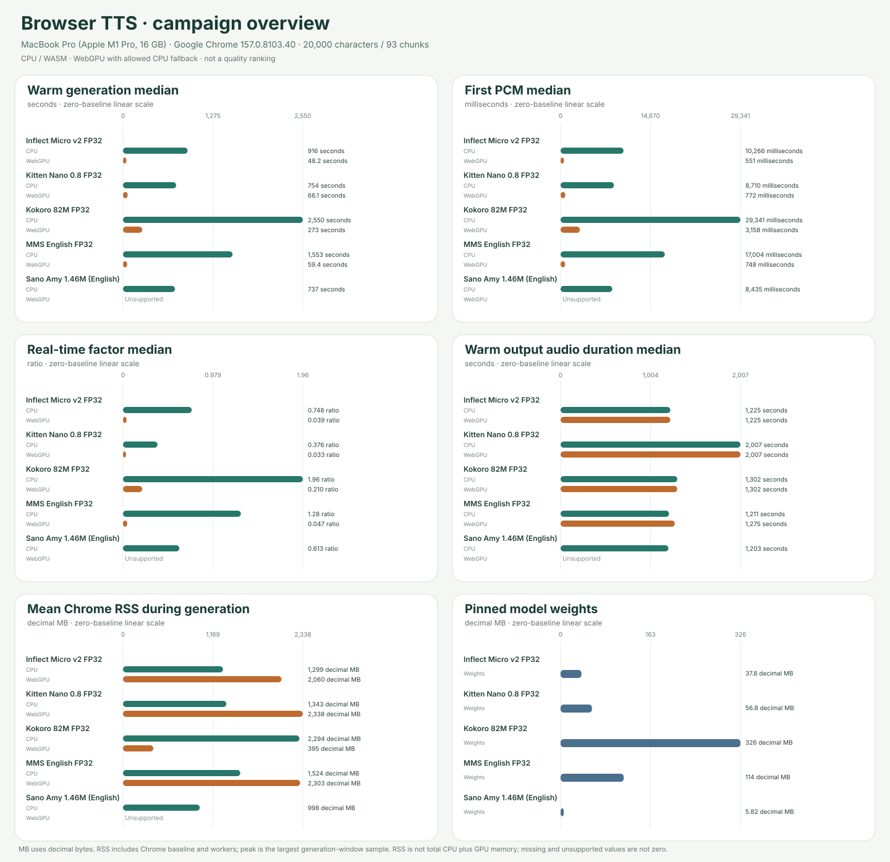

# Browser TTS campaign overview

**Cohort:** native headed-Chrome results from source commit `955a87683c0c899cc299161a7b8b127fb75617be` (source fingerprint `d692498775b06e716e111b7d122f5995ec8d8046febc2d2aebfd2c33a542379f`), on MacBook Pro (Apple M1 Pro, 16 GB) · Darwin 25.6.0 · Apple M1 Pro · Google Chrome 157.0.8103.40 · GPU apple. Fixture: `english-20k-v1`, 20,000 characters / 93 chunks, SHA-256 `4cd173ad03d14ba96df6eb1e58b193c0c796032c114cfb954838b5150651eb0b`.

The included receipts share one source, exact environment and fixture; voice, precision and non-backend settings are checked per model. The recorded non-backend model settings match; `executionProviders` identifies the requested runtime providers. Scenarios remain separate and are never pooled. Model support and terms: [voice/language counts](../../docs/MODEL_SUPPORT.md) · [licensing and publication boundaries](../../docs/LICENSING.md).

## Warm generation

Full warm workload: one excluded full-article warm-up and at least five scored 20,000-character / 93-chunk repetitions. Generation is the benchmark timer; values summarize scored repetitions only. First PCM is median of recorded per-trial values. Audio duration and RTF are reconciled from output samples, sample rate and generation time.

| Model | CPU generation median (min–max) | WebGPU generation median (min–max) | CPU first PCM median | WebGPU first PCM median | CPU audio / RTF median | WebGPU audio / RTF median |
|---|---:|---:|---:|---:|---:|---:|
| Inflect Micro v2 FP32 | 916.34 s (916.23–916.41; n=5) | 48.23 s (48.18–48.29; n=5) | 10266.40 ms (n=5) | 551.27 ms (n=5) | 1224.77 s / 0.748 | 1224.77 s / 0.039 |
| Kitten Nano 0.8 FP32 | 754.08 s (753.71–755.39; n=5) | 66.15 s (66.01–66.31; n=5) | 8710.17 ms (n=5) | 772.11 ms (n=5) | 2007.08 s / 0.376 | 2007.08 s / 0.033 |
| Kokoro 82M FP32 | 2550.00 s (2549.88–2550.72; n=5) | 272.86 s (271.87–273.12; n=5) | 29340.78 ms (n=5) | 3157.90 ms (n=5) | 1302.45 s / 1.958 | 1302.45 s / 0.210 |
| MMS English FP32 | 1553.40 s (1545.72–1560.89; n=5) | 59.39 s (58.73–59.80; n=5) | 17004.21 ms (n=5) | 748.35 ms (n=5) | 1210.56 s / 1.283 | 1274.96 s / 0.047 |
| Sano Amy 1.46M (English) | 737.23 s (737.12–737.31; n=5) | Unsupported | 8435.32 ms (n=5) | Unsupported | 1202.94 s / 0.613 | Unsupported |

## Resource diagnostics

Cached RAM is the mean process-tree RSS sampled during one full generation in a separate one-tab Chrome session. It includes browser baseline and inference workers, may double-count shared pages, and is not model-only RAM or VRAM. The peak column is the largest RSS sample inside the same generation window; process RSS does not measure total CPU plus GPU allocations. Decimal MB = 1,000,000 bytes.

| Model | CPU mean Chrome RSS | CPU max sampled RSS | WebGPU mean Chrome RSS | WebGPU max sampled RSS | Pinned model weights |
|---|---:|---:|---:|---:|---:|
| Inflect Micro v2 FP32 | 1299.45 MB (n=1; 1831 samples) | 1390.22 MB (sampled max; n=1; 1831 samples) | 2060.21 MB (n=1; 97 samples) | 2154.69 MB (sampled max; n=1; 97 samples) | 37.75 MB |
| Kitten Nano 0.8 FP32 | 1343.17 MB (n=1; 1511 samples) | 1454.05 MB (sampled max; n=1; 1511 samples) | 2337.99 MB (n=1; 132 samples) | 2456.52 MB (sampled max; n=1; 132 samples) | 56.77 MB |
| Kokoro 82M FP32 | 2293.74 MB (n=1; 5086 samples) | 2406.89 MB (sampled max; n=1; 5086 samples) | 394.93 MB (n=1; 548 samples) | 2451.88 MB (sampled max; n=1; 548 samples) | 325.53 MB |
| MMS English FP32 | 1524.37 MB (n=1; 3113 samples) | 1578.19 MB (sampled max; n=1; 3113 samples) | 2303.14 MB (n=1; 118 samples) | 2368.34 MB (sampled max; n=1; 118 samples) | 114.26 MB |
| Sano Amy 1.46M (English) | 997.53 MB (n=1; 1486 samples) | 1077.10 MB (sampled max; n=1; 1486 samples) | Unsupported | Unsupported | 5.82 MB |

## Submitted receipts

Each cell links to its submitted receipt and full per-run report. Missing entries are labeled, not treated as zero.

| Model | Warm CPU | Warm WebGPU | Cached CPU RAM | Cached WebGPU RAM | Support | License |
|---|---|---|---|---|---|---|
| Inflect Micro v2 FP32 | [Report](../../results/2026-11-10t17-52-21-838z-inflect-micro-v2-cpu-warm-c57a83a6/summary.md) | [Report](../../results/2026-11-11t02-50-06-191z-inflect-micro-v2-webgpu-warm-e21ef201/summary.md) | [Report](../../results/2026-11-11t04-11-48-039z-inflect-micro-v2-cpu-cached-d7106d59/summary.md) | [Report](../../results/2026-11-11t02-55-05-893z-inflect-micro-v2-webgpu-cached-51e2acf0/summary.md) | [Support details](../../docs/MODEL_SUPPORT.md#inflect-micro-v2) | [Terms](../../docs/LICENSING.md) |
| Kitten Nano 0.8 FP32 | [Report](../../results/2026-11-10t15-16-09-599z-kitten-nano-0.8-cpu-warm-624ea636/summary.md) | [Report](../../results/2026-11-10t19-24-19-116z-kitten-nano-0.8-webgpu-warm-cef85ae4/summary.md) | [Report](../../results/2026-11-11t04-41-26-026z-kitten-nano-0.8-cpu-cached-5dc541fc/summary.md) | [Report](../../results/2026-11-11t04-10-31-407z-kitten-nano-0.8-webgpu-cached-25f950b4/summary.md) | [Support details](../../docs/MODEL_SUPPORT.md#kitten-nano-0.8) | [Terms](../../docs/LICENSING.md) |
| Kokoro 82M FP32 | [Report](../../results/2026-11-10t22-06-51-166z-kokoro-82m-cpu-warm-a9cc8d21/summary.md) | [Report](../../results/2026-11-11t02-22-33-290z-kokoro-82m-webgpu-warm-58b6b9b7/summary.md) | [Report](../../results/2026-11-11t03-00-52-961z-kokoro-82m-cpu-cached-9b2283f1/summary.md) | [Report](../../results/2026-11-11t02-56-02-596z-kokoro-82m-webgpu-cached-b4638a41/summary.md) | [Support details](../../docs/MODEL_SUPPORT.md#kokoro-82m) | [Terms](../../docs/LICENSING.md) |
| MMS English FP32 | [Report](../../results/2026-11-10t19-31-08-081z-mms-english-cpu-warm-b81daec2/summary.md) | [Report](../../results/2026-11-10t17-46-17-830z-mms-english-webgpu-warm-3eb8b06a/summary.md) | [Report](../../results/2026-11-11t03-44-05-639z-mms-english-cpu-cached-446def8a/summary.md) | [Report](../../results/2026-11-11t04-27-23-653z-mms-english-webgpu-cached-6aa1e983/summary.md) | [Support details](../../docs/MODEL_SUPPORT.md#mms-english) | [Terms](../../docs/LICENSING.md) |
| Sano Amy 1.46M (English) | [Report](../../results/2026-11-10t16-32-03-827z-sano-amy-cpu-warm-0a4ec2a0/summary.md) | [Report](../../results/2026-11-10t16-32-02-384z-sano-amy-webgpu-warm-24afcdc7/summary.md) | [Report](../../results/2026-11-11t04-28-31-035z-sano-amy-cpu-cached-c0371d1a/summary.md) | [Report](../../results/2026-11-11t04-41-18-742z-sano-amy-webgpu-cached-78dfb9fa/summary.md) | [Support details](../../docs/MODEL_SUPPORT.md#sano-amy) | [Terms](../../docs/LICENSING.md) |

## Unsupported and error outcomes

Reasons are listed once per model, backend, status and reason; the receipt table above retains links for every submitted cell.

| Model | Backend | Status | Reason | Source receipt |
|---|---|---|---|---|
| sano-amy | webgpu | Unsupported | The official Sano browser runtime uses WebAssembly on CPU and does not provide a WebGPU path. | [Report](../../results/2026-11-10t16-32-02-384z-sano-amy-webgpu-warm-24afcdc7/summary.md) |

This overview reports measured browser execution and resource diagnostics only. It does not rank speech quality or establish intelligibility. Compare scenarios only within their named protocol boundaries; unsupported, unavailable, unrecorded and not-submitted values remain distinct.
