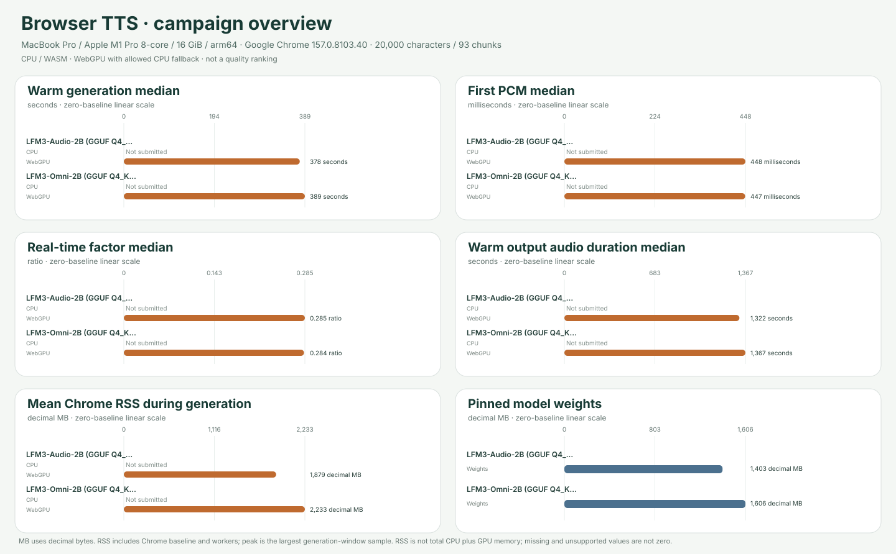

# Browser TTS campaign overview

**Cohort:** native headed-Chrome results from source commit `150db9efe48086e488bf2a206279b2384826b245` (source fingerprint `5f8229f4bac76312c4391f1a9f229dd38cc63c22520194f71b4fcf3931c89fcf`), on MacBook Pro / Apple M1 Pro 8-core / 16 GiB / arm64 · Darwin 25.6.0 · Apple M1 Pro · Google Chrome 157.0.8103.40 · GPU apple metal-3. Fixture: `english-20k-v1`, 20,000 characters / 93 chunks, SHA-256 `4cd173ad03d14ba96df6eb1e58b193c0c796032c114cfb954838b5150651eb0b`.

The included receipts share one source, exact environment and fixture; voice, precision and non-backend settings are checked per model. The recorded non-backend model settings match; `executionProviders` identifies the requested runtime providers. Scenarios remain separate and are never pooled. Model support and terms: [voice/language counts](../../docs/MODEL_SUPPORT.md) · [licensing and publication boundaries](../../docs/LICENSING.md).

## Warm generation

Full warm workload: one excluded full-article warm-up and at least five scored 20,000-character / 93-chunk repetitions. Generation is the benchmark timer; values summarize scored repetitions only. First PCM is median of recorded per-trial values. Audio duration and RTF are reconciled from output samples, sample rate and generation time.

| Model | CPU generation median (min–max) | WebGPU generation median (min–max) | CPU first PCM median | WebGPU first PCM median | CPU audio / RTF median | WebGPU audio / RTF median |
|---|---:|---:|---:|---:|---:|---:|
| LFM3-Audio-2B (GGUF Q4_K_M / Q8_0) | Not submitted | 377.75 s (372.61–384.50; n=5) | Not submitted | 447.69 ms (n=5) | Not submitted | 1321.60 s / 0.285 |
| LFM3-Omni-2B (GGUF Q4_K_M / Q8_0) | Not submitted | 388.70 s (387.33–389.59; n=5) | Not submitted | 447.11 ms (n=5) | Not submitted | 1366.96 s / 0.284 |

## Resource diagnostics

Cached RAM is the mean process-tree RSS sampled during one full generation in a separate one-tab Chrome session. It includes browser baseline and inference workers, may double-count shared pages, and is not model-only RAM or VRAM. The peak column is the largest RSS sample inside the same generation window; process RSS does not measure total CPU plus GPU allocations. Decimal MB = 1,000,000 bytes.

| Model | CPU mean Chrome RSS | CPU max sampled RSS | WebGPU mean Chrome RSS | WebGPU max sampled RSS | Pinned model weights |
|---|---:|---:|---:|---:|---:|
| LFM3-Audio-2B (GGUF Q4_K_M / Q8_0) | Not submitted | Not submitted | 1878.80 MB (n=1; 747 samples) | 2193.85 MB (sampled max; n=1; 747 samples) | 1403.44 MB |
| LFM3-Omni-2B (GGUF Q4_K_M / Q8_0) | Not submitted | Not submitted | 2232.98 MB (n=1; 774 samples) | 2321.84 MB (sampled max; n=1; 774 samples) | 1606.47 MB |

## Submitted receipts

Each cell links to its submitted receipt and full per-run report. Missing entries are labeled, not treated as zero.

| Model | Warm CPU | Warm WebGPU | Cached CPU RAM | Cached WebGPU RAM | Support | License |
|---|---|---|---|---|---|---|
| LFM3-Audio-2B (GGUF Q4_K_M / Q8_0) | Not submitted | [Report](../../results/2026-11-11t07-33-16-967z-lfm3-audio-2b-gguf-webgpu-warm-b42e4073/summary.md) | Not submitted | [Report](../../results/2026-11-11t08-50-49-901z-lfm3-audio-2b-gguf-webgpu-cached-ffbdd243/summary.md) | [Support details](../../docs/MODEL_SUPPORT.md#lfm3-audio-2b-gguf) | [Terms](../../docs/LICENSING.md) |
| LFM3-Omni-2B (GGUF Q4_K_M / Q8_0) | Not submitted | [Report](../../results/2026-11-11t08-11-31-864z-lfm3-omni-2b-gguf-webgpu-warm-0e07e4f7/summary.md) | Not submitted | [Report](../../results/2026-11-11t08-57-29-900z-lfm3-omni-2b-gguf-webgpu-cached-f692b3e2/summary.md) | [Support details](../../docs/MODEL_SUPPORT.md#lfm3-omni-2b-gguf) | [Terms](../../docs/LICENSING.md) |

## Unsupported and error outcomes

All submitted cells are measured.

This overview reports measured browser execution and resource diagnostics only. It does not rank speech quality or establish intelligibility. Compare scenarios only within their named protocol boundaries; unsupported, unavailable, unrecorded and not-submitted values remain distinct.
