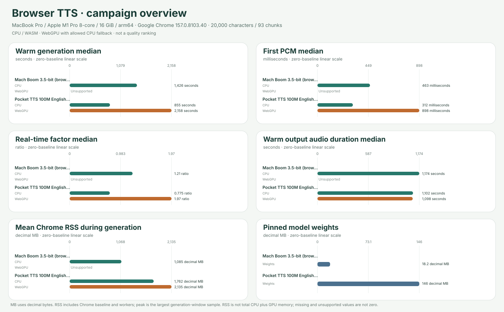

# Browser TTS campaign overview

**Cohort:** native headed-Chrome results from source commit `4a72310bcacf9b2a09b0d9f69982ebe36ee5cce4` (source fingerprint `15630e892968f9c97bc9fd039ea965cd6a354f5842267a5738e56f45300c2edf`), on MacBook Pro / Apple M1 Pro 8-core / 16 GiB / arm64 · Darwin 25.6.0 · Apple M1 Pro · Google Chrome 157.0.8103.40 · GPU apple. Fixture: `english-20k-v1`, 20,000 characters / 93 chunks, SHA-256 `4cd173ad03d14ba96df6eb1e58b193c0c796032c114cfb954838b5150651eb0b`.

The included receipts share one source, exact environment and fixture; voice, precision and non-backend settings are checked per model. The recorded non-backend model settings match; `executionProviders` identifies the requested runtime providers. Scenarios remain separate and are never pooled. Model support and terms: [voice/language counts](../../docs/MODEL_SUPPORT.md) · [licensing and publication boundaries](../../docs/LICENSING.md).

## Warm generation

Full warm workload: one excluded full-article warm-up and at least five scored 20,000-character / 93-chunk repetitions. Generation is the benchmark timer; values summarize scored repetitions only. First PCM is median of recorded per-trial values. Audio duration and RTF are reconciled from output samples, sample rate and generation time.

| Model | CPU generation median (min–max) | WebGPU generation median (min–max) | CPU first PCM median | WebGPU first PCM median | CPU audio / RTF median | WebGPU audio / RTF median |
|---|---:|---:|---:|---:|---:|---:|
| Mach Boom 3.5-bit (browser WASM port) | 1426.15 s (1420.75–1432.03; n=5) | Unsupported | 463.22 ms (n=5) | Unsupported | 1173.92 s / 1.215 | Unsupported |
| Pocket TTS 100M English (INT8/FP32) | 854.52 s (847.79–856.45; n=5) | 2158.19 s (2099.83–2225.88; n=5) | 312.38 ms (n=5) | 898.01 ms (n=5) | 1101.73 s / 0.775 | 1097.89 s / 1.966 |

## Resource diagnostics

Cached RAM is the mean process-tree RSS sampled during one full generation in a separate one-tab Chrome session. It includes browser baseline and inference workers, may double-count shared pages, and is not model-only RAM or VRAM. The peak column is the largest RSS sample inside the same generation window; process RSS does not measure total CPU plus GPU allocations. Decimal MB = 1,000,000 bytes.

| Model | CPU mean Chrome RSS | CPU max sampled RSS | WebGPU mean Chrome RSS | WebGPU max sampled RSS | Pinned model weights |
|---|---:|---:|---:|---:|---:|
| Mach Boom 3.5-bit (browser WASM port) | 1085.29 MB (n=1; 2796 samples) | 1142.73 MB (sampled max; n=1; 2796 samples) | Unsupported | Unsupported | 18.16 MB |
| Pocket TTS 100M English (INT8/FP32) | 1761.60 MB (n=1; 1682 samples) | 1991.46 MB (sampled max; n=1; 1682 samples) | 2135.24 MB (n=1; 4223 samples) | 2756.64 MB (sampled max; n=1; 4223 samples) | 146.16 MB |

## Submitted receipts

Each cell links to its submitted receipt and full per-run report. Missing entries are labeled, not treated as zero.

| Model | Warm CPU | Warm WebGPU | Cached CPU RAM | Cached WebGPU RAM | Support | License |
|---|---|---|---|---|---|---|
| Mach Boom 3.5-bit (browser WASM port) | [Report](../../results/2026-11-11t23-29-37-690z-mach-boom-cpu-warm-3e5836ed/summary.md) | [Report](../../results/2026-11-12t06-54-44-012z-mach-boom-webgpu-warm-50fcc07b/summary.md) | [Report](../../results/2026-11-12t06-54-45-636z-mach-boom-cpu-cached-3e01ad4c/summary.md) | [Report](../../results/2026-11-12t08-08-33-241z-mach-boom-webgpu-cached-0aeac0ab/summary.md) | [Support details](../../docs/MODEL_SUPPORT.md#mach-boom) | [Terms](../../docs/LICENSING.md) |
| Pocket TTS 100M English (INT8/FP32) | [Report](../../results/2026-11-12t05-28-59-020z-pocket-tts-100m-english-int8-cpu-warm-72714412/summary.md) | [Report](../../results/2026-11-12t01-52-33-830z-pocket-tts-100m-english-int8-webgpu-warm-69de3d93/summary.md) | [Report](../../results/2026-11-12t07-54-10-491z-pocket-tts-100m-english-int8-cpu-cached-b6c2a919/summary.md) | [Report](../../results/2026-11-12t07-18-18-704z-pocket-tts-100m-english-int8-webgpu-cached-1bbe1503/summary.md) | [Support details](../../docs/MODEL_SUPPORT.md#pocket-tts-100m-english-int8) | [Terms](../../docs/LICENSING.md) |

## Unsupported and error outcomes

Reasons are listed once per model, backend, status and reason; the receipt table above retains links for every submitted cell.

| Model | Backend | Status | Reason | Source receipt |
|---|---|---|---|---|
| mach-boom | webgpu | Unsupported | Mach Boom ships CPU C/Python kernels; this browser port runs CPU WebAssembly and has no WebGPU inference implementation. | [Report](../../results/2026-11-12t06-54-44-012z-mach-boom-webgpu-warm-50fcc07b/summary.md) |

This overview reports measured browser execution and resource diagnostics only. It does not rank speech quality or establish intelligibility. Compare scenarios only within their named protocol boundaries; unsupported, unavailable, unrecorded and not-submitted values remain distinct.
