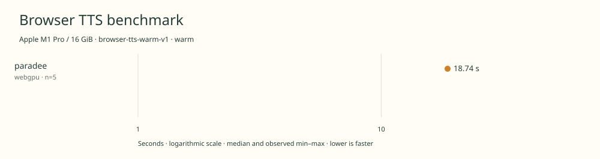

# 2026-11-09t05-06-08-477z-paradee-webgpu-warm-c3836dc0

Apple M1 Pro / 16 GiB · Apple M1 Pro · Google Chrome 157.0.8103.39

Protocol: **browser-tts-warm-v1**, scenario **warm**. Native harness run.

First source-chunk request through final CPU-readable PCM; excludes initialization, validation, hashing, WAV encoding and save. Optional articleCallPeakRssBytes spans the entire browser call including post-timer validation/export.

| Model | Requested backend | Status | Median | Min–max | Runs |
|---|---|---|---:|---:|---:|
| paradee | webgpu | measured | 18.74 s | 18.61–18.80 s | 5 |

Additional metrics (median of available observations; scopes are distinct):

| Model | Backend | Metric | Median | Unit | n |
|---|---|---|---:|---|---:|
| paradee | webgpu | First completed source chunk | 227.455 | ms | 5 |
| paradee | webgpu | First PCM block | 227.445 | ms | 5 |
| paradee | webgpu | Generated audio | 1287.350 | s | 5 |
| paradee | webgpu | Generation / audio duration | 0.015 | ratio | 5 |

- **paradee / webgpu**: Observed 1046 compute dispatches in a separate untimed utterance. WebGPU + WASM operator fallback; CPU text preprocessing. Hooks removed before timing.

Capability checks run separately before timing. GPU dispatch does not imply GPU-exclusive execution.

Raw WAV stays local and is not part of automatic submission.

AC power verified before run. CPU then WebGPU sequential order; normal desktop background processes, no simultaneous benchmark inference. Timing-only protocol; thermal state not instrumented.

Presentation pruning removed retired backend rows and/or unused runtime inventory. CPU/WebGPU measurements are unchanged. Original unpruned receipt: commit 8dae4a37e61e662037fd73a58c7254e1dac9dd89, same result path.

Different protocols, fixtures, settings or machines must not be pooled into a speedup ranking. This report does not rate speech quality.
