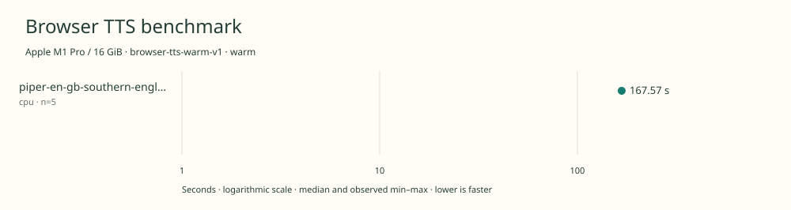

# 2026-11-09t07-33-26-519z-piper-en-gb-southern-english-female-low-cpu-warm-810f85a3

Apple M1 Pro / 16 GiB · Apple M1 Pro · Google Chrome 157.0.8103.39

Protocol: **browser-tts-warm-v1**, scenario **warm**. Native harness run.

First source-chunk request through final CPU-readable PCM; excludes initialization, validation, hashing, WAV encoding and save. Optional articleCallPeakRssBytes spans the entire browser call including post-timer validation/export.

| Model | Requested backend | Status | Median | Min–max | Runs |
|---|---|---|---:|---:|---:|
| piper-en-gb-southern-english-female-low | cpu | measured | 167.57 s | 167.19–167.97 s | 5 |

Additional metrics (median of available observations; scopes are distinct):

| Model | Backend | Metric | Median | Unit | n |
|---|---|---|---:|---|---:|
| piper-en-gb-southern-english-female-low | cpu | First completed source chunk | 1782.930 | ms | 5 |
| piper-en-gb-southern-english-female-low | cpu | First PCM block | 1782.920 | ms | 5 |
| piper-en-gb-southern-english-female-low | cpu | Generated audio | 1054.352 | s | 5 |
| piper-en-gb-southern-english-female-low | cpu | Generation / audio duration | 0.159 | ratio | 5 |

- **piper-en-gb-southern-english-female-low / cpu**: Explicit ONNX Runtime Web WASM provider with one thread; eSpeak preprocessing and synthesis run locally in the Chrome worker.

Capability checks run separately before timing. GPU dispatch does not imply GPU-exclusive execution.

Raw WAV stays local and is not part of automatic submission.

AC attached. Pre-run load averages 1.40, 1.48, 1.60; pmset recorded no thermal or performance warning. Host blocked ps/top access; coordinator reported no other benchmark active.

Different protocols, fixtures, settings or machines must not be pooled into a speedup ranking. This report does not rate speech quality.
