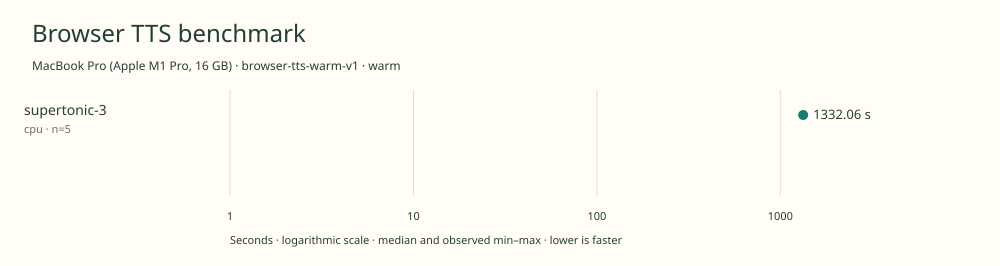

# 2026-11-10t07-43-34-755z-supertonic-3-cpu-warm-a07fded0

MacBook Pro (Apple M1 Pro, 16 GB) · Apple M1 Pro · Google Chrome 157.0.8103.39

Protocol: **browser-tts-warm-v1**, scenario **warm**. Native harness run.

First source-chunk request through final CPU-readable PCM; excludes initialization, validation, hashing, WAV encoding and save. Optional articleCallPeakRssBytes spans the entire browser call including post-timer validation/export.

| Model | Requested backend | Status | Median | Min–max | Runs |
|---|---|---|---:|---:|---:|
| supertonic-3 | cpu | measured | 1332.06 s | 1330.80–1332.17 s | 5 |

Additional metrics (median of available observations; scopes are distinct):

| Model | Backend | Metric | Median | Unit | n |
|---|---|---|---:|---|---:|
| supertonic-3 | cpu | First completed source chunk | 13963.815 | ms | 5 |
| supertonic-3 | cpu | First PCM block | 13963.810 | ms | 5 |
| supertonic-3 | cpu | Generated audio | 1126.721 | s | 5 |
| supertonic-3 | cpu | Generation / audio duration | 1.182 | ratio | 5 |

Model support (catalog capability, not coverage of this run):

| Model | Supported voices | Bundled voices | Languages | Tested voice |
|---|---:|---:|---|---|
| supertonic-3 | 10 | 1 | 31 | M3 (Robert) |

Pinned Supertonic 3 checkpoint and ten supplied preset voice styles. Ten supplied presets F1–F5 and M1–M5; only M3 \(Robert\) is staged and tested in English. Language-agnostic mode na is not an additional language. Custom voice profiles are outside this preset count. Eight denoising steps and effective speed 1.05 match the linked demo defaults \(UI speed 1.0\). Sources: [1](https://huggingface.co/Supertone/supertonic-3/blob/3cadd1ee6394adea1bd021217a0e650ede09a323/README.md), [2](https://huggingface.co/Supertone/supertonic-3/tree/3cadd1ee6394adea1bd021217a0e650ede09a323/voice_styles), [3](https://huggingface.co/spaces/Supertone/supertonic-3/blob/4402acca094e2ff2b3dff446e0bf915f3fccc462/script.js).

- **supertonic-3 / cpu**: Explicit one-thread ONNX Runtime Web WASM provider; model text processing runs in the Chrome worker.

Capability checks run separately before timing. GPU dispatch does not imply GPU-exclusive execution.

Raw WAV is saved locally; opt-in audio publication is separate from timing and automatic result submission.

AC power; CPU first, then WebGPU; pre-run load average 1.05/1.37/1.52 with aggregate sampled process CPU 14.1%; ambient temperature and thermal state not instrumented; power settings unchanged.

Different protocols, fixtures, settings or machines must not be pooled into a speedup ranking. This report does not rate speech quality.
