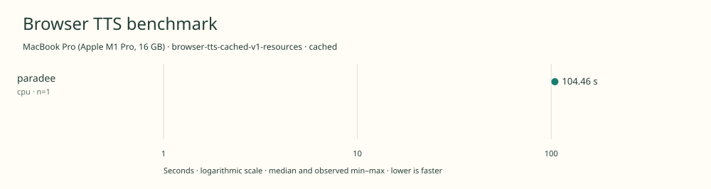

# 2026-11-10t12-13-43-130z-paradee-cpu-cached-becd1b05

MacBook Pro (Apple M1 Pro, 16 GB) · Apple M1 Pro · Google Chrome 157.0.8103.39

Protocol: **browser-tts-cached-v1-resources**, scenario **cached**. Native harness run.

First source-chunk request through final CPU-readable PCM; excludes initialization, validation, hashing, WAV encoding and save. Optional articleCallPeakRssBytes spans the entire browser call including post-timer validation/export. Generation RSS uses timestamped samples inside browser generation start/end boundaries; it includes the owned Chrome process tree and browser baseline.

| Model | Requested backend | Status | Median | Min–max | Runs |
|---|---|---|---:|---:|---:|
| paradee | cpu | measured | 104.46 s | 104.46–104.46 s | 1 |

Additional metrics (median of available observations; scopes are distinct):

| Model | Backend | Metric | Median | Unit | n |
|---|---|---|---:|---|---:|
| paradee | cpu | First completed source chunk | 1545.385 | ms | 1 |
| paradee | cpu | First PCM block | 1545.375 | ms | 1 |
| paradee | cpu | Generated audio | 1287.350 | s | 1 |
| paradee | cpu | Generation / audio duration | 0.081 | ratio | 1 |
| paradee | cpu | Model initialization | 481.739 | ms | 1 |
| paradee | cpu | Complete controller trial including setup/export | 108798.837 | ms | 1 |
| paradee | cpu | Transferred HTTP body data | 38404 | bytes | 1 |
| paradee | cpu | Ideal body transfer at 1 Mbps | 0.307 | s | 1 |
| paradee | cpu | Whole-call Chrome process-tree peak RSS | 1664581632 | bytes | 1 |
| paradee | cpu | Per-trial mean generation Chrome process-tree RSS | 1317827584 | bytes | 1 |
| paradee | cpu | In-window Chrome RSS observations | 208.000 | samples | 1 |

Model support (catalog capability, not coverage of this run):

| Model | Supported voices | Bundled voices | Languages | Tested voice |
|---|---:|---:|---|---|
| paradee | 4 | 4 | 1 (en) | af_heart |

Pinned benchmark checkpoint. Four embedded voices: af\_heart, bf\_isabella, am\_puck, bm\_fable. Only af\_heart is benchmarked. Accents are not separate languages. Sources: [1](https://huggingface.co/sahilmahendrakar/Paradee-8M-v1.2/raw/ed2934d4df8a4fd891e29584c5e1104649409765/README.md), [2](https://huggingface.co/sahilmahendrakar/Paradee-8M-v1.2/resolve/ed2934d4df8a4fd891e29584c5e1104649409765/config.json).

- **paradee / cpu**: Explicit single-thread ONNX WASM provider.

Capability checks run separately before timing. GPU dispatch does not imply GPU-exclusive execution.

Raw WAV is saved locally; opt-in audio publication is separate from timing and automatic result submission.

Dedicated one-tab Chrome RAM diagnostic; AC power; sequential run; normal user background apps remain; no thermal instrumentation; timings are resource diagnostics, not warm scores. This first retry uses a local APFS clone of verified assets after the initial cache symlink failed server path confinement.

RSS is sampled every 500 ms across the owned Chrome process tree, including the Chrome baseline and inference workers. Whole-call peak spans post-timer validation/export; generation mean uses only in-window samples from browser generation start through final CPU-readable PCM.

Different protocols, fixtures, settings or machines must not be pooled into a speedup ranking. This report does not rate speech quality.
