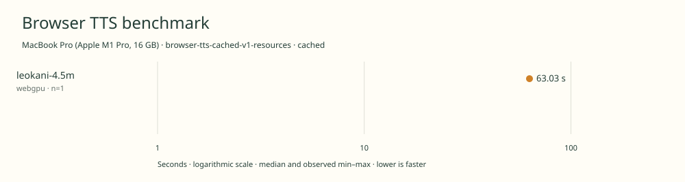

# 2026-11-10t12-20-20-070z-leokani-4.5m-webgpu-cached-2527e2cc

MacBook Pro (Apple M1 Pro, 16 GB) · Apple M1 Pro · Google Chrome 157.0.8103.39

Protocol: **browser-tts-cached-v1-resources**, scenario **cached**. Native harness run.

First source-chunk request through final CPU-readable PCM; excludes initialization, validation, hashing, WAV encoding and save. Optional articleCallPeakRssBytes spans the entire browser call including post-timer validation/export. Generation RSS uses timestamped samples inside browser generation start/end boundaries; it includes the owned Chrome process tree and browser baseline.

| Model | Requested backend | Status | Median | Min–max | Runs |
|---|---|---|---:|---:|---:|
| leokani-4.5m | webgpu | measured | 63.03 s | 63.03–63.03 s | 1 |

Additional metrics (median of available observations; scopes are distinct):

| Model | Backend | Metric | Median | Unit | n |
|---|---|---|---:|---|---:|
| leokani-4.5m | webgpu | First completed source chunk | 850.025 | ms | 1 |
| leokani-4.5m | webgpu | First PCM block | 850.015 | ms | 1 |
| leokani-4.5m | webgpu | Generated audio | 1400.275 | s | 1 |
| leokani-4.5m | webgpu | Generation / audio duration | 0.045 | ratio | 1 |
| leokani-4.5m | webgpu | Model initialization | 1644.208 | ms | 1 |
| leokani-4.5m | webgpu | Complete controller trial including setup/export | 68760.343 | ms | 1 |
| leokani-4.5m | webgpu | Transferred HTTP body data | 38404 | bytes | 1 |
| leokani-4.5m | webgpu | Ideal body transfer at 1 Mbps | 0.307 | s | 1 |
| leokani-4.5m | webgpu | Whole-call Chrome process-tree peak RSS | 2633957376 | bytes | 1 |
| leokani-4.5m | webgpu | Per-trial mean generation Chrome process-tree RSS | 2321357079 | bytes | 1 |
| leokani-4.5m | webgpu | In-window Chrome RSS observations | 125.000 | samples | 1 |

Model support (catalog capability, not coverage of this run):

| Model | Supported voices | Bundled voices | Languages | Tested voice |
|---|---:|---:|---|---|
| leokani-4.5m | 1 | 1 | 1 (en) | default |

Pinned benchmark checkpoint. One female American English voice, Dala; the 7M and 4.5M checkpoints share the voice. Sources: [1](https://huggingface.co/milliwattlabs/leokani-tts-4.5M/raw/d9eb742dfb6567872fe451d559674ec42c32e6c8/README.md).

- **leokani-4.5m / webgpu**: Observed 5028 compute dispatches in a separate utterance. WebGPU TTS with WASM fallback; CPU G2P and JavaScript iSTFT. Hooks removed before timing.

Capability checks run separately before timing. GPU dispatch does not imply GPU-exclusive execution.

Raw WAV is saved locally; opt-in audio publication is separate from timing and automatic result submission.

Dedicated one-tab Chrome RAM diagnostic; AC power; sequential run; normal user background apps remain; no thermal instrumentation; timings are resource diagnostics, not warm scores.

RSS is sampled every 500 ms across the owned Chrome process tree, including the Chrome baseline and inference workers. Whole-call peak spans post-timer validation/export; generation mean uses only in-window samples from browser generation start through final CPU-readable PCM.

Different protocols, fixtures, settings or machines must not be pooled into a speedup ranking. This report does not rate speech quality.
