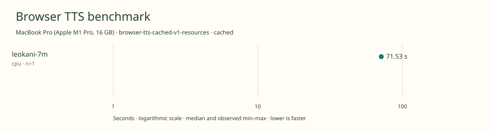

# 2026-11-10t12-21-33-736z-leokani-7m-cpu-cached-05654530

MacBook Pro (Apple M1 Pro, 16 GB) · Apple M1 Pro · Google Chrome 157.0.8103.39

Protocol: **browser-tts-cached-v1-resources**, scenario **cached**. Native harness run.

First source-chunk request through final CPU-readable PCM; excludes initialization, validation, hashing, WAV encoding and save. Optional articleCallPeakRssBytes spans the entire browser call including post-timer validation/export. Generation RSS uses timestamped samples inside browser generation start/end boundaries; it includes the owned Chrome process tree and browser baseline.

| Model | Requested backend | Status | Median | Min–max | Runs |
|---|---|---|---:|---:|---:|
| leokani-7m | cpu | measured | 71.53 s | 71.53–71.53 s | 1 |

Additional metrics (median of available observations; scopes are distinct):

| Model | Backend | Metric | Median | Unit | n |
|---|---|---|---:|---|---:|
| leokani-7m | cpu | First completed source chunk | 843.190 | ms | 1 |
| leokani-7m | cpu | First PCM block | 843.175 | ms | 1 |
| leokani-7m | cpu | Generated audio | 1401.025 | s | 1 |
| leokani-7m | cpu | Generation / audio duration | 0.051 | ratio | 1 |
| leokani-7m | cpu | Model initialization | 1189.057 | ms | 1 |
| leokani-7m | cpu | Complete controller trial including setup/export | 76641.773 | ms | 1 |
| leokani-7m | cpu | Transferred HTTP body data | 38404 | bytes | 1 |
| leokani-7m | cpu | Ideal body transfer at 1 Mbps | 0.307 | s | 1 |
| leokani-7m | cpu | Whole-call Chrome process-tree peak RSS | 2121957376 | bytes | 1 |
| leokani-7m | cpu | Per-trial mean generation Chrome process-tree RSS | 1424718718 | bytes | 1 |
| leokani-7m | cpu | In-window Chrome RSS observations | 142.000 | samples | 1 |

Model support (catalog capability, not coverage of this run):

| Model | Supported voices | Bundled voices | Languages | Tested voice |
|---|---:|---:|---|---|
| leokani-7m | 1 | 1 | 1 (en) | default |

Pinned benchmark checkpoint. One female American English voice; no other voice is exposed by this checkpoint. Sources: [1](https://huggingface.co/milliwattlabs/leokani-tts-7M/raw/ba0beb24f7b124dc1eb297ffc28d01db892462bd/README.md).

- **leokani-7m / cpu**: Explicit single-thread WASM TTS and G2P; JavaScript iSTFT.

Capability checks run separately before timing. GPU dispatch does not imply GPU-exclusive execution.

Raw WAV is saved locally; opt-in audio publication is separate from timing and automatic result submission.

Dedicated one-tab Chrome RAM diagnostic; AC power; sequential run; normal user background apps remain; no thermal instrumentation; timings are resource diagnostics, not warm scores.

RSS is sampled every 500 ms across the owned Chrome process tree, including the Chrome baseline and inference workers. Whole-call peak spans post-timer validation/export; generation mean uses only in-window samples from browser generation start through final CPU-readable PCM.

Different protocols, fixtures, settings or machines must not be pooled into a speedup ranking. This report does not rate speech quality.
