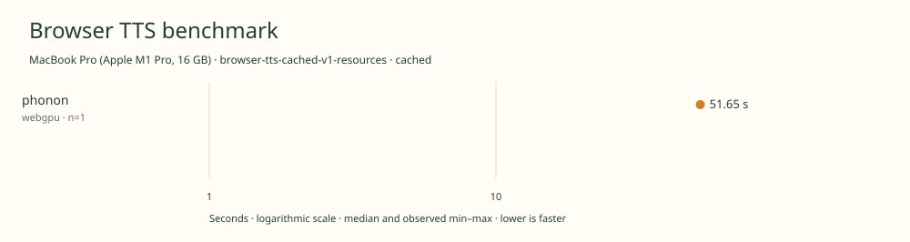

# 2026-11-10t12-28-29-585z-phonon-webgpu-cached-4f21d78e

MacBook Pro (Apple M1 Pro, 16 GB) · Apple M1 Pro · Google Chrome 157.0.8103.39

Protocol: **browser-tts-cached-v1-resources**, scenario **cached**. Native harness run.

First source-chunk request through final CPU-readable PCM; excludes initialization, validation, hashing, WAV encoding and save. Optional articleCallPeakRssBytes spans the entire browser call including post-timer validation/export. Generation RSS uses timestamped samples inside browser generation start/end boundaries; it includes the owned Chrome process tree and browser baseline.

| Model | Requested backend | Status | Median | Min–max | Runs |
|---|---|---|---:|---:|---:|
| phonon | webgpu | measured | 51.65 s | 51.65–51.65 s | 1 |

Additional metrics (median of available observations; scopes are distinct):

| Model | Backend | Metric | Median | Unit | n |
|---|---|---|---:|---|---:|
| phonon | webgpu | First completed source chunk | 662.360 | ms | 1 |
| phonon | webgpu | First PCM block | 38.295 | ms | 1 |
| phonon | webgpu | Generated audio | 1219.360 | s | 1 |
| phonon | webgpu | Generation / audio duration | 0.042 | ratio | 1 |
| phonon | webgpu | Model initialization | 290.847 | ms | 1 |
| phonon | webgpu | Complete controller trial including setup/export | 55558.448 | ms | 1 |
| phonon | webgpu | Transferred HTTP body data | 38404 | bytes | 1 |
| phonon | webgpu | Ideal body transfer at 1 Mbps | 0.307 | s | 1 |
| phonon | webgpu | Whole-call Chrome process-tree peak RSS | 1982218240 | bytes | 1 |
| phonon | webgpu | Per-trial mean generation Chrome process-tree RSS | 1268298451 | bytes | 1 |
| phonon | webgpu | In-window Chrome RSS observations | 102.000 | samples | 1 |

Model support (catalog capability, not coverage of this run):

| Model | Supported voices | Bundled voices | Languages | Tested voice |
|---|---:|---:|---|---|
| phonon | 102 | 1 | 1 (en) | default |

Pinned benchmark checkpoint plus separately pinned compatible voice catalog. 102 embeddings in the separately pinned official catalog; only default is staged and benchmarked. Voice catalog locales do not expand this English checkpoint language support. Sources: [1](https://huggingface.co/gradium/phonon-31m-en/raw/92741c5b07d085ff840e26fea8ce43110b87852f/README.md), [2](https://huggingface.co/gradium/phonon-voices/resolve/0ee17205f254b5abc43b266c8a0f215565c352f7/voices.jsonl).

- **phonon / webgpu**: Observed 68845 WebGPU compute dispatches during a separate untimed utterance; hooks were removed before measured generation.

Capability checks run separately before timing. GPU dispatch does not imply GPU-exclusive execution.

Raw WAV is saved locally; opt-in audio publication is separate from timing and automatic result submission.

Dedicated one-tab Chrome RAM diagnostic; AC power; sequential run; normal user background apps remain; no thermal instrumentation; timings are resource diagnostics, not warm scores.

RSS is sampled every 500 ms across the owned Chrome process tree, including the Chrome baseline and inference workers. Whole-call peak spans post-timer validation/export; generation mean uses only in-window samples from browser generation start through final CPU-readable PCM.

Different protocols, fixtures, settings or machines must not be pooled into a speedup ranking. This report does not rate speech quality.
