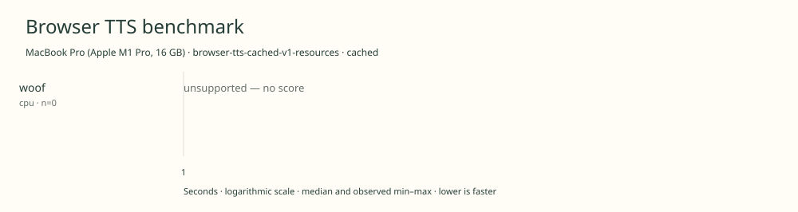

# 2026-11-10t12-29-27-973z-woof-cpu-cached-0c9a58d8

MacBook Pro (Apple M1 Pro, 16 GB) · Apple M1 Pro · Google Chrome 157.0.8103.39

Protocol: **browser-tts-cached-v1-resources**, scenario **cached**. Native harness run.

First source-chunk request through final CPU-readable PCM; excludes initialization, validation, hashing, WAV encoding and save. Optional articleCallPeakRssBytes spans the entire browser call including post-timer validation/export. Generation RSS uses timestamped samples inside browser generation start/end boundaries; it includes the owned Chrome process tree and browser baseline.

| Model | Requested backend | Status | Median | Min–max | Runs |
|---|---|---|---:|---:|---:|
| woof | cpu | unsupported | — | — | 0 |

Model support (catalog capability, not coverage of this run):

| Model | Supported voices | Bundled voices | Languages | Tested voice |
|---|---:|---:|---|---|
| woof | 1 | 1 | 1 (en) | Isla |

Pinned benchmark checkpoint. The pinned browser one-voice case uses Isla. The separate two-voice Juno/Mira release is not this measured case. Sources: [1](https://huggingface.co/ConwayResearch/Underdog-Woof/raw/be702960539777fc3f698e54335276a8391b00f9/README.md), [2](https://github.com/ngelik/browser-tts-benchmark/blob/8dae4a37e61e662037fd73a58c7254e1dac9dd89/web/workers/woof.mjs).

- **woof / cpu**: Woof is pinned to its WebGPU execution path. Woof is pinned to its WebGPU execution path.

Capability checks run separately before timing. GPU dispatch does not imply GPU-exclusive execution.

Raw WAV is saved locally; opt-in audio publication is separate from timing and automatic result submission.

Dedicated one-tab Chrome RAM diagnostic; AC power; sequential run; normal user background apps remain; no thermal instrumentation; timings are resource diagnostics, not warm scores.

RSS is sampled every 500 ms across the owned Chrome process tree, including the Chrome baseline and inference workers. Whole-call peak spans post-timer validation/export; generation mean uses only in-window samples from browser generation start through final CPU-readable PCM.

Different protocols, fixtures, settings or machines must not be pooled into a speedup ranking. This report does not rate speech quality.
