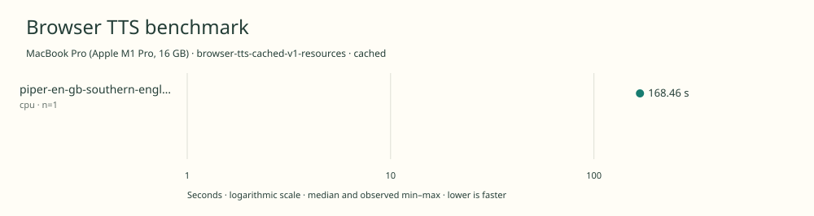

# 2026-11-10t12-32-39-591z-piper-en-gb-southern-english-female-low-cpu-cached-fff0c4ea

MacBook Pro (Apple M1 Pro, 16 GB) · Apple M1 Pro · Google Chrome 157.0.8103.39

Protocol: **browser-tts-cached-v1-resources**, scenario **cached**. Native harness run.

First source-chunk request through final CPU-readable PCM; excludes initialization, validation, hashing, WAV encoding and save. Optional articleCallPeakRssBytes spans the entire browser call including post-timer validation/export. Generation RSS uses timestamped samples inside browser generation start/end boundaries; it includes the owned Chrome process tree and browser baseline.

| Model | Requested backend | Status | Median | Min–max | Runs |
|---|---|---|---:|---:|---:|
| piper-en-gb-southern-english-female-low | cpu | measured | 168.46 s | 168.46–168.46 s | 1 |

Additional metrics (median of available observations; scopes are distinct):

| Model | Backend | Metric | Median | Unit | n |
|---|---|---|---:|---|---:|
| piper-en-gb-southern-english-female-low | cpu | First completed source chunk | 1874.795 | ms | 1 |
| piper-en-gb-southern-english-female-low | cpu | First PCM block | 1874.785 | ms | 1 |
| piper-en-gb-southern-english-female-low | cpu | Generated audio | 1050.640 | s | 1 |
| piper-en-gb-southern-english-female-low | cpu | Generation / audio duration | 0.160 | ratio | 1 |
| piper-en-gb-southern-english-female-low | cpu | Model initialization | 1011.806 | ms | 1 |
| piper-en-gb-southern-english-female-low | cpu | Complete controller trial including setup/export | 171823.162 | ms | 1 |
| piper-en-gb-southern-english-female-low | cpu | Transferred HTTP body data | 38404 | bytes | 1 |
| piper-en-gb-southern-english-female-low | cpu | Ideal body transfer at 1 Mbps | 0.307 | s | 1 |
| piper-en-gb-southern-english-female-low | cpu | Whole-call Chrome process-tree peak RSS | 1822146560 | bytes | 1 |
| piper-en-gb-southern-english-female-low | cpu | Per-trial mean generation Chrome process-tree RSS | 1384047790 | bytes | 1 |
| piper-en-gb-southern-english-female-low | cpu | In-window Chrome RSS observations | 335.000 | samples | 1 |

Model support (catalog capability, not coverage of this run):

| Model | Supported voices | Bundled voices | Languages | Tested voice |
|---|---:|---:|---|---|
| piper-en-gb-southern-english-female-low | 1 | 1 | 1 (en) | en_GB-southern_english_female-low (single speaker) |

Pinned benchmark checkpoint. One British English speaker in this checkpoint. The broader Piper voice repository contains other independent models and languages; they are not included in this count. Sources: [1](https://huggingface.co/rhasspy/piper-voices/resolve/e7229f7d33a10e145e109b886d661984201ac3c4/en/en_GB/southern_english_female/low/en_GB-southern_english_female-low.onnx.json), [2](https://huggingface.co/rhasspy/piper-voices/raw/e7229f7d33a10e145e109b886d661984201ac3c4/en/en_GB/southern_english_female/low/MODEL_CARD).

- **piper-en-gb-southern-english-female-low / cpu**: Explicit ONNX Runtime Web WASM provider with one thread; eSpeak preprocessing and synthesis run locally in the Chrome worker.

Capability checks run separately before timing. GPU dispatch does not imply GPU-exclusive execution.

Raw WAV is saved locally; opt-in audio publication is separate from timing and automatic result submission.

Dedicated one-tab Chrome RAM diagnostic; AC power; sequential run; normal user background apps remain; no thermal instrumentation; timings are resource diagnostics, not warm scores.

RSS is sampled every 500 ms across the owned Chrome process tree, including the Chrome baseline and inference workers. Whole-call peak spans post-timer validation/export; generation mean uses only in-window samples from browser generation start through final CPU-readable PCM.

Different protocols, fixtures, settings or machines must not be pooled into a speedup ranking. This report does not rate speech quality.
