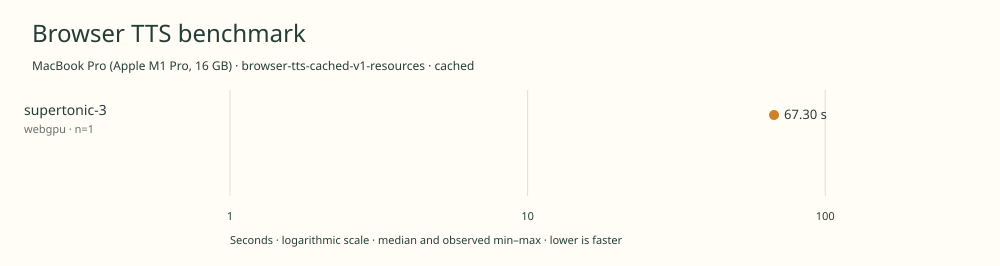

# 2026-11-10t12-35-56-902z-supertonic-3-webgpu-cached-3af494cf

MacBook Pro (Apple M1 Pro, 16 GB) · Apple M1 Pro · Google Chrome 157.0.8103.39

Protocol: **browser-tts-cached-v1-resources**, scenario **cached**. Native harness run.

First source-chunk request through final CPU-readable PCM; excludes initialization, validation, hashing, WAV encoding and save. Optional articleCallPeakRssBytes spans the entire browser call including post-timer validation/export. Generation RSS uses timestamped samples inside browser generation start/end boundaries; it includes the owned Chrome process tree and browser baseline.

| Model | Requested backend | Status | Median | Min–max | Runs |
|---|---|---|---:|---:|---:|
| supertonic-3 | webgpu | measured | 67.30 s | 67.30–67.30 s | 1 |

Additional metrics (median of available observations; scopes are distinct):

| Model | Backend | Metric | Median | Unit | n |
|---|---|---|---:|---|---:|
| supertonic-3 | webgpu | First completed source chunk | 812.055 | ms | 1 |
| supertonic-3 | webgpu | First PCM block | 812.040 | ms | 1 |
| supertonic-3 | webgpu | Generated audio | 1126.720 | s | 1 |
| supertonic-3 | webgpu | Generation / audio duration | 0.060 | ratio | 1 |
| supertonic-3 | webgpu | Model initialization | 1804.945 | ms | 1 |
| supertonic-3 | webgpu | Complete controller trial including setup/export | 74891.615 | ms | 1 |
| supertonic-3 | webgpu | Transferred HTTP body data | 256573185 | bytes | 1 |
| supertonic-3 | webgpu | Ideal body transfer at 1 Mbps | 2052.585 | s | 1 |
| supertonic-3 | webgpu | Whole-call Chrome process-tree peak RSS | 3130261504 | bytes | 1 |
| supertonic-3 | webgpu | Per-trial mean generation Chrome process-tree RSS | 2506275397 | bytes | 1 |
| supertonic-3 | webgpu | In-window Chrome RSS observations | 134.000 | samples | 1 |

Model support (catalog capability, not coverage of this run):

| Model | Supported voices | Bundled voices | Languages | Tested voice |
|---|---:|---:|---|---|
| supertonic-3 | 10 | 1 | 31 | M3 (Robert) |

Pinned Supertonic 3 checkpoint and ten supplied preset voice styles. Ten supplied presets F1–F5 and M1–M5; only M3 \(Robert\) is staged and tested in English. Language-agnostic mode na is not an additional language. Custom voice profiles are outside this preset count. Eight denoising steps and effective speed 1.05 match the linked demo defaults \(UI speed 1.0\). Sources: [1](https://huggingface.co/Supertone/supertonic-3/blob/3cadd1ee6394adea1bd021217a0e650ede09a323/README.md), [2](https://huggingface.co/Supertone/supertonic-3/tree/3cadd1ee6394adea1bd021217a0e650ede09a323/voice_styles), [3](https://huggingface.co/spaces/Supertone/supertonic-3/blob/4402acca094e2ff2b3dff446e0bf915f3fccc462/script.js).

- **supertonic-3 / webgpu**: Observed 8014 WebGPU compute dispatches in a separate untimed synthesis. WebGPU + WASM operator fallback; CPU text processing. Hooks were removed before timed generation.

Capability checks run separately before timing. GPU dispatch does not imply GPU-exclusive execution.

Raw WAV is saved locally; opt-in audio publication is separate from timing and automatic result submission.

Dedicated one-tab Chrome RAM diagnostic; AC power; sequential run; normal user background apps remain; no thermal instrumentation; timings are resource diagnostics, not warm scores.

RSS is sampled every 500 ms across the owned Chrome process tree, including the Chrome baseline and inference workers. Whole-call peak spans post-timer validation/export; generation mean uses only in-window samples from browser generation start through final CPU-readable PCM.

Different protocols, fixtures, settings or machines must not be pooled into a speedup ranking. This report does not rate speech quality.
