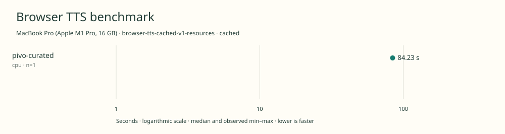

# 2026-11-10t12-59-54-018z-pivo-curated-cpu-cached-60e6cfd6

MacBook Pro (Apple M1 Pro, 16 GB) · Apple M1 Pro · Google Chrome 157.0.8103.39

Protocol: **browser-tts-cached-v1-resources**, scenario **cached**. Native harness run.

First source-chunk request through final CPU-readable PCM; excludes initialization, validation, hashing, WAV encoding and save. Optional articleCallPeakRssBytes spans the entire browser call including post-timer validation/export. Generation RSS uses timestamped samples inside browser generation start/end boundaries; it includes the owned Chrome process tree and browser baseline.

| Model | Requested backend | Status | Median | Min–max | Runs |
|---|---|---|---:|---:|---:|
| pivo-curated | cpu | measured | 84.23 s | 84.23–84.23 s | 1 |

Additional metrics (median of available observations; scopes are distinct):

| Model | Backend | Metric | Median | Unit | n |
|---|---|---|---:|---|---:|
| pivo-curated | cpu | First completed source chunk | 1053.630 | ms | 1 |
| pivo-curated | cpu | First PCM block | 67.770 | ms | 1 |
| pivo-curated | cpu | Generated audio | 1189.530 | s | 1 |
| pivo-curated | cpu | Generation / audio duration | 0.071 | ratio | 1 |
| pivo-curated | cpu | Model initialization | 382.301 | ms | 1 |
| pivo-curated | cpu | Complete controller trial including setup/export | 87159.872 | ms | 1 |
| pivo-curated | cpu | Transferred HTTP body data | 38404 | bytes | 1 |
| pivo-curated | cpu | Ideal body transfer at 1 Mbps | 0.307 | s | 1 |
| pivo-curated | cpu | Whole-call Chrome process-tree peak RSS | 1571340288 | bytes | 1 |
| pivo-curated | cpu | Per-trial mean generation Chrome process-tree RSS | 1143255800 | bytes | 1 |
| pivo-curated | cpu | In-window Chrome RSS observations | 167.000 | samples | 1 |

Model support (catalog capability, not coverage of this run):

| Model | Supported voices | Bundled voices | Languages | Tested voice |
|---|---:|---:|---|---|
| pivo-curated | 2 | 2 | 1 (en) | Pi |

Pinned benchmark checkpoint. Two embedded voices, Pi and Vo; this adapter benchmarks Pi only. Sources: [1](https://huggingface.co/empero-ai/PiVo-1.4M/raw/515d84fc3420da6ae138f1b81017fcbc24d622a8/README.md).

- **pivo-curated / cpu**: The cpu provider produced finite PiVo PCM in an untimed compatibility probe.

Capability checks run separately before timing. GPU dispatch does not imply GPU-exclusive execution.

Raw WAV is saved locally; opt-in audio publication is separate from timing and automatic result submission.

Dedicated one-tab Chrome RAM diagnostic; AC power; sequential run; normal user background apps remain; no thermal instrumentation; timings are resource diagnostics, not warm scores.

RSS is sampled every 500 ms across the owned Chrome process tree, including the Chrome baseline and inference workers. Whole-call peak spans post-timer validation/export; generation mean uses only in-window samples from browser generation start through final CPU-readable PCM.

Different protocols, fixtures, settings or machines must not be pooled into a speedup ranking. This report does not rate speech quality.
