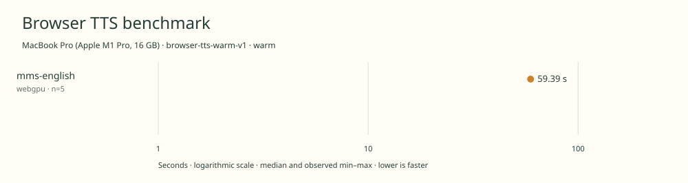

# 2026-11-10t17-46-17-830z-mms-english-webgpu-warm-3eb8b06a

MacBook Pro (Apple M1 Pro, 16 GB) · Apple M1 Pro · Google Chrome 157.0.8103.40

Protocol: **browser-tts-warm-v1**, scenario **warm**. Native harness run.

First source-chunk request through final CPU-readable PCM; excludes initialization, validation, hashing, WAV encoding and save. Optional articleCallPeakRssBytes spans the entire browser call including post-timer validation/export.

| Model | Requested backend | Status | Median | Min–max | Runs |
|---|---|---|---:|---:|---:|
| mms-english | webgpu | measured | 59.39 s | 58.73–59.80 s | 5 |

Additional metrics (median of available observations; scopes are distinct):

| Model | Backend | Metric | Median | Unit | n |
|---|---|---|---:|---|---:|
| mms-english | webgpu | First completed source chunk | 748.345 | ms | 5 |
| mms-english | webgpu | First PCM block | 748.345 | ms | 5 |
| mms-english | webgpu | Generated audio | 1274.960 | s | 5 |
| mms-english | webgpu | Generation / audio duration | 0.047 | ratio | 5 |

Model support (catalog capability, not coverage of this run):

| Model | Supported voices | Bundled voices | Languages | Tested voice |
|---|---:|---:|---|---|
| mms-english | 1 | 1 | 1 (en) | English fixed voice |

Pinned English checkpoint, not the wider multilingual MMS family. Single English speaker. Official Xenova ONNX export removes training-only weights. Benchmark spells out numeric tokens before the official grapheme tokenizer to avoid dropping digits absent from its vocabulary. Sources: [1](https://huggingface.co/facebook/mms-tts-eng/blob/c71de0fe7204c83f1c10820a7d696d0b450048ba/README.md).

- **mms-english / webgpu**: Observed 1766 dispatches in separate untimed synthesis. CPU tokenization and possible WASM operators; CPU-readable output. Hooks removed before timing.

Capability checks run separately before timing. GPU dispatch does not imply GPU-exclusive execution.

Raw WAV is saved locally; opt-in audio publication is separate from timing and automatic result submission.

Campaign 2026-11-10T15-16-09-103Z-2e95f2b088d2; cell 4/25; source 955a87683c0c899cc299161a7b8b127fb75617be; AC attached; native arm64; 8 CPU cores and 16 GiB RAM. Headed Chrome, disposable profiles, sequential inference. Ordinary user applications remain open; owned caffeinate -di assertion for campaign lifetime; no persistent system power settings changed; temperature not instrumented.

Different protocols, fixtures, settings or machines must not be pooled into a speedup ranking. This report does not rate speech quality.
