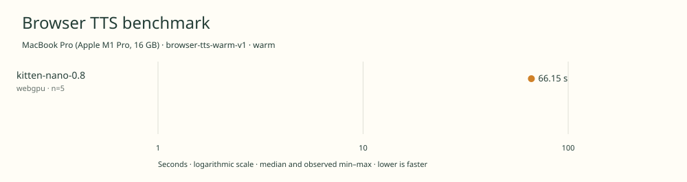

# 2026-11-10t19-24-19-116z-kitten-nano-0.8-webgpu-warm-cef85ae4

MacBook Pro (Apple M1 Pro, 16 GB) · Apple M1 Pro · Google Chrome 157.0.8103.40

Protocol: **browser-tts-warm-v1**, scenario **warm**. Native harness run.

First source-chunk request through final CPU-readable PCM; excludes initialization, validation, hashing, WAV encoding and save. Optional articleCallPeakRssBytes spans the entire browser call including post-timer validation/export.

| Model | Requested backend | Status | Median | Min–max | Runs |
|---|---|---|---:|---:|---:|
| kitten-nano-0.8 | webgpu | measured | 66.15 s | 66.01–66.31 s | 5 |

Additional metrics (median of available observations; scopes are distinct):

| Model | Backend | Metric | Median | Unit | n |
|---|---|---|---:|---|---:|
| kitten-nano-0.8 | webgpu | First completed source chunk | 772.120 | ms | 5 |
| kitten-nano-0.8 | webgpu | First PCM block | 772.110 | ms | 5 |
| kitten-nano-0.8 | webgpu | Generated audio | 2007.075 | s | 5 |
| kitten-nano-0.8 | webgpu | Generation / audio duration | 0.033 | ratio | 5 |

Model support (catalog capability, not coverage of this run):

| Model | Supported voices | Bundled voices | Languages | Tested voice |
|---|---:|---:|---|---|
| kitten-nano-0.8 | 8 | 8 | 1 (en) | Bella (expr-voice-2-f) |

Pinned Kitten Nano 0.8 checkpoint and supplied voice archive. Eight preset voices; all styles bundled in voices.npz. Only Bella is tested. Official clean\_text=false path with browser eSpeak and strict token mapping; no silent unknown-symbol skips. Sources: [1](https://huggingface.co/KittenML/kitten-tts-nano-0.8-fp32/blob/e73cfb095bd949c786ccdcf3b8ab04eb36c47442/config.json).

- **kitten-nano-0.8 / webgpu**: Observed 1543 dispatches during separate untimed synthesis. WebGPU with WASM operator fallback; CPU eSpeak preprocessing and PCM readback. Hooks removed before timing.

Capability checks run separately before timing. GPU dispatch does not imply GPU-exclusive execution.

Raw WAV is saved locally; opt-in audio publication is separate from timing and automatic result submission.

Campaign 2026-11-10T15-16-09-103Z-2e95f2b088d2; cell 6/25; source 955a87683c0c899cc299161a7b8b127fb75617be; AC attached; native arm64; 8 CPU cores and 16 GiB RAM. Headed Chrome, disposable profiles, sequential inference. Ordinary user applications remain open; owned caffeinate -di assertion for campaign lifetime; no persistent system power settings changed; temperature not instrumented.

Different protocols, fixtures, settings or machines must not be pooled into a speedup ranking. This report does not rate speech quality.
