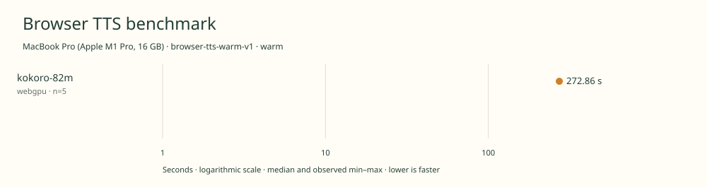

# 2026-11-11t02-22-33-290z-kokoro-82m-webgpu-warm-58b6b9b7

MacBook Pro (Apple M1 Pro, 16 GB) · Apple M1 Pro · Google Chrome 157.0.8103.40

Protocol: **browser-tts-warm-v1**, scenario **warm**. Native harness run.

First source-chunk request through final CPU-readable PCM; excludes initialization, validation, hashing, WAV encoding and save. Optional articleCallPeakRssBytes spans the entire browser call including post-timer validation/export.

| Model | Requested backend | Status | Median | Min–max | Runs |
|---|---|---|---:|---:|---:|
| kokoro-82m | webgpu | measured | 272.86 s | 271.87–273.12 s | 5 |

Additional metrics (median of available observations; scopes are distinct):

| Model | Backend | Metric | Median | Unit | n |
|---|---|---|---:|---|---:|
| kokoro-82m | webgpu | First completed source chunk | 3158.405 | ms | 5 |
| kokoro-82m | webgpu | First PCM block | 3157.900 | ms | 5 |
| kokoro-82m | webgpu | Generated audio | 1302.450 | s | 5 |
| kokoro-82m | webgpu | Generation / audio duration | 0.210 | ratio | 5 |

Model support (catalog capability, not coverage of this run):

| Model | Supported voices | Bundled voices | Languages | Tested voice |
|---|---:|---:|---|---|
| kokoro-82m | 54 | 1 | 8 | af_heart |

Kokoro v1.0 model catalog; English browser runtime exercised. 54 named preset voices across 8 languages \(English has US/GB accents\). The export also contains a legacy af.bin alias, not a distinct named catalog voice. Official JS 1.2.1 exposes 28 English voices; only af\_heart is staged and tested. Sources: [1](https://huggingface.co/hexgrad/Kokoro-82M/blob/f3ff3571791e39611d31c381e3a41a3af07b4987/VOICES.md).

- **kokoro-82m / webgpu**: Observed 2088 dispatches in separate untimed synthesis. CPU preprocessing and possible WASM operators; CPU-readable output. Hooks removed before timing.

Capability checks run separately before timing. GPU dispatch does not imply GPU-exclusive execution.

Raw WAV is saved locally; opt-in audio publication is separate from timing and automatic result submission.

Campaign 2026-11-10T15-16-09-103Z-2e95f2b088d2; cell 9/25; source 955a87683c0c899cc299161a7b8b127fb75617be; AC attached; native arm64; 8 CPU cores and 16 GiB RAM. Headed Chrome, disposable profiles, sequential inference. Ordinary user applications remain open; owned caffeinate -di assertion for campaign lifetime; no persistent system power settings changed; temperature not instrumented.

Different protocols, fixtures, settings or machines must not be pooled into a speedup ranking. This report does not rate speech quality.
