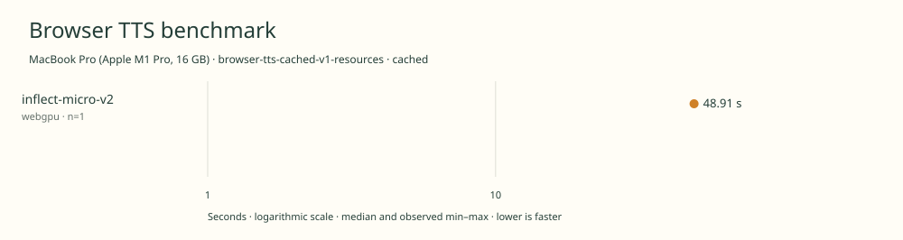

# 2026-11-11t02-55-05-893z-inflect-micro-v2-webgpu-cached-51e2acf0

MacBook Pro (Apple M1 Pro, 16 GB) · Apple M1 Pro · Google Chrome 157.0.8103.40

Protocol: **browser-tts-cached-v1-resources**, scenario **cached**. Native harness run.

First source-chunk request through final CPU-readable PCM; excludes initialization, validation, hashing, WAV encoding and save. Optional articleCallPeakRssBytes spans the entire browser call including post-timer validation/export. Generation RSS uses timestamped samples inside browser generation start/end boundaries; it includes the owned Chrome process tree and browser baseline.

| Model | Requested backend | Status | Median | Min–max | Runs |
|---|---|---|---:|---:|---:|
| inflect-micro-v2 | webgpu | measured | 48.91 s | 48.91–48.91 s | 1 |

Additional metrics (median of available observations; scopes are distinct):

| Model | Backend | Metric | Median | Unit | n |
|---|---|---|---:|---|---:|
| inflect-micro-v2 | webgpu | First completed source chunk | 794.365 | ms | 1 |
| inflect-micro-v2 | webgpu | First PCM block | 794.355 | ms | 1 |
| inflect-micro-v2 | webgpu | Generated audio | 1224.771 | s | 1 |
| inflect-micro-v2 | webgpu | Generation / audio duration | 0.040 | ratio | 1 |
| inflect-micro-v2 | webgpu | Model initialization | 610.992 | ms | 1 |
| inflect-micro-v2 | webgpu | Complete controller trial including setup/export | 53012.466 | ms | 1 |
| inflect-micro-v2 | webgpu | Transferred HTTP body data | 38404 | bytes | 1 |
| inflect-micro-v2 | webgpu | Ideal body transfer at 1 Mbps | 0.307 | s | 1 |
| inflect-micro-v2 | webgpu | Whole-call Chrome process-tree peak RSS | 2540929024 | bytes | 1 |
| inflect-micro-v2 | webgpu | Per-trial mean generation Chrome process-tree RSS | 2060208445 | bytes | 1 |
| inflect-micro-v2 | webgpu | In-window Chrome RSS observations | 97.000 | samples | 1 |

Model support (catalog capability, not coverage of this run):

| Model | Supported voices | Bundled voices | Languages | Tested voice |
|---|---:|---:|---|---|
| inflect-micro-v2 | 1 | 1 | 1 (en) | English (single speaker; eSpeak en-us) |

Pinned Inflect Micro v2 complete English checkpoint and official FP32 ONNX export. One fixed synthetic English voice; no reference recording or voice-cloning model required. 9,356,513 deployable parameters including waveform decoder. Browser port uses a disclosed seeded JavaScript normal-noise generator rather than NumPy bitwise parity. Sources: [1](https://huggingface.co/owensong/Inflect-Micro-v2-ONNX/blob/91b1ab6432323064ec0e8e9704d92fcecd24855f/README.md), [2](https://huggingface.co/owensong/Inflect-Micro-v2-ONNX/blob/91b1ab6432323064ec0e8e9704d92fcecd24855f/onnx/SOURCE.json), [3](https://huggingface.co/owensong/Inflect-Micro-v2/blob/9d862840734dcc53afb5d27ef468459daad020fa/README.md).

- **inflect-micro-v2 / webgpu**: Observed 2250 WebGPU dispatches in untimed duration and decoder inference; final waveform was read back to CPU. WASM fallback may execute unsupported operators. Hooks removed before timing.

Capability checks run separately before timing. GPU dispatch does not imply GPU-exclusive execution.

Raw WAV is saved locally; opt-in audio publication is separate from timing and automatic result submission.

Campaign 2026-11-10T15-16-09-103Z-2e95f2b088d2; cell 11/25; source 955a87683c0c899cc299161a7b8b127fb75617be; AC attached; native arm64; 8 CPU cores and 16 GiB RAM. Headed Chrome, disposable profiles, sequential inference. Ordinary user applications remain open; owned caffeinate -di assertion for campaign lifetime; no persistent system power settings changed; temperature not instrumented.

RSS is sampled every 500 ms across the owned Chrome process tree, including the Chrome baseline and inference workers. Whole-call peak spans post-timer validation/export; generation mean uses only in-window samples from browser generation start through final CPU-readable PCM.

Different protocols, fixtures, settings or machines must not be pooled into a speedup ranking. This report does not rate speech quality.
