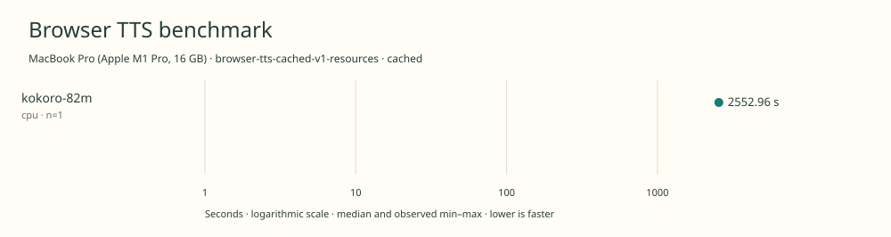

# 2026-11-11t03-00-52-961z-kokoro-82m-cpu-cached-9b2283f1

MacBook Pro (Apple M1 Pro, 16 GB) · Apple M1 Pro · Google Chrome 157.0.8103.40

Protocol: **browser-tts-cached-v1-resources**, scenario **cached**. Native harness run.

First source-chunk request through final CPU-readable PCM; excludes initialization, validation, hashing, WAV encoding and save. Optional articleCallPeakRssBytes spans the entire browser call including post-timer validation/export. Generation RSS uses timestamped samples inside browser generation start/end boundaries; it includes the owned Chrome process tree and browser baseline.

| Model | Requested backend | Status | Median | Min–max | Runs |
|---|---|---|---:|---:|---:|
| kokoro-82m | cpu | measured | 2552.96 s | 2552.96–2552.96 s | 1 |

Additional metrics (median of available observations; scopes are distinct):

| Model | Backend | Metric | Median | Unit | n |
|---|---|---|---:|---|---:|
| kokoro-82m | cpu | First completed source chunk | 29584.300 | ms | 1 |
| kokoro-82m | cpu | First PCM block | 29584.285 | ms | 1 |
| kokoro-82m | cpu | Generated audio | 1302.450 | s | 1 |
| kokoro-82m | cpu | Generation / audio duration | 1.960 | ratio | 1 |
| kokoro-82m | cpu | Model initialization | 1126.439 | ms | 1 |
| kokoro-82m | cpu | Complete controller trial including setup/export | 2557869.887 | ms | 1 |
| kokoro-82m | cpu | Transferred HTTP body data | 38404 | bytes | 1 |
| kokoro-82m | cpu | Ideal body transfer at 1 Mbps | 0.307 | s | 1 |
| kokoro-82m | cpu | Whole-call Chrome process-tree peak RSS | 2989391872 | bytes | 1 |
| kokoro-82m | cpu | Per-trial mean generation Chrome process-tree RSS | 2293737373 | bytes | 1 |
| kokoro-82m | cpu | In-window Chrome RSS observations | 5086.000 | samples | 1 |

Model support (catalog capability, not coverage of this run):

| Model | Supported voices | Bundled voices | Languages | Tested voice |
|---|---:|---:|---|---|
| kokoro-82m | 54 | 1 | 8 | af_heart |

Kokoro v1.0 model catalog; English browser runtime exercised. 54 named preset voices across 8 languages \(English has US/GB accents\). The export also contains a legacy af.bin alias, not a distinct named catalog voice. Official JS 1.2.1 exposes 28 English voices; only af\_heart is staged and tested. Sources: [1](https://huggingface.co/hexgrad/Kokoro-82M/blob/f3ff3571791e39611d31c381e3a41a3af07b4987/VOICES.md).

- **kokoro-82m / cpu**: Explicit single-thread WASM provider.

Capability checks run separately before timing. GPU dispatch does not imply GPU-exclusive execution.

Raw WAV is saved locally; opt-in audio publication is separate from timing and automatic result submission.

Campaign 2026-11-10T15-16-09-103Z-2e95f2b088d2; cell 13/25; source 955a87683c0c899cc299161a7b8b127fb75617be; AC attached; native arm64; 8 CPU cores and 16 GiB RAM. Headed Chrome, disposable profiles, sequential inference. Ordinary user applications remain open; owned caffeinate -di assertion for campaign lifetime; no persistent system power settings changed; temperature not instrumented.

RSS is sampled every 500 ms across the owned Chrome process tree, including the Chrome baseline and inference workers. Whole-call peak spans post-timer validation/export; generation mean uses only in-window samples from browser generation start through final CPU-readable PCM.

Different protocols, fixtures, settings or machines must not be pooled into a speedup ranking. This report does not rate speech quality.
