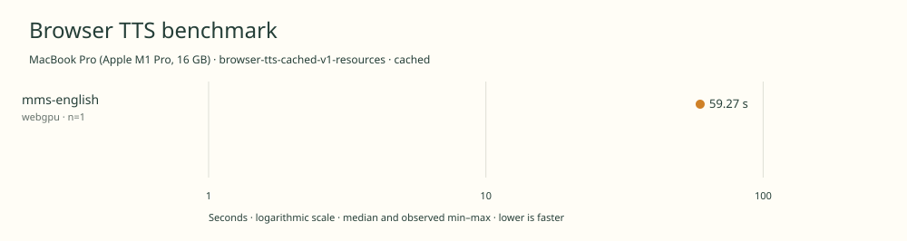

# 2026-11-11t04-27-23-653z-mms-english-webgpu-cached-6aa1e983

MacBook Pro (Apple M1 Pro, 16 GB) · Apple M1 Pro · Google Chrome 157.0.8103.40

Protocol: **browser-tts-cached-v1-resources**, scenario **cached**. Native harness run.

First source-chunk request through final CPU-readable PCM; excludes initialization, validation, hashing, WAV encoding and save. Optional articleCallPeakRssBytes spans the entire browser call including post-timer validation/export. Generation RSS uses timestamped samples inside browser generation start/end boundaries; it includes the owned Chrome process tree and browser baseline.

| Model | Requested backend | Status | Median | Min–max | Runs |
|---|---|---|---:|---:|---:|
| mms-english | webgpu | measured | 59.27 s | 59.27–59.27 s | 1 |

Additional metrics (median of available observations; scopes are distinct):

| Model | Backend | Metric | Median | Unit | n |
|---|---|---|---:|---|---:|
| mms-english | webgpu | First completed source chunk | 813.360 | ms | 1 |
| mms-english | webgpu | First PCM block | 813.355 | ms | 1 |
| mms-english | webgpu | Generated audio | 1275.504 | s | 1 |
| mms-english | webgpu | Generation / audio duration | 0.046 | ratio | 1 |
| mms-english | webgpu | Model initialization | 1085.600 | ms | 1 |
| mms-english | webgpu | Complete controller trial including setup/export | 63040.628 | ms | 1 |
| mms-english | webgpu | Transferred HTTP body data | 38404 | bytes | 1 |
| mms-english | webgpu | Ideal body transfer at 1 Mbps | 0.307 | s | 1 |
| mms-english | webgpu | Whole-call Chrome process-tree peak RSS | 2746318848 | bytes | 1 |
| mms-english | webgpu | Per-trial mean generation Chrome process-tree RSS | 2303137063 | bytes | 1 |
| mms-english | webgpu | In-window Chrome RSS observations | 118.000 | samples | 1 |

Model support (catalog capability, not coverage of this run):

| Model | Supported voices | Bundled voices | Languages | Tested voice |
|---|---:|---:|---|---|
| mms-english | 1 | 1 | 1 (en) | English fixed voice |

Pinned English checkpoint, not the wider multilingual MMS family. Single English speaker. Official Xenova ONNX export removes training-only weights. Benchmark spells out numeric tokens before the official grapheme tokenizer to avoid dropping digits absent from its vocabulary. Sources: [1](https://huggingface.co/facebook/mms-tts-eng/blob/c71de0fe7204c83f1c10820a7d696d0b450048ba/README.md).

- **mms-english / webgpu**: Observed 1766 dispatches in separate untimed synthesis. CPU tokenization and possible WASM operators; CPU-readable output. Hooks removed before timing.

Capability checks run separately before timing. GPU dispatch does not imply GPU-exclusive execution.

Raw WAV is saved locally; opt-in audio publication is separate from timing and automatic result submission.

Campaign 2026-11-10T15-16-09-103Z-2e95f2b088d2; cell 17/25; source 955a87683c0c899cc299161a7b8b127fb75617be; AC attached; native arm64; 8 CPU cores and 16 GiB RAM. Headed Chrome, disposable profiles, sequential inference. Ordinary user applications remain open; owned caffeinate -di assertion for campaign lifetime; no persistent system power settings changed; temperature not instrumented.

RSS is sampled every 500 ms across the owned Chrome process tree, including the Chrome baseline and inference workers. Whole-call peak spans post-timer validation/export; generation mean uses only in-window samples from browser generation start through final CPU-readable PCM.

Different protocols, fixtures, settings or machines must not be pooled into a speedup ranking. This report does not rate speech quality.
