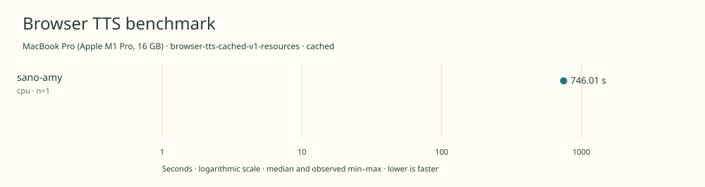

# 2026-11-11t04-28-31-035z-sano-amy-cpu-cached-c0371d1a

MacBook Pro (Apple M1 Pro, 16 GB) · Apple M1 Pro · Google Chrome 157.0.8103.40

Protocol: **browser-tts-cached-v1-resources**, scenario **cached**. Native harness run.

First source-chunk request through final CPU-readable PCM; excludes initialization, validation, hashing, WAV encoding and save. Optional articleCallPeakRssBytes spans the entire browser call including post-timer validation/export. Generation RSS uses timestamped samples inside browser generation start/end boundaries; it includes the owned Chrome process tree and browser baseline.

| Model | Requested backend | Status | Median | Min–max | Runs |
|---|---|---|---:|---:|---:|
| sano-amy | cpu | measured | 746.01 s | 746.01–746.01 s | 1 |

Additional metrics (median of available observations; scopes are distinct):

| Model | Backend | Metric | Median | Unit | n |
|---|---|---|---:|---|---:|
| sano-amy | cpu | First completed source chunk | 16821.985 | ms | 1 |
| sano-amy | cpu | First PCM block | 16821.975 | ms | 1 |
| sano-amy | cpu | Generated audio | 1202.945 | s | 1 |
| sano-amy | cpu | Generation / audio duration | 0.620 | ratio | 1 |
| sano-amy | cpu | Model initialization | 47.256 | ms | 1 |
| sano-amy | cpu | Complete controller trial including setup/export | 749320.164 | ms | 1 |
| sano-amy | cpu | Transferred HTTP body data | 38404 | bytes | 1 |
| sano-amy | cpu | Ideal body transfer at 1 Mbps | 0.307 | s | 1 |
| sano-amy | cpu | Whole-call Chrome process-tree peak RSS | 1616445440 | bytes | 1 |
| sano-amy | cpu | Per-trial mean generation Chrome process-tree RSS | 997527348 | bytes | 1 |
| sano-amy | cpu | In-window Chrome RSS observations | 1486.000 | samples | 1 |

Model support (catalog capability, not coverage of this run):

| Model | Supported voices | Bundled voices | Languages | Tested voice |
|---|---:|---:|---|---|
| sano-amy | 1 | 1 | 1 (en) | Amy (English, eSpeak en-us) |

Pinned Sano Amy 1.46M checkpoint and FP32 browser bundle only. Amy browser bundle uses the official en-us eSpeak frontend and synthesizes at 22,050 Hz. The broader Sano family supports additional voices and languages; they are outside this pinned checkpoint. Sources: [1](https://huggingface.co/ampixa/sanoTTS/blob/4a8194aa1dd958033ee449b3ad30c37e536b216e/amy-en-1p46m/README.md), [2](https://huggingface.co/ampixa/sanoTTS/blob/4a8194aa1dd958033ee449b3ad30c37e536b216e/web/voices/amy/meta.json).

- **sano-amy / cpu**: Official Sano Emscripten WebAssembly inference in a headed Chrome classic worker; an untimed CPU utterance passed; no GPU execution.

Capability checks run separately before timing. GPU dispatch does not imply GPU-exclusive execution.

Raw WAV is saved locally; opt-in audio publication is separate from timing and automatic result submission.

Campaign 2026-11-10T15-16-09-103Z-2e95f2b088d2; cell 18/25; source 955a87683c0c899cc299161a7b8b127fb75617be; AC attached; native arm64; 8 CPU cores and 16 GiB RAM. Headed Chrome, disposable profiles, sequential inference. Ordinary user applications remain open; owned caffeinate -di assertion for campaign lifetime; no persistent system power settings changed; temperature not instrumented.

RSS is sampled every 500 ms across the owned Chrome process tree, including the Chrome baseline and inference workers. Whole-call peak spans post-timer validation/export; generation mean uses only in-window samples from browser generation start through final CPU-readable PCM.

Different protocols, fixtures, settings or machines must not be pooled into a speedup ranking. This report does not rate speech quality.
