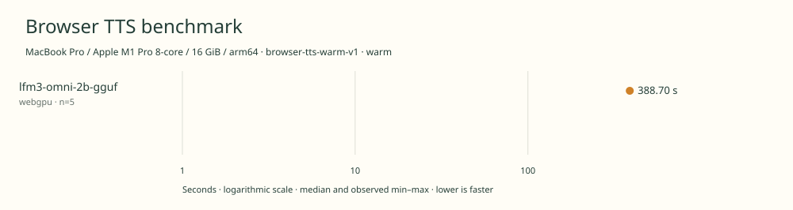

# 2026-11-11t08-11-31-864z-lfm3-omni-2b-gguf-webgpu-warm-0e07e4f7

MacBook Pro / Apple M1 Pro 8-core / 16 GiB / arm64 · Apple M1 Pro · Google Chrome 157.0.8103.40

Protocol: **browser-tts-warm-v1**, scenario **warm**. Native harness run.

First source-chunk request through final CPU-readable PCM; excludes initialization, validation, hashing, WAV encoding and save. Optional articleCallPeakRssBytes spans the entire browser call including post-timer validation/export.

| Model | Requested backend | Status | Median | Min–max | Runs |
|---|---|---|---:|---:|---:|
| lfm3-omni-2b-gguf | webgpu | measured | 388.70 s | 387.33–389.59 s | 5 |

Additional metrics (median of available observations; scopes are distinct):

| Model | Backend | Metric | Median | Unit | n |
|---|---|---|---:|---|---:|
| lfm3-omni-2b-gguf | webgpu | First completed source chunk | 4514.940 | ms | 5 |
| lfm3-omni-2b-gguf | webgpu | First PCM block | 447.110 | ms | 5 |
| lfm3-omni-2b-gguf | webgpu | Generated audio | 1366.960 | s | 5 |
| lfm3-omni-2b-gguf | webgpu | Generation / audio duration | 0.284 | ratio | 5 |

Model support (catalog capability, not coverage of this run):

| Model | Supported voices | Bundled voices | Languages | Tested voice |
|---|---:|---:|---|---|
| lfm3-omni-2b-gguf | Unknown | Unknown | 18 | American English female (prompted style; no fixed voice identifier) |

Pinned speech-generating checkpoint; TTS mode only. 18 spoken languages \(English has US and UK locales\). Female/male prompt controls do not establish a count of fixed voices. Benchmark selects American English female. Weight size includes complete pinned GGUF files, including modality components not exercised by TTS. Sources: [1](https://huggingface.co/LiquidAI/LFM3-Omni-2B), [2](https://www.liquid.ai/blog/lfm3).

- **lfm3-omni-2b-gguf / webgpu**: Observed 90359 WebGPU compute dispatches during untimed synthesis with finite CPU-readable PCM. Hooks removed before timing. CPU JavaScript handles tokenization and scheduling.

Capability checks run separately before timing. GPU dispatch does not imply GPU-exclusive execution.

Raw WAV is saved locally; opt-in audio publication is separate from timing and automatic result submission.

AC power; headed Google Chrome; sequential Liquid campaign: Audio GPU warm, Omni GPU warm, Audio cached memory, Omni cached memory. No cold-load checks. Normal user applications left running; no thermal or background-load isolation. Official runtime retains stochastic speech sampling. CPU Fusor q7 configurations use different weights and runtime.

Different protocols, fixtures, settings or machines must not be pooled into a speedup ranking. This report does not rate speech quality.
