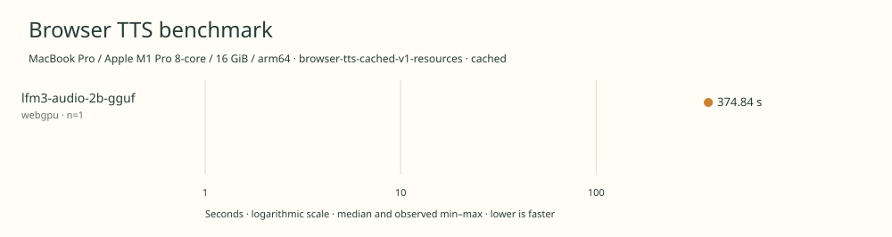

# 2026-11-11t08-50-49-901z-lfm3-audio-2b-gguf-webgpu-cached-ffbdd243

MacBook Pro / Apple M1 Pro 8-core / 16 GiB / arm64 · Apple M1 Pro · Google Chrome 157.0.8103.40

Protocol: **browser-tts-cached-v1-resources**, scenario **cached**. Native harness run.

First source-chunk request through final CPU-readable PCM; excludes initialization, validation, hashing, WAV encoding and save. Optional articleCallPeakRssBytes spans the entire browser call including post-timer validation/export. Generation RSS uses timestamped samples inside browser generation start/end boundaries; it includes the owned Chrome process tree and browser baseline.

| Model | Requested backend | Status | Median | Min–max | Runs |
|---|---|---|---:|---:|---:|
| lfm3-audio-2b-gguf | webgpu | measured | 374.84 s | 374.84–374.84 s | 1 |

Additional metrics (median of available observations; scopes are distinct):

| Model | Backend | Metric | Median | Unit | n |
|---|---|---|---:|---|---:|
| lfm3-audio-2b-gguf | webgpu | First completed source chunk | 4290.255 | ms | 1 |
| lfm3-audio-2b-gguf | webgpu | First PCM block | 497.130 | ms | 1 |
| lfm3-audio-2b-gguf | webgpu | Generated audio | 1316.000 | s | 1 |
| lfm3-audio-2b-gguf | webgpu | Generation / audio duration | 0.285 | ratio | 1 |
| lfm3-audio-2b-gguf | webgpu | Model initialization | 6194.484 | ms | 1 |
| lfm3-audio-2b-gguf | webgpu | Complete controller trial including setup/export | 384850.849 | ms | 1 |
| lfm3-audio-2b-gguf | webgpu | Transferred HTTP body data | 1413661804 | bytes | 1 |
| lfm3-audio-2b-gguf | webgpu | Ideal body transfer at 1 Mbps | 11309.294 | s | 1 |
| lfm3-audio-2b-gguf | webgpu | Whole-call Chrome process-tree peak RSS | 2637512704 | bytes | 1 |
| lfm3-audio-2b-gguf | webgpu | Per-trial mean generation Chrome process-tree RSS | 1878796927 | bytes | 1 |
| lfm3-audio-2b-gguf | webgpu | In-window Chrome RSS observations | 747.000 | samples | 1 |

Model support (catalog capability, not coverage of this run):

| Model | Supported voices | Bundled voices | Languages | Tested voice |
|---|---:|---:|---|---|
| lfm3-audio-2b-gguf | Unknown | Unknown | 18 | American English female (prompted style; no fixed voice identifier) |

Pinned speech-generating checkpoint; TTS mode only. 18 spoken languages \(English has US and UK locales\). Female/male prompt controls do not establish a count of fixed voices. Benchmark selects American English female. Weight size includes complete pinned GGUF files, including modality components not exercised by TTS. Sources: [1](https://huggingface.co/LiquidAI/LFM3-Audio-2B), [2](https://www.liquid.ai/blog/lfm3).

- **lfm3-audio-2b-gguf / webgpu**: Observed 82015 WebGPU compute dispatches during untimed synthesis with finite CPU-readable PCM. Hooks removed before timing. CPU JavaScript handles tokenization and scheduling.

Capability checks run separately before timing. GPU dispatch does not imply GPU-exclusive execution.

Raw WAV is saved locally; opt-in audio publication is separate from timing and automatic result submission.

AC power; headed Google Chrome; sequential Liquid campaign: Audio GPU warm, Omni GPU warm, Audio cached memory, Omni cached memory. No cold-load checks. Normal user applications left running; no thermal or background-load isolation. Official runtime retains stochastic speech sampling. CPU Fusor q7 configurations use different weights and runtime.

RSS is sampled every 500 ms across the owned Chrome process tree, including the Chrome baseline and inference workers. Whole-call peak spans post-timer validation/export; generation mean uses only in-window samples from browser generation start through final CPU-readable PCM.

Different protocols, fixtures, settings or machines must not be pooled into a speedup ranking. This report does not rate speech quality.
