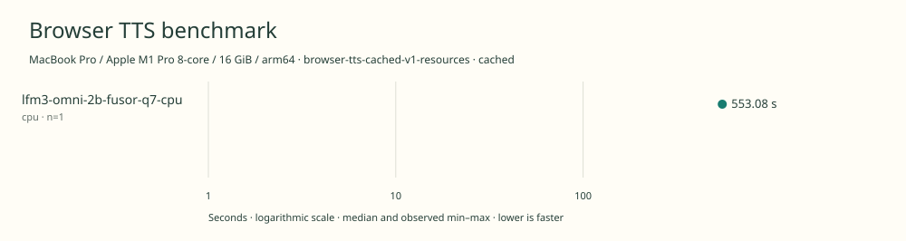

# 2026-11-11t11-57-01-791z-lfm3-omni-2b-fusor-q7-cpu-cpu-cached-42d33e30

MacBook Pro / Apple M1 Pro 8-core / 16 GiB / arm64 · Apple M1 Pro · Google Chrome 157.0.8103.40

Protocol: **browser-tts-cached-v1-resources**, scenario **cached**. Native harness run.

First source-chunk request through final CPU-readable PCM; excludes initialization, validation, hashing, WAV encoding and save. Optional articleCallPeakRssBytes spans the entire browser call including post-timer validation/export. Generation RSS uses timestamped samples inside browser generation start/end boundaries; it includes the owned Chrome process tree and browser baseline.

| Model | Requested backend | Status | Median | Min–max | Runs |
|---|---|---|---:|---:|---:|
| lfm3-omni-2b-fusor-q7-cpu | cpu | measured | 553.08 s | 553.08–553.08 s | 1 |

Additional metrics (median of available observations; scopes are distinct):

| Model | Backend | Metric | Median | Unit | n |
|---|---|---|---:|---|---:|
| lfm3-omni-2b-fusor-q7-cpu | cpu | First completed source chunk | 6985.505 | ms | 1 |
| lfm3-omni-2b-fusor-q7-cpu | cpu | First PCM block | 524.885 | ms | 1 |
| lfm3-omni-2b-fusor-q7-cpu | cpu | Generated audio | 1393.440 | s | 1 |
| lfm3-omni-2b-fusor-q7-cpu | cpu | Generation / audio duration | 0.397 | ratio | 1 |
| lfm3-omni-2b-fusor-q7-cpu | cpu | Model initialization | 4952.733 | ms | 1 |
| lfm3-omni-2b-fusor-q7-cpu | cpu | Complete controller trial including setup/export | 562215.395 | ms | 1 |
| lfm3-omni-2b-fusor-q7-cpu | cpu | Transferred HTTP body data | 2386952870 | bytes | 1 |
| lfm3-omni-2b-fusor-q7-cpu | cpu | Ideal body transfer at 1 Mbps | 19095.623 | s | 1 |
| lfm3-omni-2b-fusor-q7-cpu | cpu | Whole-call Chrome process-tree peak RSS | 4874829824 | bytes | 1 |
| lfm3-omni-2b-fusor-q7-cpu | cpu | Per-trial mean generation Chrome process-tree RSS | 4137227348 | bytes | 1 |
| lfm3-omni-2b-fusor-q7-cpu | cpu | In-window Chrome RSS observations | 1102.000 | samples | 1 |

Model support (catalog capability, not coverage of this run):

| Model | Supported voices | Bundled voices | Languages | Tested voice |
|---|---:|---:|---|---|
| lfm3-omni-2b-fusor-q7-cpu | Unknown | Unknown | 18 | American English female (prompted style; no fixed speaker ID) |

Pinned Fusor q7 browser bundle; 6 CPU threads; speech generation only. 18 spoken languages; English has US and UK locales. Male/female prompt controls do not establish a fixed-voice count. Only American English female is tested. Six-thread Fusor WASM q7 configuration; different weights/runtime/sampling from the official WebGPU GGUF configuration. Sources: [1](https://huggingface.co/LiquidAI/LFM3-Omni-2B), [2](https://www.liquid.ai/blog/lfm3), [3](https://huggingface.co/fusorlabs/lfm3-omni-2b-web/blob/09f4fc6ddbbb3cc6cd30f74b1e76cc894f4901f4/README.md), [4](https://huggingface.co/fusorlabs/lfm3-omni-2b-web/blob/09f4fc6ddbbb3cc6cd30f74b1e76cc894f4901f4/manifest.json).

- **lfm3-omni-2b-fusor-q7-cpu / cpu**: Explicit Fusor web-threaded-relaxed CPU runtime with 6 threads; separate untimed probe returned finite 24 kHz PCM. Probe excluded from timed synthesis.

Capability checks run separately before timing. GPU dispatch does not imply GPU-exclusive execution.

Raw WAV is saved locally; opt-in audio publication is separate from timing and automatic result submission.

AC power verified before run. Sequential headed Chrome; user applications left open. No overlapping inference or tests. Omni uses the reviewed HTTP-only loading fix after preserved pre-scoring OPFS loading failures; weights, neural runtime and speech settings unchanged. Six-thread q7 CPU is distinct from official GGUF WebGPU configuration. Different source cohort from prior Audio CPU. Cold-load checks excluded.

RSS is sampled every 500 ms across the owned Chrome process tree, including the Chrome baseline and inference workers. Whole-call peak spans post-timer validation/export; generation mean uses only in-window samples from browser generation start through final CPU-readable PCM.

Different protocols, fixtures, settings or machines must not be pooled into a speedup ranking. This report does not rate speech quality.
