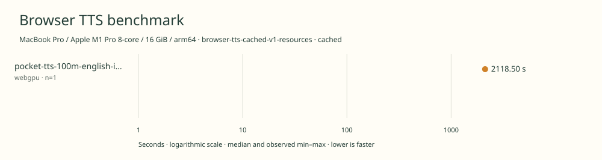

# 2026-11-12t07-18-18-704z-pocket-tts-100m-english-int8-webgpu-cached-1bbe1503

MacBook Pro / Apple M1 Pro 8-core / 16 GiB / arm64 · Apple M1 Pro · Google Chrome 157.0.8103.40

Protocol: **browser-tts-cached-v1-resources**, scenario **cached**. Native harness run.

First source-chunk request through final CPU-readable PCM; excludes initialization, validation, hashing, WAV encoding and save. Optional articleCallPeakRssBytes spans the entire browser call including post-timer validation/export. Generation RSS uses timestamped samples inside browser generation start/end boundaries; it includes the owned Chrome process tree and browser baseline.

| Model | Requested backend | Status | Median | Min–max | Runs |
|---|---|---|---:|---:|---:|
| pocket-tts-100m-english-int8 | webgpu | measured | 2118.50 s | 2118.50–2118.50 s | 1 |

Additional metrics (median of available observations; scopes are distinct):

| Model | Backend | Metric | Median | Unit | n |
|---|---|---|---:|---|---:|
| pocket-tts-100m-english-int8 | webgpu | First completed source chunk | 28516.560 | ms | 1 |
| pocket-tts-100m-english-int8 | webgpu | First PCM block | 981.815 | ms | 1 |
| pocket-tts-100m-english-int8 | webgpu | Generated audio | 1095.410 | s | 1 |
| pocket-tts-100m-english-int8 | webgpu | Generation / audio duration | 1.934 | ratio | 1 |
| pocket-tts-100m-english-int8 | webgpu | Model initialization | 1481.211 | ms | 1 |
| pocket-tts-100m-english-int8 | webgpu | Complete controller trial including setup/export | 2123414.645 | ms | 1 |
| pocket-tts-100m-english-int8 | webgpu | Transferred HTTP body data | 38404 | bytes | 1 |
| pocket-tts-100m-english-int8 | webgpu | Ideal body transfer at 1 Mbps | 0.307 | s | 1 |
| pocket-tts-100m-english-int8 | webgpu | Whole-call Chrome process-tree peak RSS | 2756640768 | bytes | 1 |
| pocket-tts-100m-english-int8 | webgpu | Per-trial mean generation Chrome process-tree RSS | 2135244548 | bytes | 1 |
| pocket-tts-100m-english-int8 | webgpu | In-window Chrome RSS observations | 4223.000 | samples | 1 |

Model support (catalog capability, not coverage of this run):

| Model | Supported voices | Bundled voices | Languages | Tested voice |
|---|---:|---:|---|---|
| pocket-tts-100m-english-int8 | 8 | 8 | 1 (en) | alba |

Selected english\_2026-04 checkpoint with eight bundled preset voices; not the broader multilingual family. Alba, Azelma, Cosette, Eponine, Fantine, Javert, Jean and Marius are bundled; only alba in English is measured. This is the original approximately 100M Pocket family, not the newer 18.2M model. A pinned community ONNX/browser implementation is used. Sources: [1](https://huggingface.co/KevinAHM/pocket-tts-onnx/tree/58a6d00cf13d239b6748cb0769f35c580a8f606c), [2](https://huggingface.co/spaces/KevinAHM/pocket-tts-web/tree/d0c0c79b7712256a32d691c67f20b8ae2e020d00), [3](https://huggingface.co/KevinAHM/pocket-tts-onnx/blob/58a6d00cf13d239b6748cb0769f35c580a8f606c/onnx/english_2026-04/bundle.json).

- **pocket-tts-100m-english-int8 / webgpu**: Observed 111434 WebGPU compute dispatches in separate untimed Pocket TTS synthesis; WebGPU with WASM fallback. Hooks removed before scored generation.

Capability checks run separately before timing. GPU dispatch does not imply GPU-exclusive execution.

Raw WAV is saved locally; opt-in audio publication is separate from timing and automatic result submission.

Screenshot campaign mach-pocket-2026-11-11-v1; cell order mach-boom/cpu, pocket-tts-100m-english-int8/webgpu, pocket-tts-100m-english-int8/cpu, mach-boom/webgpu; sequential headed Chrome on AC power. Other user apps left open; no controlled thermal stabilization or universal performance claim. Process-scoped idle-sleep prevention is active. No dedicated cold-load check. Separate single-article generation RSS diagnostic after warm campaign.

RSS is sampled every 500 ms across the owned Chrome process tree, including the Chrome baseline and inference workers. Whole-call peak spans post-timer validation/export; generation mean uses only in-window samples from browser generation start through final CPU-readable PCM.

Different protocols, fixtures, settings or machines must not be pooled into a speedup ranking. This report does not rate speech quality.
