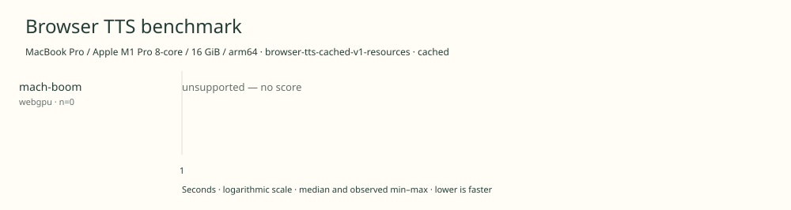

# 2026-11-12t08-08-33-241z-mach-boom-webgpu-cached-0aeac0ab

MacBook Pro / Apple M1 Pro 8-core / 16 GiB / arm64 · Apple M1 Pro · Google Chrome 157.0.8103.40

Protocol: **browser-tts-cached-v1-resources**, scenario **cached**. Native harness run.

First source-chunk request through final CPU-readable PCM; excludes initialization, validation, hashing, WAV encoding and save. Optional articleCallPeakRssBytes spans the entire browser call including post-timer validation/export. Generation RSS uses timestamped samples inside browser generation start/end boundaries; it includes the owned Chrome process tree and browser baseline.

| Model | Requested backend | Status | Median | Min–max | Runs |
|---|---|---|---:|---:|---:|
| mach-boom | webgpu | unsupported | — | — | 0 |

Model support (catalog capability, not coverage of this run):

| Model | Supported voices | Bundled voices | Languages | Tested voice |
|---|---:|---:|---|---|
| mach-boom | 4 | 1 | 1 (en) | Zoey |

Four named voices bundled upstream with this English checkpoint; Zoey staged for the benchmark. Zoey, Juniper, Everly and Harper are supplied upstream. Additional compatible Phonon voices are not counted here. Only Zoey in English is measured. Browser port uses CPU WebAssembly, not native x86 AMX/AVX. Sources: [1](https://huggingface.co/SyzygyResearch/Mach-Boom/blob/01860b06bdf8498761255ad1c64b99980b96486d/README.md), [2](https://huggingface.co/SyzygyResearch/Mach-Boom/blob/01860b06bdf8498761255ad1c64b99980b96486d/voices/voices.jsonl).

- **mach-boom / webgpu**: No GPU path is substituted or silently routed to CPU. Mach Boom ships CPU C/Python kernels; this browser port runs CPU WebAssembly and has no WebGPU inference implementation.

Capability checks run separately before timing. GPU dispatch does not imply GPU-exclusive execution.

Raw WAV is saved locally; opt-in audio publication is separate from timing and automatic result submission.

Screenshot campaign mach-pocket-2026-11-11-v1; cell order mach-boom/cpu, pocket-tts-100m-english-int8/webgpu, pocket-tts-100m-english-int8/cpu, mach-boom/webgpu; sequential headed Chrome on AC power. Other user apps left open; no controlled thermal stabilization or universal performance claim. Process-scoped idle-sleep prevention is active. No dedicated cold-load check. Separate single-article generation RSS diagnostic after warm campaign.

RSS is sampled every 500 ms across the owned Chrome process tree, including the Chrome baseline and inference workers. Whole-call peak spans post-timer validation/export; generation mean uses only in-window samples from browser generation start through final CPU-readable PCM.

Different protocols, fixtures, settings or machines must not be pooled into a speedup ranking. This report does not rate speech quality.
