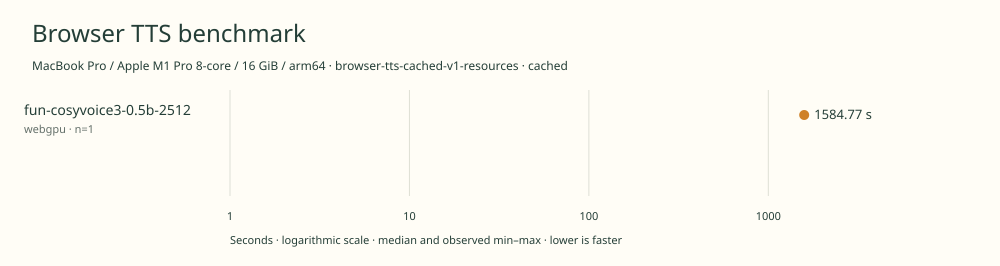

# 2026-11-14t15-12-11-363z-fun-cosyvoice3-0.5b-2512-webgpu-cached-168c91d4

MacBook Pro / Apple M1 Pro 8-core / 16 GiB / arm64 · Apple M1 Pro · Google Chrome 157.0.8103.40

Protocol: **browser-tts-cached-v1-resources**, scenario **cached**. Native harness run.

First source-chunk request through final CPU-readable PCM; excludes initialization, validation, hashing, WAV encoding and save. Optional articleCallPeakRssBytes spans the entire browser call including post-timer validation/export. Generation RSS uses timestamped samples inside browser generation start/end boundaries; it includes the owned Chrome process tree and browser baseline.

| Model | Requested backend | Status | Median | Min–max | Runs |
|---|---|---|---:|---:|---:|
| fun-cosyvoice3-0.5b-2512 | webgpu | measured | 1584.77 s | 1584.77–1584.77 s | 1 |

Additional metrics (median of available observations; scopes are distinct):

| Model | Backend | Metric | Median | Unit | n |
|---|---|---|---:|---|---:|
| fun-cosyvoice3-0.5b-2512 | webgpu | First completed source chunk | 18884.900 | ms | 1 |
| fun-cosyvoice3-0.5b-2512 | webgpu | First PCM block | 18884.825 | ms | 1 |
| fun-cosyvoice3-0.5b-2512 | webgpu | Generated audio | 1183.440 | s | 1 |
| fun-cosyvoice3-0.5b-2512 | webgpu | Generation / audio duration | 1.339 | ratio | 1 |
| fun-cosyvoice3-0.5b-2512 | webgpu | Model initialization | 5064.264 | ms | 1 |
| fun-cosyvoice3-0.5b-2512 | webgpu | Complete controller trial including setup/export | 1593464.384 | ms | 1 |
| fun-cosyvoice3-0.5b-2512 | webgpu | Transferred HTTP body data | 38404 | bytes | 1 |
| fun-cosyvoice3-0.5b-2512 | webgpu | Ideal body transfer at 1 Mbps | 0.307 | s | 1 |
| fun-cosyvoice3-0.5b-2512 | webgpu | Whole-call Chrome process-tree peak RSS | 3328458752 | bytes | 1 |
| fun-cosyvoice3-0.5b-2512 | webgpu | Per-trial mean generation Chrome process-tree RSS | 2706944678 | bytes | 1 |
| fun-cosyvoice3-0.5b-2512 | webgpu | In-window Chrome RSS observations | 3159.000 | samples | 1 |

Model support (catalog capability, not coverage of this run):

| Model | Supported voices | Bundled voices | Languages | Tested voice |
|---|---:|---:|---|---|
| fun-cosyvoice3-0.5b-2512 | Unknown | 1 | 9 | LibriTTS-R 4446 default |

Upstream multilingual checkpoint with zero-shot voice conditioning; pinned browser export bundles one English preset.. English measured using the supplied LibriTTS-R speaker 4446 features. Upstream also lists 18+ Chinese dialects separately from its nine languages. Total possible voices is open-ended. Sources: [1](https://huggingface.co/danyalmalik/Fun-CosyVoice3-0.5B-ONNX-WebGPU/blob/dcdb9df4bce4a47d318f5f8736de0b080efd944f/README.md), [2](https://huggingface.co/FunAudioLLM/Fun-CosyVoice3-0.5B-2512/blob/29e01c4e8d000f4bcd70751be16fa94bf3d85a18/README.md), [3](https://github.com/mdanyalmalik/quick-inf/blob/b50b3b8576f486d55fec5c366a0d8305a1fe8c41/src/runtime/speech/speech-engine.ts).

- **fun-cosyvoice3-0.5b-2512 / webgpu**: Observed 139208 WebGPU compute dispatches during a separate PCM probe; WASM fallback enabled.

Capability checks run separately before timing. GPU dispatch does not imply GPU-exclusive execution.

Raw WAV is saved locally; opt-in audio publication is separate from timing and automatic result submission.

English 20k November campaign. Sequential headed Chrome, AC power and one isolated benchmark tab. Predeclared backend order, no cold-load check. Separate generation-window RSS diagnostic.

RSS is sampled every 500 ms across the owned Chrome process tree, including the Chrome baseline and inference workers. Whole-call peak spans post-timer validation/export; generation mean uses only in-window samples from browser generation start through final CPU-readable PCM.

Different protocols, fixtures, settings or machines must not be pooled into a speedup ranking. This report does not rate speech quality.
