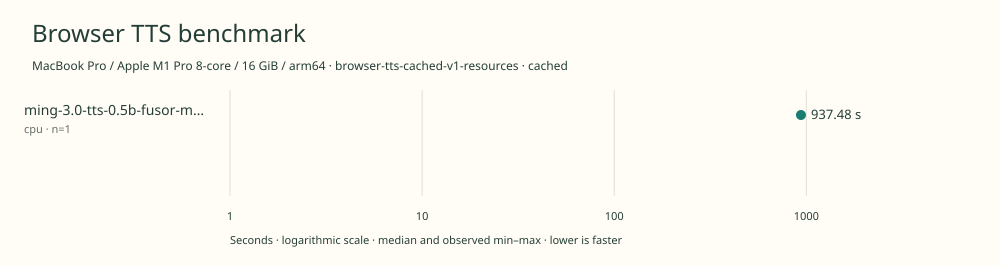

# 2026-11-14t19-30-24-576z-ming-3.0-tts-0.5b-fusor-mix-cpu-cpu-cached-40143301

MacBook Pro / Apple M1 Pro 8-core / 16 GiB / arm64 · Apple M1 Pro · Google Chrome 157.0.8103.40

Protocol: **browser-tts-cached-v1-resources**, scenario **cached**. Native harness run.

First source-chunk request through final CPU-readable PCM; excludes initialization, validation, hashing, WAV encoding and save. Optional articleCallPeakRssBytes spans the entire browser call including post-timer validation/export. Generation RSS uses timestamped samples inside browser generation start/end boundaries; it includes the owned Chrome process tree and browser baseline.

| Model | Requested backend | Status | Median | Min–max | Runs |
|---|---|---|---:|---:|---:|
| ming-3.0-tts-0.5b-fusor-mix-cpu | cpu | measured | 937.48 s | 937.48–937.48 s | 1 |

Additional metrics (median of available observations; scopes are distinct):

| Model | Backend | Metric | Median | Unit | n |
|---|---|---|---:|---|---:|
| ming-3.0-tts-0.5b-fusor-mix-cpu | cpu | First completed source chunk | 11497.345 | ms | 1 |
| ming-3.0-tts-0.5b-fusor-mix-cpu | cpu | First PCM block | 970.735 | ms | 1 |
| ming-3.0-tts-0.5b-fusor-mix-cpu | cpu | Generated audio | 1009.300 | s | 1 |
| ming-3.0-tts-0.5b-fusor-mix-cpu | cpu | Generation / audio duration | 0.929 | ratio | 1 |
| ming-3.0-tts-0.5b-fusor-mix-cpu | cpu | Model initialization | 1287.229 | ms | 1 |
| ming-3.0-tts-0.5b-fusor-mix-cpu | cpu | Complete controller trial including setup/export | 943805.389 | ms | 1 |
| ming-3.0-tts-0.5b-fusor-mix-cpu | cpu | Transferred HTTP body data | 38404 | bytes | 1 |
| ming-3.0-tts-0.5b-fusor-mix-cpu | cpu | Ideal body transfer at 1 Mbps | 0.307 | s | 1 |
| ming-3.0-tts-0.5b-fusor-mix-cpu | cpu | Whole-call Chrome process-tree peak RSS | 3048472576 | bytes | 1 |
| ming-3.0-tts-0.5b-fusor-mix-cpu | cpu | Per-trial mean generation Chrome process-tree RSS | 1882027554 | bytes | 1 |
| ming-3.0-tts-0.5b-fusor-mix-cpu | cpu | In-window Chrome RSS observations | 1868.000 | samples | 1 |

Model support (catalog capability, not coverage of this run):

| Model | Supported voices | Bundled voices | Languages | Tested voice |
|---|---:|---:|---|---|
| ming-3.0-tts-0.5b-fusor-mix-cpu | 117 | 7 | 7 | US_James (built-in US English male narrator) |

Named presets in the base Ming checkpoint cookbook. The Fusor browser runtime bundles seven and the benchmark selects US\_James.. Five English and two Chinese voice presets are enumerated by the pinned WASM voices\(\) export. The base checkpoint supports seven languages. Only English is evaluated. Sources: [1](https://github.com/inclusionAI/Ming-3.0-tts/blob/e999c39fa676722aaa9ea29b5aa19a90525b271f/cookbooks/instruction_en.md#built-in-premium-voices), [2](https://huggingface.co/fusorlabs/ming-3.0-tts-0.5b-web/blob/62588575d91dceb33822fe1e3925e748393c6b3e/README.md), [3](https://huggingface.co/spaces/fusorlabs/ming-wasm/tree/bdf46b41e966340f398fdd82d3ca64f4058ad892/engine/dist/web-threaded-relaxed), [4](https://github.com/fusor-rs/ming-wasm/blob/bcbcf268f6b32db48c075aec94f3b7ff59208085/README.md).

- **ming-3.0-tts-0.5b-fusor-mix-cpu / cpu**: Pinned Fusor web-threaded-relaxed WebAssembly runtime initialized with 6 compute threads. A separate untimed synthesis probe returned finite PCM.

Capability checks run separately before timing. GPU dispatch does not imply GPU-exclusive execution.

Raw WAV is saved locally; opt-in audio publication is separate from timing and automatic result submission.

English 20k November campaign. Sequential headed Chrome, AC power and one isolated benchmark tab. Predeclared backend order, no cold-load check. Separate generation-window RSS diagnostic.

RSS is sampled every 500 ms across the owned Chrome process tree, including the Chrome baseline and inference workers. Whole-call peak spans post-timer validation/export; generation mean uses only in-window samples from browser generation start through final CPU-readable PCM.

Different protocols, fixtures, settings or machines must not be pooled into a speedup ranking. This report does not rate speech quality.
