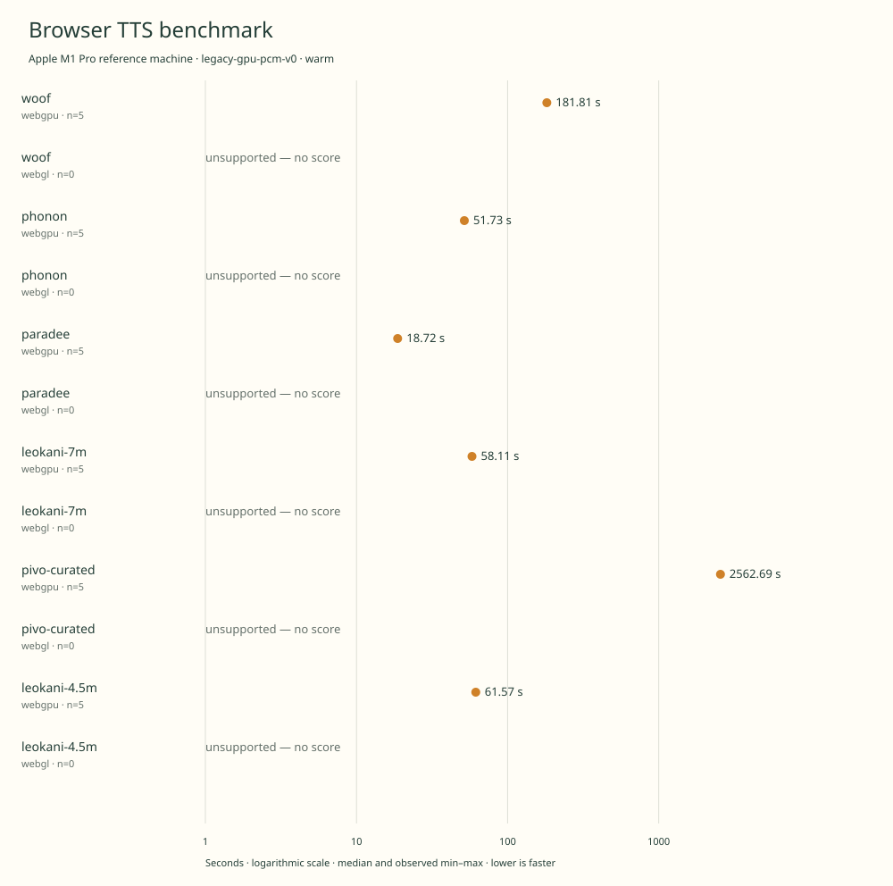

# historical-2026-11-08-m1pro-gpu-warm

Apple M1 Pro reference machine · Apple M1 Pro · Google Chrome 157.0.8103.39

Protocol: **legacy-gpu-pcm-v0**, scenario **warm**. Historical measurements imported from the original experiment.

First of 93 source-chunk requests through final CPU-readable PCM delivery. Loading, warm-up, PCM validation/hash, WAV encoding and saving are outside the timer.

| Model | Requested backend | Status | Median | Min–max | Runs |
|---|---|---|---:|---:|---:|
| woof | webgpu | measured | 181.81 s | 180.92–182.20 s | 5 |
| woof | webgl | unsupported | — | — | 0 |
| phonon | webgpu | measured | 51.73 s | 51.69–51.87 s | 5 |
| phonon | webgl | unsupported | — | — | 0 |
| paradee | webgpu | measured | 18.72 s | 18.66–18.81 s | 5 |
| paradee | webgl | unsupported | — | — | 0 |
| leokani-7m | webgpu | measured | 58.11 s | 57.31–58.43 s | 5 |
| leokani-7m | webgl | unsupported | — | — | 0 |
| pivo-curated | webgpu | measured | 2562.69 s | 2541.70–2563.14 s | 5 |
| pivo-curated | webgl | unsupported | — | — | 0 |
| leokani-4.5m | webgpu | measured | 61.57 s | 61.46–62.46 s | 5 |
| leokani-4.5m | webgl | unsupported | — | — | 0 |

- **woof / webgpu**: Actual GPU dispatch and finite PCM verified in a separate untimed synthesis probe. Timed workers have no dispatch instrumentation.
- **woof / webgl**: No WebGL path in the pinned official runtime. No WebGL path in the pinned official runtime.
- **phonon / webgpu**: Actual GPU dispatch and finite PCM verified in a separate untimed synthesis probe. Timed workers have no dispatch instrumentation.
- **phonon / webgl**: No WebGL path in the pinned official runtime. No WebGL path in the pinned official runtime.
- **paradee / webgpu**: Actual GPU dispatch and finite PCM verified in a separate untimed synthesis probe. Timed workers have no dispatch instrumentation.
- **paradee / webgl**: Pinned WebGL model loader rejected FLOAT16. Pinned WebGL model loader rejected FLOAT16.
- **leokani-7m / webgpu**: Actual GPU dispatch and finite PCM verified in a separate untimed synthesis probe. Timed workers have no dispatch instrumentation.
- **leokani-7m / webgl**: Pinned WebGL model loader rejected int64. Pinned WebGL model loader rejected int64.
- **pivo-curated / webgpu**: Actual GPU dispatch and finite PCM verified in a separate untimed synthesis probe. Timed workers have no dispatch instrumentation.
- **pivo-curated / webgl**: Pinned WebGL model loader rejected int64. Pinned WebGL model loader rejected int64.
- **leokani-4.5m / webgpu**: Actual GPU dispatch and finite PCM verified in a separate untimed synthesis probe. Timed workers have no dispatch instrumentation.
- **leokani-4.5m / webgl**: Pinned WebGL model loader rejected int64. Pinned WebGL model loader rejected int64.

Historical import; original private filesystem paths, browser profiles and logs are omitted. Source summary SHA-256 anchors the imported evidence.

No audio, model weights or restricted upstream runtime code are redistributed in this result. Output SHA-256 digests refer to locally retained recordings.

PiVo used curated normalization and 12 pronunciation overrides. These are a distinct configuration, not the strict frontend.

Times describe these implementations and this machine. Speech quality has not been ranked.

ONNX GPU pipelines permit disclosed WASM fallback. Leokani G2P remains on CPU. Real GPU compute dispatch was verified in separate untimed synthesis probes.

PiVo retains sequential small graph invocations and CPU readbacks. Its GPU score does not establish the fastest possible implementation of that architecture.

Different protocols, fixtures, settings or machines must not be pooled into a speedup ranking. This report does not rate speech quality.
