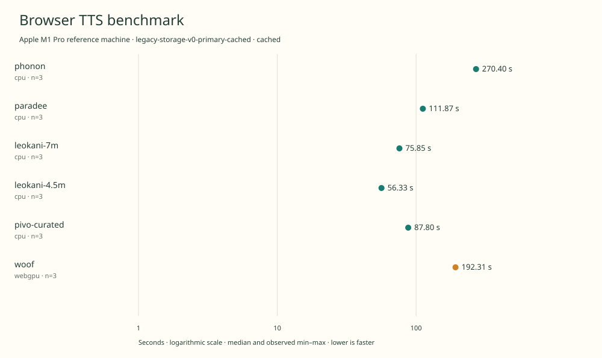

# historical-2026-11-08-m1pro-primary-cached

Apple M1 Pro reference machine · Apple M1 Pro · Google Chrome 157.0.8103.39

Protocol: **legacy-storage-v0-primary-cached**, scenario **cached**. Historical measurements imported from the original experiment.

Original browser generationMs through local PCM storage. Model initialization and WAV encoding are excluded; boundaries differ from the later GPU-only and native v1 protocols.

| Model | Requested backend | Status | Median | Min–max | Runs |
|---|---|---|---:|---:|---:|
| phonon | cpu | measured | 270.40 s | 270.25–271.38 s | 3 |
| paradee | cpu | measured | 111.87 s | 111.72–112.04 s | 3 |
| leokani-7m | cpu | measured | 75.85 s | 75.22–75.92 s | 3 |
| leokani-4.5m | cpu | measured | 56.33 s | 56.28–56.46 s | 3 |
| pivo-curated | cpu | measured | 87.80 s | 87.61–88.37 s | 3 |
| woof | webgpu | measured | 192.31 s | 192.29–192.44 s | 3 |

- **phonon / cpu**: Pinned CPU-only execution provider in original experiment.
- **paradee / cpu**: Pinned CPU-only execution provider in original experiment.
- **leokani-7m / cpu**: Pinned CPU-only execution provider in original experiment.
- **leokani-4.5m / cpu**: Pinned CPU-only execution provider in original experiment.
- **pivo-curated / cpu**: Pinned CPU-only execution provider in original experiment.
- **woof / webgpu**: Official WebGPU-only runtime; hardware dispatch separately verified in same-asset GPU capability probes.

Historical import; original private filesystem paths, browser profiles and logs are omitted. Source summary SHA-256 anchors the imported evidence.

No audio, model weights or restricted upstream runtime code are redistributed in this result. Output SHA-256 digests refer to locally retained recordings.

PiVo used curated normalization and 12 pronunciation overrides. These are a distinct configuration, not the strict frontend.

Times describe these implementations and this machine. Speech quality has not been ranked.

Original warmup/cached setup differs from native v1: full-article excluded warm-up receipts are not represented here.

Original process-tree RSS is sampled total Chrome memory, including baseline and possible shared-page double counting; not model RAM or VRAM. 1 Mbps ideal transfer is body bytes / 125,000, excluding overhead and initialization.

Different protocols, fixtures, settings or machines must not be pooled into a speedup ranking. This report does not rate speech quality.
